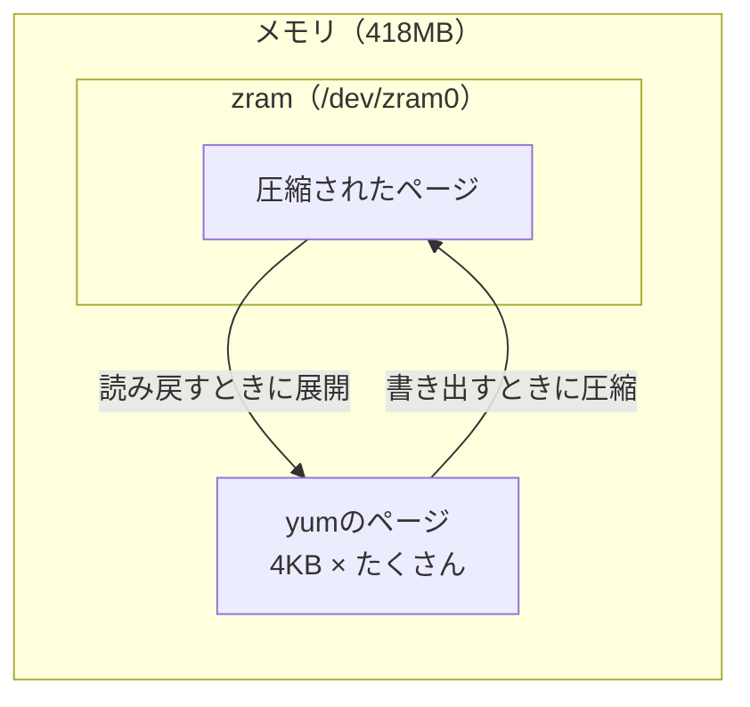
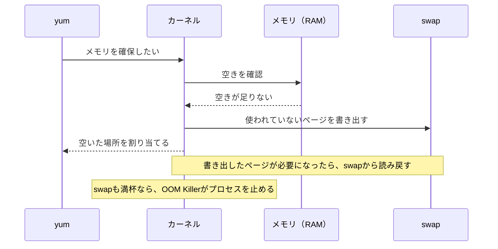
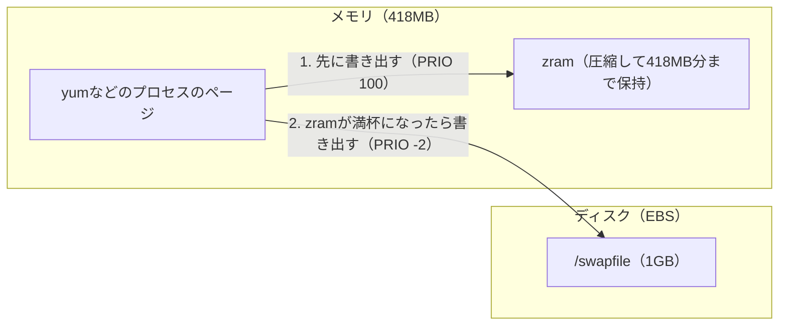

こんにちは、製造ビジネステクノロジー部のはすとです。

先日、t4g.nano（メモリ418MB）でAmazon Linux 2023のEC2を起動したところ、ユーザーデータに書いた`yum install`が途中で強制終了され、いくつかのパッケージが入りませんでした。
カーネルのログを見ると、OOM Killerがyumを止めていて、同タイミングには、Amazon InspectorのSSM関連付けによって、別のyumも動いていました。

ユーザーデータのyumが失敗する事例は、過去に[こちらの記事](https://dev.classmethod.jp/articles/ec2-instance-user-data-dnf-yum-command-failure-mitigation/)でも紹介されていますが、そちらの原因はロック競合で、今回の原因は**メモリ不足**でした。

結論から言うと、ユーザーデータの先頭でswapfileを1GB足すことで、すべてのパッケージが入るようになりました。
結論だけを見たい方は[こちら](#結果)からどうぞ。
本記事では、OOMが起きた瞬間のプロセス一覧を見ながら、なぜメモリが足りなくなったのか、そしてなぜswapfileを足すと止まらなくなるのかを見ていきます。

:::details OOM Killerとは
Linuxカーネルの機能で、メモリが足りなくなったときに動きます。
メモリもswapも使い切り、空きを作れなくなると、カーネルはプロセスを1つ選んで強制終了（SIGKILL）します。
そのプロセスが使っていたメモリを空けて、システム全体が止まるのを防ぐためです。

止めるプロセスは、主にメモリの使用量をもとに選ばれます。
使用量が大きいプロセスほど選ばれやすく、プロセスごとに`oom_score_adj`という値で選ばれやすさを調整できます。

OOM Killerがプロセスを止めると、カーネルのログに次のような行が出ます。

```text
Out of memory: Killed process 1633 (yum) total-vm:1203732kB, anon-rss:149584kB, ...
```

止められたコマンドの終了コードは137（128＋SIGKILLの番号9）になります。
:::


## 検証した環境

- インスタンスタイプ：t4g.nano（メモリ418MB）
- AMI：`al2023-ami-2023.12.20260930.0-kernel-6.1-arm64`（東京リージョンでは`ami-00a205e9e967454f6`）
- Amazon Inspector：EC2スキャンと、Linuxのディープインスペクションを有効化済み（スキャンモードは`EC2_HYBRID`）
- インスタンスプロファイル：`AmazonSSMManagedInstanceCore`だけを付けたロール

## 失敗した状態を再現する

まずは、最初に失敗したUserDataと同じように、パッケージを1つずつ`yum install`するEC2を起動しました。以降、これをパターンAと呼びます。
入れるパッケージは、lftp、telnet、vsftpd、nodejs、cronie、mount-s3の6つです。

```bash:パターンA
# パッケージを1つずつ yum install する
for p in lftp telnet vsftpd nodejs cronie https://s3.amazonaws.com/mountpoint-s3-release/latest/arm64/mount-s3.rpm; do
  yum install -y "$p"
done
```

結果は、6つのうち4つが入りませんでした。
ユーザーデータのログで、パッケージごとの終了コード（`rc`）を見ると、lftp、telnet、vsftpd、nodejsが137（OOM Killerに止められた）になっています。
※ 本記事の時刻は、すべてUTCです。

```text
rc[lftp]=137 02:27:41
rc[telnet]=137 02:28:00
rc[vsftpd]=137 02:28:28
rc[nodejs]=137 02:28:45
rc[cronie]=0 02:29:01
rc[https://s3.amazonaws.com/mountpoint-s3-release/latest/arm64/mount-s3.rpm]=0 02:29:09
```

※ 実際のUserDataには、このほかにメモリ使用量や終了コードを記録する行を入れています。

:::details 実際のUserData

`vmstat`でメモリとswapの使用量を、`procs.log`でyumのプロセスと`oom_score_adj`を1秒ごとに記録しました。

```bash:パターンA
#!/bin/bash
# 計測: vmstat と yum/dnf プロセスの oom_score_adj を 1 秒ごとに記録
# ログの置き場所を作る
mkdir -p /var/log/oomtest
# メモリとswapの使用量を、1秒ごとに vmstat.log へ記録する（バックグラウンドで実行）
nohup vmstat -t 1 > /var/log/oomtest/vmstat.log 2>&1 &
# 1秒ごとに yum/dnf のプロセスを探し、PID・親のPID・oom_score_adj・メモリ使用量（RSS）・コマンドを procs.log へ記録する
nohup bash -c 'while true; do for p in $(pgrep -x "yum|dnf|dnf-3|python3"); do c=$(tr "\0" " " < /proc/$p/cmdline 2>/dev/null) || continue; case "$c" in *yum*|*dnf*) echo "$(date +%T) pid=$p ppid=$(ps -o ppid= -p $p) adj=$(cat /proc/$p/oom_score_adj) rss_kb=$(ps -o rss= -p $p) cmd=$c";; esac; done; sleep 1; done' > /var/log/oomtest/procs.log 2>&1 &
# 以降の出力を、画面と userdata.log の両方に書き出す
exec > >(tee -a /var/log/oomtest/userdata.log) 2>&1
# 開始時刻と、swap（zram）の状態を記録する
echo "start $(date +%T)"; swapon --show; zramctl
# パッケージを1つずつ yum install し、パッケージごとに終了コード（rc）と時刻を記録する
for p in lftp telnet vsftpd nodejs cronie https://s3.amazonaws.com/mountpoint-s3-release/latest/arm64/mount-s3.rpm; do
  echo "== $(date +%T) yum install $p"; yum install -y "$p"; echo "rc[$p]=$? $(date +%T)"
done
# 終了時刻、yumのキャッシュの大きさ、カーネルログのOOMの行を記録する
echo "done $(date +%T)"; du -sh /var/cache/dnf; journalctl -k | grep -iE "killed process|oom"
```
:::

## なぜメモリが足りなくなるのか

### zram swapがあっても足りない

Amazon Linux 2023は、メモリが800MB以下のインスタンスでzram swapを自動で有効にするため、設定ファイルには、しきい値が書かれています。

```bash
grep -v "^#" /usr/lib/systemd/zram-generator.conf
```

```text
[zram0]
zram-size = min(ram, 8192)
host-memory-limit=800
compression-algorithm=lzo-rle
```

t4g.nanoでも、メモリと同じ418MBのzramが作られていました。

```bash
swapon --show
```

```text
NAME       TYPE      SIZE USED PRIO
/dev/zram0 partition 418M   0B  100
```

zramは、メモリの中に圧縮したデータを置く仕組みで、ディスクに書き出すswapとは違い、圧縮後のデータもメモリを使います。
OOMが起きた時点のカーネルログには、`Free swap  = 0kB`と出ていました。
これはつまり、zramを使い切っても、まだメモリが足りなかったということです。
ちなみに、yumは1回で480〜510MBほどのメモリを使うので、zramだけでは受け止めきれません。

:::details zramの仕組み
zramは、メモリの一部を「圧縮して使うswap置き場」にするLinuxカーネルの機能です。
`/dev/zram0`というディスクのように見える装置を作りますが、実体はメモリの中にあります。
ここに書き出されたページは、圧縮して保存されます。



ディスクを使わないので、ディスク上のswapより読み書きが速く、圧縮する分、同じメモリに多くのページを置けます。
パターンAのユーザーデータが終わった後に`zramctl`を見ると、26.3MB分のページを9.2MBのメモリで持っていました。

```text
NAME       ALGORITHM DISKSIZE  DATA COMPR TOTAL STREAMS MOUNTPOINT
/dev/zram0 lzo-rle       418M 26.3M  6.5M  9.2M       2 [SWAP]
```

ただし、置けるページの量には上限があります。
`DISKSIZE`の418MBは圧縮前のサイズで、設定の`zram-size = min(ram, 8192)`により、メモリと同じ大きさになっています。
yumはこれを超える量のメモリを使ったので、zramが満杯になりました。

Amazon Linux 2023では、`zram-generator`が起動時にzramを作ります。
:::

### 起動直後に動くInspectorのyum

EC2の起動直後には、ユーザーデータとは別に、Amazon Inspectorによるyumも動いていました。
Inspectorを有効にしたアカウントでは、SSMのステートマネージャーに次のような関連付けが登録されます。
ターゲットは`InstanceIds: *`にしているので、SSMに登録されたインスタンスにはすべて適用されます。

```bash
aws ssm list-associations --query 'Associations[].[Name,ScheduleExpression]' --output text
```

```text
AmazonInspector2-ConfigureInspectorSsmPlugin       rate(12 hours)
AmazonInspector2-ConfigureInspectorSsmPluginLinux  rate(13 hours)
AmazonInspector2-InvokeInspectorSsmPlugin          rate(6 hours)
AmazonInspector2-InvokeInspectorSsmPluginLinux     rate(6 hours)
AWS-GatherSoftwareInventory                        rate(30 minutes)
```

:::details SSMの関連付けとInspectorの関係
**関連付け**は、Systems Managerのステートマネージャーの機能です。
「どのSSMドキュメントを、どのインスタンスに、どの間隔で実行するか」を登録しておくと、対象のインスタンスで自動的に実行されます。
作成した直後にも1回実行され、その後は登録した間隔で実行されます。

Amazon InspectorのEC2スキャンには、SSM Agentを使う方法（エージェントベース）と、EBSスナップショットを使う方法（エージェントレス）があります。
エージェントベースでは、Inspectorが自分のアカウントに関連付けを作り、インスタンスのソフトウェア一覧を集めます。
今回のアカウントにあった関連付けは、それぞれ次の役割を持っています。

| 関連付けの名前 | ドキュメント | 役割 |
|---|---|---|
| InspectorInventoryCollection-do-not-delete | AWS-GatherSoftwareInventory | ソフトウェアの一覧を集める |
| InspectorLinuxDistributor-do-not-delete | AmazonInspector2-ConfigureInspectorSsmPluginLinux | LinuxインスタンスにInspectorのSSMプラグインをインストールする |
| InvokeInspectorLinuxSsmPlugin-do-not-delete | AmazonInspector2-InvokeInspectorSsmPluginLinux | プラグインを使ってスキャンを始める |
| InspectorDistributor-do-not-delete、InvokeInspectorSsmPlugin-do-not-delete | 上の2つのWindows版 | Linuxではスキップされる |

公式ドキュメントでは、Linux向けの2つはディープインスペクション（プログラミング言語のパッケージまで調べる機能）用と説明されています。
名前に「do-not-delete」とあるとおり、削除してもInspectorが次のスキャンのタイミングで作り直します。
:::

このうち`AmazonInspector2-ConfigureInspectorSsmPluginLinux`は、Distributorパッケージ`AmazonInspector2-InspectorSsmPluginLinux`をインストールする関連付けです。
インストールには`aws:configurePackage`を使います。
今回、13時間ごとのスケジュールとは別に、新しく起動したインスタンスにもすぐ適用されていました。

検証用のインスタンスでは、起動から約1分後に`yum -y localinstall inspectorssmplugin.rpm`が動きました。

フリートマネージャーでインスタンスの関連付けを開くと、成功した時刻を確認できます。


### OOMが起きた瞬間に、どのプロセスがメモリを使っていたか

OOM Killerが動くと、カーネルはその時点のプロセス一覧をログに出すので、`journalctl -k`で確認してみます。

```bash
journalctl -k -o short-precise | grep -A60 "Tasks state"
```

パターンAで起きた4回のOOMについて、メモリの使用量が大きいプロセスを抜き出しました。
使用量は、プロセス一覧の`rss`（メモリに置かれている量）と`swapents`（swapに書き出された量）を足して、MBに換算した値です。
どちらも4KB単位の値なので、4KBを掛けて換算しています。

| OOM | 時刻 | ユーザーデータのyum | Inspectorのyum（oom_score_adj -900） | killされた側 |
|---|---|---|---|---|
| 1回目（lftp） | 02:27:41 | 477MB | 記録に現れていない | ユーザーデータ |
| 2回目（telnet） | 02:28:00 | 490MB | 記録に現れていない | ユーザーデータ |
| 3回目（vsftpd） | 02:28:28 | 471MB | 31MB | ユーザーデータ |
| 4回目（nodejs） | 02:28:45 | 30MB | 472MB | ユーザーデータ |

1回目と2回目のOOMでは、大きなメモリを使っていたのはユーザーデータのyumだけでした。

ただ、4回目は様子が異なりました。
カーネルログのプロセス一覧から、該当する2行とkillの行をそのまま抜き出します。

```text
Oct 05 02:28:45.084249 kernel: [  pid  ]   uid  tgid total_vm      rss pgtables_bytes swapents oom_score_adj name
Oct 05 02:28:45.087207 kernel: [   2244]     0  2244   191989    42293  1171456    78469          -900 yum
Oct 05 02:28:45.087249 kernel: [   2497]     0  2497    78564       28   237568     7789             0 yum
Oct 05 02:28:45.087960 kernel: Out of memory: Killed process 2497 (yum) total-vm:314256kB, anon-rss:112kB, file-rss:0kB, shmem-rss:0kB, UID:0 pgtables:232kB oom_score_adj:0
```

pid 2244がInspectorのyum、pid 2497がユーザーデータのyum（nodejs）です。
メモリを使っていたのはInspectorのyumで、ユーザーデータのyumは30MBしか使っていません。
それでもkillされたのはユーザーデータ側でした。

どちらを止めるかは、`oom_score_adj`の値に左右されるため、OOM Killerは、この値が小さいプロセスほど止めにくくなります。
SSM Agent（`amazon-ssm-agent`）は-900で動いていて、そこから起動したInspectorのyumも-900を引き継いでいました。

```text
02:28:10 pid=2244 ppid=   2243 adj=-900 rss_kb=55008 cmd=/usr/bin/python3 /usr/bin/yum -y localinstall inspectorssmplugin.rpm
```

ユーザーデータのyumは0なので、2つのyumが重なると、Inspector側が残されやすくなります。
ただし3回目のように、ユーザーデータのyum（471MB）がInspectorのyum（31MB）よりずっと大きいときは、ユーザーデータ側が止められます。

### Inspectorを止めると何が変わるか

Inspectorの関連付けが動かない状態でパターンAを1回試すと、killされたのは最初のlftpだけで、残りの5つは入りました。Inspectorありでは、4つが入らなかったため、Inspectorのyumと重なることで失敗が増えていたと見られます。

:::details Inspectorなしで試した手順と結果
SSMで接続できないので、パターンAのUserDataの最後に、結果をコンソール出力にも書き出す1行を足しました。

```bash
grep -E "^(start|rc|done)" /var/log/oomtest/userdata.log | sed "s/^/OOMTEST /" > /dev/console
```

結果は`get-console-output`で確認しています。

```bash
aws ec2 get-console-output --instance-id <インスタンスID> --latest --output text | grep -E "OOMTEST|Killed process"
```

実行結果です。

```text
Out of memory: Killed process 1629 (yum) total-vm:1236004kB, anon-rss:167288kB, file-rss:0kB, shmem-rss:0kB, UID:0 pgtables:1276kB oom_score_adj:0
OOMTEST start 02:48:25
OOMTEST rc[lftp]=137 02:48:47
OOMTEST rc[telnet]=0 02:49:18
OOMTEST rc[vsftpd]=0 02:49:22
OOMTEST rc[nodejs]=0 02:49:30
OOMTEST rc[cronie]=0 02:49:33
OOMTEST rc[https://s3.amazonaws.com/mountpoint-s3-release/latest/arm64/mount-s3.rpm]=0 02:49:40
OOMTEST done 02:49:40
```

EC2コンソールの「システムログを取得」でも、同じ結果を確認できます。


:::

## 対策を試す

原因が分かったところで、パッケージの入れ方を変えたパターンを2つ試しました。

| パターン | 入れ方 | ねらい |
|---|---|---|
| B | すべてのパッケージを1回の`yum install`にまとめる | yumの回数を減らす |
| C | 先にswapfileを1GB作ってから、Aと同じように入れる | swapの置き場所を増やす |

```bash:パターンB
# すべてのパッケージを1回の yum install で入れる
yum install -y lftp telnet vsftpd nodejs cronie https://s3.amazonaws.com/mountpoint-s3-release/latest/arm64/mount-s3.rpm
```

```bash:パターンC
# 1GBのswapfileを作って有効にする
fallocate -l 1G /swapfile  # 1GBのファイルを作る
chmod 600 /swapfile        # root以外が読み書きできないようにする
mkswap /swapfile           # swapとして使える形式にする
swapon /swapfile           # swapとして使い始める

# パッケージを1つずつ yum install する（パターンAと同じ）
for p in lftp telnet vsftpd nodejs cronie https://s3.amazonaws.com/mountpoint-s3-release/latest/arm64/mount-s3.rpm; do
  yum install -y "$p"
done
```

:::details 実際のUserData（記録用の行を含む全文）
```bash:パターンB
#!/bin/bash
# 計測: vmstat と yum/dnf プロセスの oom_score_adj を 1 秒ごとに記録
# ログの置き場所を作る
mkdir -p /var/log/oomtest
# メモリとswapの使用量を、1秒ごとに vmstat.log へ記録する（バックグラウンドで実行）
nohup vmstat -t 1 > /var/log/oomtest/vmstat.log 2>&1 &
# 1秒ごとに yum/dnf のプロセスを探し、PID・親のPID・oom_score_adj・メモリ使用量（RSS）・コマンドを procs.log へ記録する
nohup bash -c 'while true; do for p in $(pgrep -x "yum|dnf|dnf-3|python3"); do c=$(tr "\0" " " < /proc/$p/cmdline 2>/dev/null) || continue; case "$c" in *yum*|*dnf*) echo "$(date +%T) pid=$p ppid=$(ps -o ppid= -p $p) adj=$(cat /proc/$p/oom_score_adj) rss_kb=$(ps -o rss= -p $p) cmd=$c";; esac; done; sleep 1; done' > /var/log/oomtest/procs.log 2>&1 &
# 以降の出力を、画面と userdata.log の両方に書き出す
exec > >(tee -a /var/log/oomtest/userdata.log) 2>&1
# 開始時刻と、swap（zram）の状態を記録する
echo "start $(date +%T)"; swapon --show; zramctl
# すべてのパッケージを1回の yum install で入れ、終了コード（rc）と時刻を記録する
echo "== $(date +%T) yum install all"
yum install -y lftp telnet vsftpd nodejs cronie https://s3.amazonaws.com/mountpoint-s3-release/latest/arm64/mount-s3.rpm; echo "rc=$? $(date +%T)"
# 終了時刻、yumのキャッシュの大きさ、カーネルログのOOMの行を記録する
echo "done $(date +%T)"; du -sh /var/cache/dnf; journalctl -k | grep -iE "killed process|oom"
```

```bash:パターンC
#!/bin/bash
# 計測: vmstat と yum/dnf プロセスの oom_score_adj を 1 秒ごとに記録
# ログの置き場所を作る
mkdir -p /var/log/oomtest
# メモリとswapの使用量を、1秒ごとに vmstat.log へ記録する（バックグラウンドで実行）
nohup vmstat -t 1 > /var/log/oomtest/vmstat.log 2>&1 &
# 1秒ごとに yum/dnf のプロセスを探し、PID・親のPID・oom_score_adj・メモリ使用量（RSS）・コマンドを procs.log へ記録する
nohup bash -c 'while true; do for p in $(pgrep -x "yum|dnf|dnf-3|python3"); do c=$(tr "\0" " " < /proc/$p/cmdline 2>/dev/null) || continue; case "$c" in *yum*|*dnf*) echo "$(date +%T) pid=$p ppid=$(ps -o ppid= -p $p) adj=$(cat /proc/$p/oom_score_adj) rss_kb=$(ps -o rss= -p $p) cmd=$c";; esac; done; sleep 1; done' > /var/log/oomtest/procs.log 2>&1 &
# 以降の出力を、画面と userdata.log の両方に書き出す
exec > >(tee -a /var/log/oomtest/userdata.log) 2>&1
# 開始時刻と、swap（zram）の状態を記録する
echo "start $(date +%T)"; swapon --show; zramctl
# 1GBのswapfileを作って有効にし、swaponの終了コードとswapの状態を記録する
fallocate -l 1G /swapfile; chmod 600 /swapfile; mkswap /swapfile; swapon /swapfile; echo "swapon rc=$?"; swapon --show
# パッケージを1つずつ yum install し、パッケージごとに終了コード（rc）と時刻を記録する
for p in lftp telnet vsftpd nodejs cronie https://s3.amazonaws.com/mountpoint-s3-release/latest/arm64/mount-s3.rpm; do
  echo "== $(date +%T) yum install $p"; yum install -y "$p"; echo "rc[$p]=$? $(date +%T)"
done
# 終了時刻、yumのキャッシュの大きさ、カーネルログのOOMの行を記録する
echo "done $(date +%T)"; du -sh /var/cache/dnf; journalctl -k | grep -iE "killed process|oom"
```
:::

### 結果

| パターン | 結果 | killされたyum | swap使用量の最大 |
|---|---|---|---|
| A：1つずつ | ❌ lftp、telnet、vsftpd、nodejsが入らず | 4回 | 418MB（zramを使い切り） |
| B：1回にまとめる | ❌ 1つも入らず | 1回 | zramを使い切り（OOM時のログで`Free swap  = 0kB`） |
| C：swapfile 1GBを追加（2回実行） | ✅ すべて入る | 0回 | 約495MB／約508MB |

1回にまとめるBの場合、yumの回数が減るため、Aより有利になるかなと思いきや、Bが一番悪く、一つも入りませんでした。

結果、成功したのは、swapfileを使ったパターンCだけでした。
念の為、2回実行しましたが、どちらもkillは0回です。
`swapon`の終了コードは0で、`swapon --show`にはzramとswapfileが並びました。

```text
NAME       TYPE       SIZE USED PRIO
/dev/zram0 partition  418M 24.1M  100
/swapfile  file      1024M    2M   -2
```

### なぜ、swapfileで余裕が出たのか

swapは、メモリ（RAM）に置ききれないデータを、一時的に別の場所へ移すことができます。
移すときは、4KBごとのまとまり（ページ）単位です。

動きとしては、メモリに空きが足りなくなると、カーネルはしばらく使われていないページをswapへ書き出し、空いた場所を新しいデータとして割り当てます。
書き出したページが再び必要になると、カーネルがswapから読み戻します。



zramとswapfileはどちらもswapですが、ページの書き出し先が違います。
zramの書き出し先は、メモリの中で、swapfileの書き出し先は、ディスク（EBS）です。



`swapon --show`のPRIOは優先度で、値が大きいzramから先に使われます。
パターンAでは、zramの418MBを使い切った時点（`Free swap  = 0kB`）で、OOM Killerがyumを止めました。
パターンCでは、swapの使用量が最大で約495MB／約508MBになりました。
zramの418MBを超えた分は、swapfileに書き出されたことになります。
swapfileへの読み書きはメモリより遅くなりますが、yumが一時的にメモリを多く使う間を乗り切れれば、最後まで処理が進みます。

## まとめ

結論、t4g.nanoのAmazon Linux 2023で、ユーザーデータのyumがメモリ不足で止まってしまう問題は、ユーザーデータの先頭でswapfileを作ることで解決できました。

メモリ不足と分かったときは、まずインスタンスタイプを上げることを考えましたが、インスタンスタイプを上げるとコストも上がってしまいます。
コストは上げたくないという依頼を受け、なんとか別の方法がないかと探した結果、swapfileにたどり着きました。

私と同じように、小さいEC2インスタンスでユーザーデータのyumが止まってしまった方の参考になれば嬉しいです。

## 参考

- [Amazon Linux 2023.2 で zram swapping がサポートされました - DevelopersIO](https://dev.classmethod.jp/articles/al202302-zram-swap/)
- [Amazon Linux 2のswapファイル作成にfallocate、ダメ、ゼッタイ - DevelopersIO](https://dev.classmethod.jp/articles/al2-swapfile-fallocate-ng/)
- [EC2 の Amazon Linux 2023 でSwapメモリの作成 - DevelopersIO](https://dev.classmethod.jp/articles/how-to-create-swap-memory-in-linux-on-ec2-jp/)
- [EC2インスタンスのユーザーデータ内のdnfコマンドやyumコマンドが失敗する場合の緩和策を考えてみた - DevelopersIO](https://dev.classmethod.jp/articles/ec2-instance-user-data-dnf-yum-command-failure-mitigation/)
