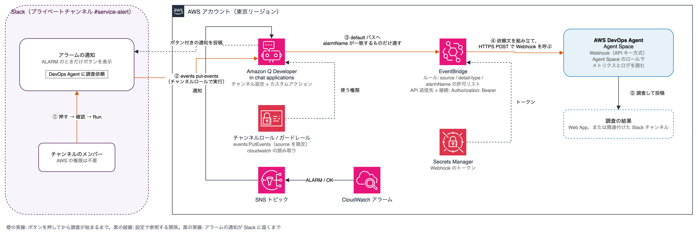
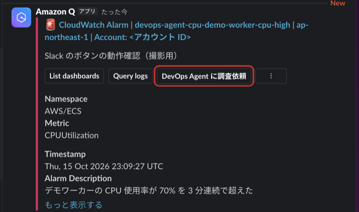
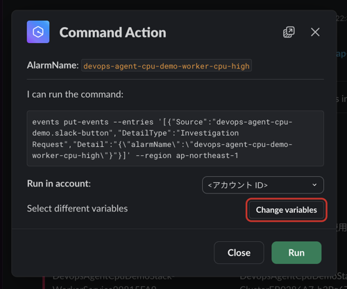
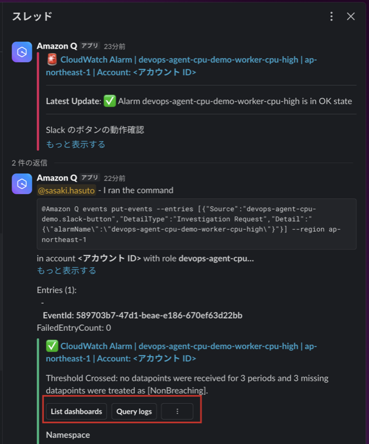
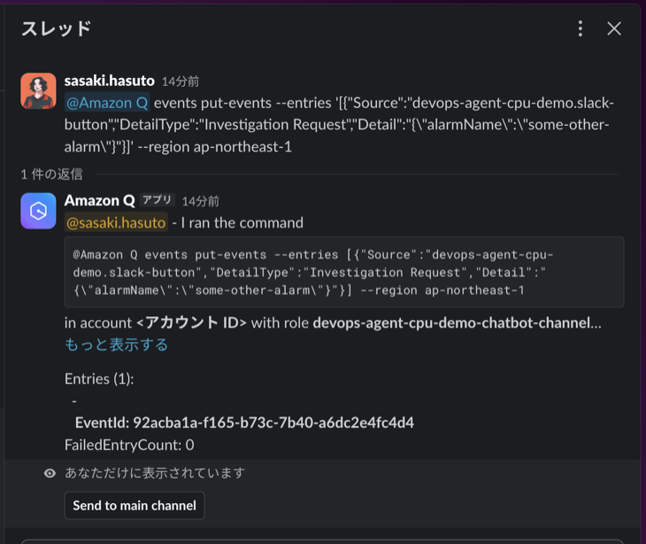
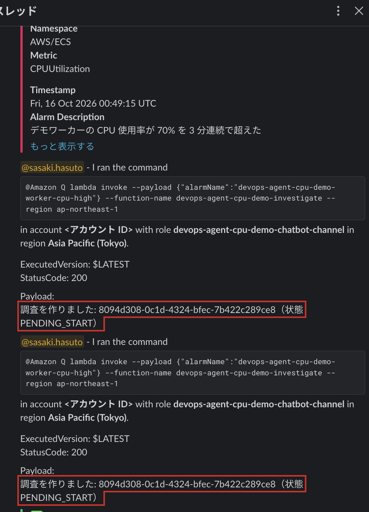

こんにちは、製造ビジネステクノロジー部のはすとです。

AWS DevOps Agentは、CloudWatchアラームをきっかけに調査を自動で始められます。
便利なのですが、調査は実行時間に応じて課金されるので、アラームが鳴るたびに調査が始まると費用がかさみます。
そこで「人がSlackの通知のボタンを押したときだけ調査する」形にできないかと考えました。

ただ、Slackにボタンを置くと、今度は「誰でも押せてしまうのでは」「ボタンはどんな権限で動くのか」が気になります。
本記事では、Amazon Q Developer in chat applications（旧AWS Chatbot）のカスタムアクションでボタンを作り、通信の流れと、押せる人や通る権限を確かめた結果をまとめます。

## 検証環境

2026年10月時点の情報です。

- リージョン: 東京（ap-northeast-1）
- Slack: プライベートチャンネル。Amazon Qのアプリを招待済み
- AWS CDK: aws-cdk-lib 2.272.0
- 調査の対象: ECS FargateのCPU使用率のアラーム（DevOps AgentのAgent SpaceとWebhookは作成済み）

## 仕組み

ボタンを押してから調査が始まるまでの流れは、次のようになります。



ボタンの正体は、Amazon Qの**カスタムアクション**です。
通知にボタンを付けておき、押されたらAWS CLIのコマンドを実行する仕組みで、コマンドには通知の値を変数として埋め込めます。
ここでは、アラーム名を入れた`events put-events`を実行し、EventBridgeのdefaultバスにイベントを送ります。

EventBridgeから先は、DevOps AgentのWebhookを呼ぶ一般的な構成です。
ルールがイベントを拾い、入力トランスフォーマーで調査の依頼文（タイトルと説明）を組み立てて、API送信先からWebhookにPOSTします。
API送信先は、EventBridgeが外部のHTTPエンドポイントを呼ぶための仕組みで、認証ヘッダの値は接続に保存します。

アラームが鳴ったら自動で調査を始める構成では、ルールの入力が`CloudWatch Alarm State Change`のイベントになります。
今回は、その入力をボタンから送るイベントに置き換えただけです。

公式ドキュメントには、カスタムアクションの権限について次のように書かれています。

> No additional permissions are needed to configure or run custom actions. When your channel members choose the custom action button, the action target is invoked using the configured IAM permissions in your channel configuration.
>
> （カスタムアクションの設定や実行に追加の権限は要りません。チャンネルのメンバーがボタンを選ぶと、チャンネル設定に構成されたIAMの権限でアクションの対象が呼び出されます）
>
> [Custom actions using Amazon Q Developer in chat applications](https://docs.aws.amazon.com/chatbot/latest/adminguide/custom-actions.html)

つまり、ボタンを押したときに使われるのは、チャンネル設定に付けたIAMロール（チャンネルロール）の権限です。
押した人のAWSの権限ではありません。

## 作ったもの

CDKで作ったものは次の4つです。
Agent SpaceとWebhook、EventBridgeの接続とAPI送信先は作成済みのものを使います。

| 作るもの | 役割 |
|---|---|
| チャンネルロールとガードレール | ボタンが使う権限と、チャンネルから使える権限の上限 |
| カスタムアクション | 通知に出すボタンと、押したときに実行するコマンド |
| Amazon Qのチャンネル設定 | SNSトピックの購読、チャンネルロール、ガードレール、ボタンの登録 |
| EventBridgeのルール | ボタンから送られたイベントだけをWebhookに渡す |

チャンネルロールに付けた権限は、通知の表示に使うCloudWatchの読み取りと、`events:PutEvents`だけです。
`PutEvents`は、`source`がボタン用の値のときだけ許可しています。
ガードレールにも同じ内容のポリシーを指定しています。

```typescript
const channelPermissions = [
  new iam.PolicyStatement({
    actions: ['cloudwatch:Describe*', 'cloudwatch:Get*', 'cloudwatch:List*'],
    resources: ['*'],
  }),
  new iam.PolicyStatement({
    actions: ['events:PutEvents'],
    resources: [`arn:aws:events:${this.region}:${this.account}:event-bus/default`],
    conditions: { StringEquals: { 'events:source': 'devops-agent-cpu-demo.slack-button' } },
  }),
];
const channelRole = new iam.Role(this, 'ChatbotChannelRole', {
  assumedBy: new iam.ServicePrincipal('chatbot.amazonaws.com', {
    conditions: { StringEquals: { 'aws:SourceAccount': this.account } },
  }),
  inlinePolicies: { ButtonOnly: new iam.PolicyDocument({ statements: channelPermissions }) },
});
// ガードレール: チャンネルから使える権限の上限。既定のままだと AdministratorAccess になる
const guardrail = new iam.ManagedPolicy(this, 'ChatbotGuardrail', { statements: channelPermissions });
```

カスタムアクションは、`AWS::Chatbot::CustomAction`で作ります。
`$AlarmName`は、通知の値に置き換わる変数です。
`criteria`で、ALARMになったときの通知にだけボタンを出すようにしています。

```typescript
new chatbot.CfnCustomAction(this, 'InvestigateCustomAction', {
  actionName: 'devops-agent-cpu-demo-investigate',
  definition: {
    commandText: `events put-events --entries '[{"Source":"devops-agent-cpu-demo.slack-button","DetailType":"Investigation Request","Detail":"{\\"alarmName\\":\\"$AlarmName\\"}"}]' --region ${this.region}`,
  },
  attachments: [
    {
      notificationType: 'CloudWatch',
      buttonText: 'DevOps Agent に調査依頼',
      // 通知の中身から JMESPath で値を取り出す
      variables: { AlarmName: 'event.AlarmName', State: 'event.NewStateValue' },
      // ALARM の通知にだけ表示する
      criteria: [
        { variableName: 'AlarmName', operator: 'HAS_VALUE' },
        { variableName: 'State', operator: 'EQUALS', value: 'ALARM' },
      ],
    },
  ],
});
```

EventBridgeのルールでは、`source`と`detail-type`に加えて、`detail.alarmName`を対象のアラームの名前に限っています。
この行が要る理由は、あとで出てきます。

```typescript
new events.Rule(this, 'ButtonToDevOpsAgentRule', {
  eventPattern: {
    source: ['devops-agent-cpu-demo.slack-button'],
    detailType: ['Investigation Request'],
    detail: { alarmName: [cpuAlarm.alarmName] }, // 対象のアラームの名前だけを通す
  },
  targets: [new targets.ApiDestination(destination, { event: /* 調査の依頼文 */ })],
});
```

## 押してみた

アラームをALARMにすると、Slackの通知に「DevOps Agent に調査依頼」のボタンが付きました。



ボタンを押すと、すぐには実行されず、確認のダイアログが出ます。
実行するコマンドの全文と、実行先のアカウントが表示されます。



Runを押すと、スレッドに実行結果が投稿されました。
`FailedEntryCount: 0`なので、イベントは受け付けられています。
数秒後にはDevOps Agentにタスクが作られ、調査が始まりました（約14分で完了）。



アラームがOKに戻った通知にはボタンが出ていません。
`criteria`で指定した表示の条件は、そのとおりに働いています。

## 誰が押せるのか

チャンネル設定には、チャンネルロールを使う方法と、メンバーごとにユーザーロールを選ばせる方法があります。
公式ドキュメントでは、チャンネルロールは次のように説明されています。

> A channel role gives all channel members the same permissions.
>
> （チャンネルロールは、チャンネルの全メンバーに同じ権限を与えます）
>
> [Understanding Amazon Q Developer in chat applications permissions](https://docs.aws.amazon.com/chatbot/latest/adminguide/understanding-permissions.html)

今回の構成はチャンネルロールなので、チャンネルにいる人なら誰でもボタンを押せます。
AWSのアカウントを持っているかどうかは関係ありません。
「誰が押せるか」は、Slackのチャンネルに誰を入れるかで決まります。

ゲストアカウントやSlack Connectの外部ユーザーが押せるかは、今回は試していません。
プライベートチャンネルに招待した人だけで検証しています。

## ボタンを使わずに、同じイベントを送れる

ここからが本記事で一番確かめたかったところです。

ボタンに「ALARMの通知にだけ表示する」という条件を付けたので、対象外のアラームや、OKに戻った通知からは調査を起動できないはずだと考えると思います。
私もそう思っていました。

実際には、この条件は表示の条件にすぎません。
チャンネルのメンバーは、ボタンと同じコマンドを自分で打てます。
Amazon Qにメンションして、アラーム名を適当な値に変えた`put-events`を送ってみました。

```
@Amazon Q events put-events --entries '[{"Source":"devops-agent-cpu-demo.slack-button","DetailType":"Investigation Request","Detail":"{\"alarmName\":\"some-other-alarm\"}"}]' --region ap-northeast-1
```

Amazon Qは「I can run the command」と返し、Run commandを押すと、チャンネルロールでコマンドを実行しました。
`FailedEntryCount: 0`なので、イベントはEventBridgeに届いています。



IAMの条件は`source`しか見ていないので、ここで止まらないのは当然です。
止めたのはEventBridgeのルールでした。
ルールの`detail.alarmName`が一致しないため、このイベントはどのルールにも拾われませんでした。
実行後にルールのメトリクスを確かめると、`TriggeredRules`はボタンを押したときの1回だけで、手打ちのぶんは増えていません。
DevOps Agentのタスクも増えていませんでした。

```bash
aws cloudwatch get-metric-statistics --namespace AWS/Events --metric-name TriggeredRules \
  --dimensions Name=RuleName,Value=<ルール名> \
  --start-time 2026-10-15T13:00:00Z --end-time 2026-10-15T15:30:00Z --period 300 --statistics Sum \
  --query "Datapoints[].[Timestamp,Sum]" --output text
```

実行結果です。

```
2026-10-15T22:55:00+09:00	1.0
```

もう1つ、確認のダイアログには「Change variables」のボタンがあります。
手打ちをしなくても、ボタンを押した人がその場でアラーム名を書き換えられます。

ボタンの表示条件や変数の初期値は、起動を制限する仕組みではありません。
どのアラームの調査を起動してよいかは、EventBridgeのルールで決める必要があります。

## 気をつけること

検証して分かった、設計で気をつける点です。

**ガードレールを既定のままにしない**
チャンネル設定のガードレールは、既定では`AdministratorAccess`です。
ガードレールはチャンネルロールとユーザーロールの両方に優先する上限なので、ここが広いままだと、将来チャンネルロールに権限を足したときに、そのままチャンネルの全員が使えるようになります。
今回はチャンネルロールと同じ最小のポリシーを指定しました。

**押した人の記録は、Amazon QのログとCloudTrailで残り方が違う**
Amazon Qは、実行したコマンドの監査ログをCloudWatch Logs（バージニア北部の`/aws/chatbot/<設定名>`）に残します。
手打ちしたコマンドは、`prepared`と`approved`の2行が、SlackのユーザーIDとコマンド全文付きで残っていました。
一方、ボタンを押した時刻には、このログに`command`の行がありませんでした。
カスタムアクションの実行は、この検証では監査ログに残りませんでした。

CloudTrailについては、`PutEvents`は管理イベントではなくデータイベントです。

> All Amazon EventBridge API operations except PutEvents and PutPartnerEvents are control plane operations.
>
> （PutEventsとPutPartnerEventsを除く、すべてのAmazon EventBridgeのAPI操作はコントロールプレーンの操作です）
>
> [Logging Amazon EventBridge API calls using AWS CloudTrail](https://docs.aws.amazon.com/eventbridge/latest/userguide/logging-using-cloudtrail.html)

データイベントは既定では記録されないので、証跡の設定で有効にしないと、誰がイベントを送ったかはCloudTrailに残りません。
有効にしても、イベントの`detail`（アラーム名）は伏せられます。

**費用の歯止めは別に要る**
ボタンは何度でも押せます。
EventBridgeのイベントIDは押すたびに変わるので、同じ通知で2回押せば、2回調査が始まります。
調査の時間に上限を付けたい場合は、1日の調査時間の合計を見るアラームや、起動の前に判定を挟む仕組みが別に要ります。
この点は、次のLambdaを使う構成で解消できました。

## EventBridgeを使わずにLambdaから起動してみた

ここまでの構成を見直すと、気になる点が3つありました。

- Webhookのトークンを、Secrets ManagerとEventBridgeの接続に置いている。EventBridgeのAPI送信先はHMAC署名を計算できないので、認証はBearerトークン一択になる
- 連打をまとめられない
- 「どのアラームなら起動してよいか」をEventBridgeのルールに書いているが、ほかの判定（今ALARMかどうか、など）は足せない

DevOps Agentには、調査を作る`CreateBacklogTask`というAPIがあります。
Amazon QのCLI実行から`devops-agent`を直接呼べれば一番簡単ですが、試したところ`Internal Failure`になり、使えませんでした（2026年10月時点）。
そこで、カスタムアクションからLambdaを呼び、LambdaがAPIを呼ぶ形にしてみました。

```
Slackのボタン
  → Amazon Qがチャンネルロールで lambda invoke を実行
  → Lambda（許可リストの照合、アラームが今ALARMかの確認）
  → CreateBacklogTask
```

Lambdaの中身は次のとおりです。
`clientToken`に「アラーム名と時刻（1時間単位）」を入れているので、同じアラームのボタンを同じ1時間の間に何度押しても、調査は1件になります。

```javascript
import { CloudWatchClient, DescribeAlarmsCommand } from "@aws-sdk/client-cloudwatch";
import { DevOpsAgentClient, CreateBacklogTaskCommand } from "@aws-sdk/client-devops-agent";

const cloudwatch = new CloudWatchClient({});
const devopsAgent = new DevOpsAgentClient({});
const agentSpaceId = process.env.AGENT_SPACE_ID;
const allowedAlarms = (process.env.ALLOWED_ALARMS ?? "").split(",").filter(Boolean);

export const handler = async (event) => {
  const alarmName = event?.alarmName;
  // 許可リスト: 対象のアラーム以外は調査を作らない
  if (!allowedAlarms.includes(alarmName)) {
    return `\`${alarmName}\` は調査の対象ではありません。`;
  }
  // 今 ALARM のものだけ調査する
  const { MetricAlarms = [] } = await cloudwatch.send(new DescribeAlarmsCommand({ AlarmNames: [alarmName] }));
  const alarm = MetricAlarms[0];
  if (alarm?.StateValue !== "ALARM") {
    return `\`${alarmName}\` は今 ${alarm?.StateValue} なので調査を始めません。`;
  }
  // 同じアラームで同じ 1 時間の間に何度押しても、調査は 1 件にする（clientToken は冪等キー）
  const hour = new Date().toISOString().slice(0, 13).replace(/[-T:]/g, "");
  const clientToken = `${alarmName}-${hour}`.slice(0, 64);

  const { task } = await devopsAgent.send(
    new CreateBacklogTaskCommand({
      agentSpaceId,
      clientToken,
      taskType: "INVESTIGATION",
      priority: "MEDIUM",
      title: `Slack から調査依頼: ${alarmName}`,
      description: `Slack のアラーム通知のボタンから調査の依頼がありました。対象は CloudWatch アラーム ${alarmName} です。アラームの理由: ${alarm.StateReason}。...`,
    }),
  );
  return `調査を作りました: ${task.taskId}（状態 ${task.status}）`;
};
```

戻り値の文字列は、Amazon QがそのままSlackのスレッドに投稿します。
Lambdaのロールには`aidevops:CreateBacklogTask`（このAgent Spaceだけ）と`cloudwatch:DescribeAlarms`を付けます。

ボタンの定義は、CLIアクションとして`lambda invoke`を書きます。
Slackの画面にはLambda専用のアクションの種類もありますが、そちらで作ったものは`list-custom-actions`に出てこず、CloudFormationでも表せませんでした。

```typescript
new chatbot.CfnCustomAction(this, 'InvestigateLambdaCustomAction', {
  actionName: 'devops-agent-cpu-demo-investigate-lambda',
  definition: {
    // 出力先のファイル名（位置引数）を付けると Amazon Q が解釈できないので付けない
    commandText: `lambda invoke --function-name ${investigateFn.functionName} --payload '{"alarmName":"$AlarmName"}' --region ${this.region}`,
  },
  attachments: [
    {
      notificationType: 'CloudWatch',
      buttonText: '調査依頼（Lambda 経由）',
      variables: { AlarmName: 'event.AlarmName' },
      criteria: [{ variableName: 'AlarmName', operator: 'HAS_VALUE' }], // ALARM かどうかは Lambda が確かめる
    },
  ],
});
```

チャンネルロールに足す権限は、この関数1つの`lambda:InvokeFunction`だけです。
`events:PutEvents`も、Webhookのトークンも、EventBridgeのルールも要りません。

押してみた結果です。

- アラームがOKのときに押す: 「今 OK なので調査を始めません」が返り、調査は作られない
- 許可リストにないアラーム名で呼ぶ: 「調査の対象ではありません」が返る
- ALARMにして押す: 調査が作られ、タスクIDが返る
- 続けてもう一度押す: 同じタスクIDが返り、調査は増えない



2つの構成を並べると、次のようになります。

| 観点 | EventBridge → Webhook | Lambda → CreateBacklogTask |
|---|---|---|
| AWSの外に出る通信 | あり（WebhookへのHTTPS） | なし |
| 認証情報 | Bearerトークンを保管する | なし（IAMロール） |
| どのアラームを許すか | EventBridgeのルール | Lambdaのコード |
| 今ALARMかの確認 | できない | できる |
| 連打 | 押した回数だけ調査が始まる | 1時間に1件にまとめられる |
| 起動の記録 | `PutEvents`はデータイベント（既定では残らない） | `CreateBacklogTask`は管理イベント（CloudTrailに残る。ただし主体はLambdaのロール） |
| 用意するもの | ルール、API送信先、接続、シークレット | Lambdaとそのロール |

Amazon Qの監査ログにボタンの実行が残らない点は、どちらの構成でも同じでした。

## まとめ

Slackの通知のボタンから調査を起動する仕組みは、カスタムアクションとEventBridgeのルールだけで作れました。
ボタンを押したときに使われるのはチャンネルロールの権限で、チャンネルにいる人なら誰でも押せます。

意外だったのは、「ALARMの通知にだけ表示する」という条件が、起動の制限にはならないことです。
同じコマンドは手で打てますし、確認のダイアログからも変数を書き換えられます。
どのアラームなら調査を起動してよいかは、ボタンの外側で絞る必要があります。
EventBridgeのルールでも絞れますが、Lambdaから`CreateBacklogTask`を呼ぶ形にすると、Webhookのトークンが要らなくなり、連打も1件にまとめられました。

同じようにSlackからDevOps Agentを起動したい方の参考になれば幸いです。

## 参考

- [Custom actions using Amazon Q Developer in chat applications](https://docs.aws.amazon.com/chatbot/latest/adminguide/custom-actions.html)
- [Understanding Amazon Q Developer in chat applications permissions](https://docs.aws.amazon.com/chatbot/latest/adminguide/understanding-permissions.html)
- [Accessing Amazon CloudWatch Logs for Amazon Q Developer in chat applications](https://docs.aws.amazon.com/chatbot/latest/adminguide/cloudwatch-logs.html)
- [Logging Amazon EventBridge API calls using AWS CloudTrail](https://docs.aws.amazon.com/eventbridge/latest/userguide/logging-using-cloudtrail.html)
- [Amazon EventBridge input transformation](https://docs.aws.amazon.com/eventbridge/latest/userguide/eb-transform-target-input.html)
- [AWS::Chatbot::CustomAction - AWS CloudFormation](https://docs.aws.amazon.com/AWSCloudFormation/latest/UserGuide/aws-resource-chatbot-customaction.html)
- [Invoking DevOps Agent through Webhook - AWS DevOps Agent](https://docs.aws.amazon.com/devopsagent/latest/userguide/configuring-integrations-and-knowledge-invoking-devops-agent-through-webhook.html)
- [CreateBacklogTask - AWS DevOps Agent API Reference](https://docs.aws.amazon.com/devopsagent/latest/APIReference/API_CreateBacklogTask.html)
