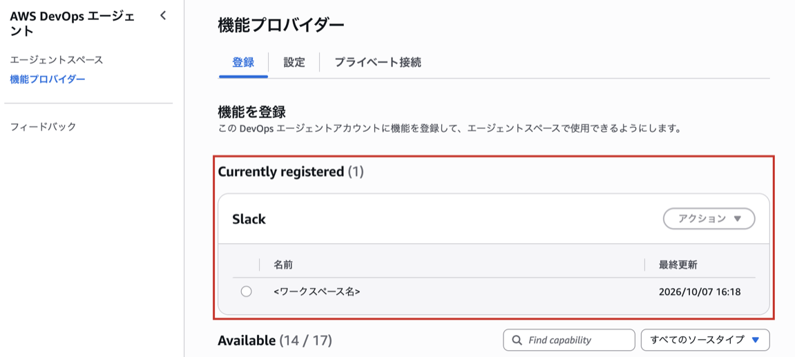
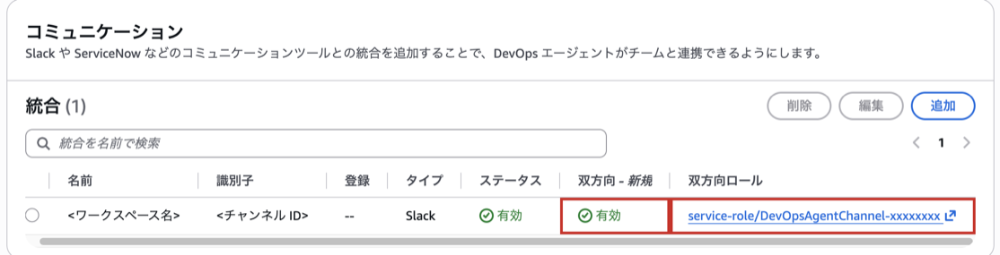
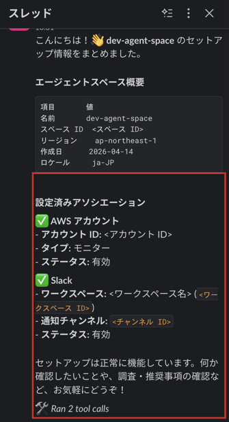
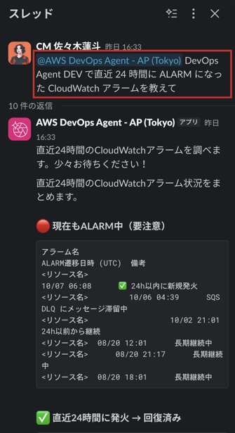
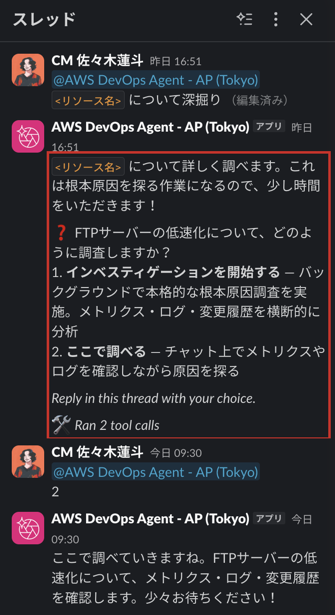
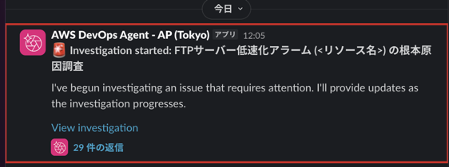
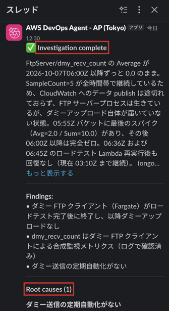
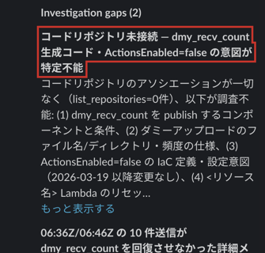

こんにちは、製造ビジネステクノロジー部のはすとです。

AWS DevOps AgentのSlack連携に双方向通信が追加され、チャンネルでメンションするだけで質問や調査の依頼ができるようになりました（[アップデートの記事](https://dev.classmethod.jp/articles/devops-agent-slack-bidirectional-communication/)）。
設定手順はその記事にまとまっています。
実際の業務で使うチャンネルに入れるとなると、手順よりも先に気になることがありました。
Slackから話しかけたAgentは、AWSのどこまで読めるのか。
誰が何を頼んだのか、あとから追えるのか。
そして、1回頼むといくらかかるのか。

本記事では、検証用のAWSアカウントでSlack連携を設定し、実際に質問と調査を頼んだうえで、CloudTrailと利用時間のAPIからこの3点を確かめた結果をまとめます。

## 検証した環境

- リージョン: 東京（ap-northeast-1）
- Agent Space: 検証用アカウントに作成済みのものを1つ使用（AWSアカウントの関連付けのみ。GitHubなどは未関連付け）
- Slackアプリ: 「AWS DevOps Agent - AP (Tokyo)」
- チャンネル: プライベートチャンネル

Slack Marketplaceには、リージョンごとに別のアプリが並んでいます。
Agent Spaceが東京にあるので、アプリも東京版を選びます。

双方向通信はプライベートチャンネルでしか使えません。
私は最初にパブリックチャンネルで作ってしまい、あとからプライベートに切り替えました。

## Slack連携の設定

設定の流れは次の3段階です。

1. DevOps Agentのコンソールの「機能プロバイダー」でSlackを登録する（SlackのOAuth画面でワークスペースへのインストールを承認する）
2. Agent Spaceの「コミュニケーション」でチャンネルIDを指定して関連付け、双方向通信を有効にする
3. Slackのチャンネルでアプリを招待し、`@AWS DevOps Agent - AP (Tokyo) setup`を送る

登録が終わると、機能プロバイダーの画面にSlackのワークスペースが表示されます。



Agent Spaceの「コミュニケーション」には、関連付けたチャンネルと、双方向通信の状態、双方向通信に使うIAMロールが表示されます。
IAMロールは、関連付けの画面で自動作成を選びました。



なお、CLIの`list-associations`ではチャンネルIDは出るものの、双方向通信の有効・無効とロールは出力に含まれていませんでした。

```bash
aws devops-agent list-associations \
  --agent-space-id <スペース ID> \
  --region ap-northeast-1
```

実行結果です（Slackの関連付けだけ抜粋）。

```json
{
    "agentSpaceId": "<スペース ID>",
    "associationId": "...",
    "serviceId": "...",
    "configuration": {
        "slack": {
            "workspaceId": "<ワークスペース ID>",
            "workspaceName": "<ワークスペース名>",
            "transmissionTarget": {
                "opsOncallTarget": {
                    "channelId": "<チャンネル ID>"
                }
            }
        }
    }
}
```

手元のAWS CLI（2.32.30）には`devops-agent`コマンドがまだ入っていなかったので、`uvx --from awscli aws devops-agent ...`で最新版のCLIを一時的に使っています。

チャンネルで`setup`を送ると、Agent Spaceの概要と関連付けの一覧が返ってきました。



## Slackから質問と調査を頼んでみた

まず、直近24時間にALARMになったCloudWatchアラームを聞いてみました。



ALARM中のアラームと、24時間以内に発火して回復したアラームが表で返ってきました。
注目すべき点も3つ挙げてくれています。

そのうちの1つ（FTPサーバーの低速化を検知するアラーム）を深掘りするよう頼むと、調査の進め方を選ぶよう返ってきました。



選択肢は「インベスティゲーションを開始する」と「ここで調べる」の2つです。
「ここで調べる」を選ぶとチャットの中で調べ、「インベスティゲーションを開始する」を選ぶと、コンソールの調査（Investigation）として実行されます。
選択肢への返答も、メンションを付けて送りました。

最初は「ここで調べる」を選び、チャットの中で仮説と推奨アクションまで返ってきました。
続けて同じスレッドで「GitHubのリポジトリを参照した上で調査して」と頼むと、今度はインベスティゲーションを勧められたので、そちらを選びました。

インベスティゲーションを開始すると、チャンネルに「Investigation started」が投稿されます。



このスレッドには、調査の途中経過（Observation、Finding）が順に投稿され、約25分後に「Investigation complete」と根本原因、対応案が投稿されました。



調査結果の「Investigation gaps」には、コードリポジトリが関連付けられていないため調べられなかった点が挙がっていました。



Slackで「GitHubを参照して」と頼んでも、Agent Spaceに関連付けていないリポジトリは読めません。
調べられなかったことを、調査結果の中で正直に書いてくれるのは助かります。

## 確認1: Slackから話しかけたAgentはAWSのどこまで読めるのか

Slack連携のために新しいIAMロールが作られるので、Slackから話しかけると、そのロールの権限でAWSを操作するのだろうと考えると思います。

自動作成されたロール（`service-role/DevOpsAgentChannel-xxxxxxxx`）を見てみます。

```bash
aws iam list-attached-role-policies \
  --role-name DevOpsAgentChannel-xxxxxxxx
```

実行結果です。

```json
{
    "AttachedPolicies": [
        {
            "PolicyName": "AIDevOpsChannelAccessPolicy",
            "PolicyArn": "arn:aws:iam::aws:policy/service-role/AIDevOpsChannelAccessPolicy"
        }
    ]
}
```

付いているのはAWS管理ポリシーの`AIDevOpsChannelAccessPolicy`だけです。
中身を見てみます。

```bash
aws iam get-policy-version \
  --policy-arn arn:aws:iam::aws:policy/service-role/AIDevOpsChannelAccessPolicy \
  --version-id <既定のバージョン>
```

実行結果です（`PolicyVersion.Document`の部分）。

```json
{
    "Version": "2012-10-17",
    "Statement": [
        {
            "Sid": "AllowChatActions",
            "Effect": "Allow",
            "Action": [
                "aidevops:CreateChat",
                "aidevops:SendMessage"
            ],
            "Resource": "arn:aws:aidevops:*:*:agentspace/${aws:PrincipalTag/AgentSpaceId}",
            "Condition": {
                "StringEquals": {
                    "aws:ResourceAccount": "${aws:PrincipalAccount}"
                }
            }
        }
    ]
}
```

実際には、このロールでできるのは、自分のAgent Spaceに対してチャットを始めることとメッセージを送ることだけでした。
信頼ポリシーも、`aidevops.amazonaws.com`がこのアカウントのこのAgent Spaceから使う場合に限られています。

では、調査のときに実際にAWSを読んだのは誰なのか。
インベスティゲーションが動いていた約27分間（UTC 03:05〜03:32）のCloudTrailを取得し、DevOps Agentのロールによる呼び出しを集計しました。

```bash
aws cloudtrail lookup-events \
  --region ap-northeast-1 \
  --start-time 2026-10-08T03:05:00Z \
  --end-time 2026-10-08T03:32:00Z \
  --output json > ct.json
```

```bash
jq -r '.Events[].CloudTrailEvent | fromjson
  | select(.userIdentity.arn // "" | test("DevOpsAgent"))
  | [(.userIdentity.arn | split("/")[1]), .eventSource, (.errorCode // "OK")]
  | @tsv' ct.json | sort | uniq -c | sort -rn
```

実行結果です（ロール名の末尾は伏せています）。

```text
  78 DevOpsAgentRole-AgentSpace-xxxxxxxx  logs.amazonaws.com            OK
  54 DevOpsAgentRole-AgentSpace-xxxxxxxx  kms.amazonaws.com             OK
  20 DevOpsAgentRole-AgentSpace-xxxxxxxx  cloudtrail.amazonaws.com      OK
  18 DevOpsAgentRole-AgentSpace-xxxxxxxx  ecs.amazonaws.com             OK
  13 DevOpsAgentRole-AgentSpace-xxxxxxxx  cloudformation.amazonaws.com  OK
   6 DevOpsAgentRole-AgentSpace-xxxxxxxx  lambda.amazonaws.com          OK
   6 DevOpsAgentRole-AgentSpace-xxxxxxxx  events.amazonaws.com          OK
   5 DevOpsAgentRole-AgentSpace-xxxxxxxx  monitoring.amazonaws.com      OK
   2 DevOpsAgentRole-AgentSpace-xxxxxxxx  lambda.amazonaws.com          AccessDenied
   ...
```

AWSのリソースを読んでいたのは、すべてAgent Spaceのロール（Agent SpaceにAWSアカウントを関連付けるときに指定したロール）でした。
Slack連携用のロールによる呼び出しは、この時間帯には1件もありません。
`AccessDenied`の2件は`lambda:GetFunction`で、Agent Spaceのロールの権限に含まれていない操作でした。

つまり、Slackから頼んだときにAgentが読める範囲は、Slack連携を入れる前と変わらず、Agent Spaceのロールの権限で決まります。
Slack連携を入れたからといって、AWSへの権限が増えるわけではありません。

### Agent Spaceのロールで読めるもの

そうなると、確認すべきはAgent Spaceのロールの権限です。
今回のロールには、AWS管理ポリシーの`AIDevOpsAgentAccessPolicy`が付いています。
データベースまわりは`Describe*`と`List*`が中心で、DynamoDBの`GetItem`や`Query`、`Scan`、RDSの`rds-data`、S3の`GetObject`は含まれていませんでした。
テーブルやバケットの設定は読めても、中のデータは読めない構成です。

一方で、CloudWatch Logsは`GetLogEvents`、`FilterLogEvents`、`StartQuery`が許可されています。
ログの本文は読めます。
調査の途中経過にもログから読み取った内容が書かれていたので、ログに個人情報や機密情報を出しているシステムでは、その内容がSlackのスレッドに投稿されることがありえます。

集計の中で意外だったことが2つあります。

1つめは、東京以外のリージョンも読みに行っていたことです。
調査対象のアラームに関係するLambda関数が大阪リージョン（ap-northeast-3）にあり、Agentは自分で大阪リージョンのLogs Insightsにクエリを投げていました。
同じ方法で大阪リージョンのCloudTrailを集計した結果です。

```text
  15 DevOpsAgentRole-AgentSpace-xxxxxxxx  logs.amazonaws.com            OK
  11 DevOpsAgentRole-AgentSpace-xxxxxxxx  kms.amazonaws.com             OK
   3 DevOpsAgentRole-AgentSpace-xxxxxxxx  lambda.amazonaws.com          OK
   2 DevOpsAgentRole-AgentSpace-xxxxxxxx  events.amazonaws.com          OK
   1 DevOpsAgentRole-AgentSpace-xxxxxxxx  cloudformation.amazonaws.com  OK
```

Agent Spaceが東京にあっても、読みに行く先のリージョンはロールの権限で決まります。
特定のリージョンを読ませたくない場合は、Agent Spaceのロール側で制限する必要があります。

2つめは、KMSの`Decrypt`が多いことです。
暗号化コンテキストを見ると、すべて`aws:lambda:FunctionArn`でした。

```bash
jq -r '.Events[].CloudTrailEvent | fromjson
  | select(.userIdentity.arn // "" | test("DevOpsAgentRole-AgentSpace"))
  | select(.eventSource == "kms.amazonaws.com")
  | .requestParameters.encryptionContext | keys[]' ct.json | sort | uniq -c
```

実行結果です。

```text
  54 aws:lambda:FunctionArn
```

Lambda関数の一覧や設定（`ListFunctions`、`GetFunctionConfiguration`）を取得したときに、環境変数が復号されていると見られます。
これらのAPIの応答には環境変数の値が含まれるので、環境変数に秘密情報を入れている関数があれば、Agentはその値を読めることになります。

## 確認2: 誰が何を頼んだのか、あとから追えるか

Slackからチャットを始めたときのCloudTrailには、`CreateChat`が記録されていました。

```bash
aws cloudtrail lookup-events \
  --lookup-attributes AttributeKey=EventName,AttributeValue=CreateChat \
  --start-time 2026-10-07T00:00:00Z \
  --region ap-northeast-1 \
  --query 'Events[].[EventTime,Username]' \
  --output text
```

実行結果です（SlackユーザーIDは伏せています）。

```text
2026-10-07T16:33:04+09:00  DevOpsAgentChannel-xxxxxxxx-U0XXXXXXXXX
2026-10-07T16:31:22+09:00  DevOpsAgentChannel-xxxxxxxx-U0XXXXXXXXX
```

ユーザー名が`{ロール名}-{SlackユーザーID}`になっているので、Slackの誰がチャットを始めたかは追えます。
ただし、記録されていたのは新しいスレッドを始めた2回だけでした。
同じスレッドでの続きの発言（選択肢への返答や、追加の依頼）は、`SendMessage`も含めて管理イベントとしては記録されていませんでした。
何を頼んだかの中身は、Slackのスレッドに残っている内容で確認することになります。

## 確認3: 1回頼むといくらかかるのか

DevOps Agentの料金は、Agentが動いた秒数で決まります。
[料金ページ](https://aws.amazon.com/devops-agent/pricing/)では、調査（Investigations）、評価（Evaluations）、チャットを含むオンデマンドのタスク（On-demand SRE tasks）のいずれも、1秒あたり$0.0083です。
Agentが待っている時間は課金されません。

Slackのスレッドに費用が表示されるとうれしいのですが、そのような機能は見つかりませんでした。
Agentに「いくらかかった？」と聞くこと自体もチャットとして課金されるので、今回はアカウントの利用時間を返す`get-account-usage`で、操作の前後の差分をとりました。

```bash
aws devops-agent get-account-usage --region ap-northeast-1
```

実行結果です（インベスティゲーションの完了後）。

```json
{
    "monthlyAccountInvestigationHours": {
        "limit": -1,
        "usage": 0.42916666666666664
    },
    "monthlyAccountEvaluationHours": {
        "limit": -1,
        "usage": 0.0
    },
    "monthlyAccountSystemLearningHours": {
        "limit": -1,
        "usage": 0.0
    },
    "monthlyAccountOnDemandHours": {
        "limit": -1,
        "usage": 0.06388888888888888
    },
    "usagePeriodStartTime": "2026-10-01T00:00:00Z",
    "usagePeriodEndTime": "2026-10-08T06:35:49.276Z"
}
```

値はその月の累計（時間単位）です。
各時点の値を並べると次のとおりです。

| 時点（JST） | それまでに行った操作 | 調査 | チャット（On-demand） |
|---|---|---|---|
| 10/07 16:37 | setup、アラームの質問 | 0秒 | 12秒 |
| 10/07 19:42 | 上記に加えて深掘りの依頼 | 0秒 | 62秒 |
| 10/08 15:35 | 上記に加えてチャット内の調査、インベスティゲーション | 1,545秒 | 230秒 |

最初の時点の12秒は、setupと質問の2回分としては短いので、取得した時点ではまだ全部が反映されていなかった可能性があります。
反映までの遅れは今回は確かめていません。

Slackから始めたインベスティゲーションは、チャットではなく調査として計上されていました。
約25分の調査で1,545秒、$0.0083を掛けて約$12.82です。
チャットのほうは、setupから質問、チャット内の調査、インベスティゲーションの依頼までを合わせて230秒、約$1.91でした。

チャットの中で調べてもらうだけなら1回数十秒から数分で済みますが、インベスティゲーションに進むと桁が変わります。
Agentが選択肢を出してくれるので、どちらに進むかは頼む側が選べます。

この方法で測れるのはアカウント全体の累計なので、同じ時間帯に別の調査が動いていると、その分も差分に含まれます。
今回は検証用のアカウントで、ほかの調査が動いていないことを前提にしています。

## まとめ

Slack連携で作られるIAMロールは、Agent Spaceにチャットを送るためだけのもので、AWSを読む権限は持っていませんでした。
Slackから頼んだときにAgentが読める範囲は、これまでどおりAgent Spaceのロールで決まります。
そのうえで、ログの本文やLambdaの環境変数のように、Agentが読めてSlackのスレッドに出る可能性のある情報があるので、業務のチャンネルに入れる前にはAgent Spaceのロールの権限を見直しておくと安心です。

費用は、チャットで聞くだけなら小さく、インベスティゲーションに進むと1件あたり十数ドルかかりました。
Slackのスレッドで気軽に頼めるようになった分、どちらに進むかを選ぶ場面で一度立ち止まれると良さそうです。

私と同じように、Slack連携を業務のチャンネルに入れるか迷っている方の参考になれば嬉しいです。

## 参考

- [【アップデート】AWS DevOps Agent の Slack連携に双方向コミュニケーション機能が追加されました - DevelopersIO](https://dev.classmethod.jp/articles/devops-agent-slack-bidirectional-communication/)
- [Slack setup - AWS DevOps Agent User Guide](https://docs.aws.amazon.com/devopsagent/latest/userguide/configuring-capabilities-connecting-ticketing-and-chat-slack.html)
- [AWS DevOps Agent Pricing](https://aws.amazon.com/devops-agent/pricing/)
- [AWS DevOps Agentの料金体系とコストの抑え方を整理してみた - DevelopersIO](https://dev.classmethod.jp/articles/aws-devops-agent-evaluation-cost/)
