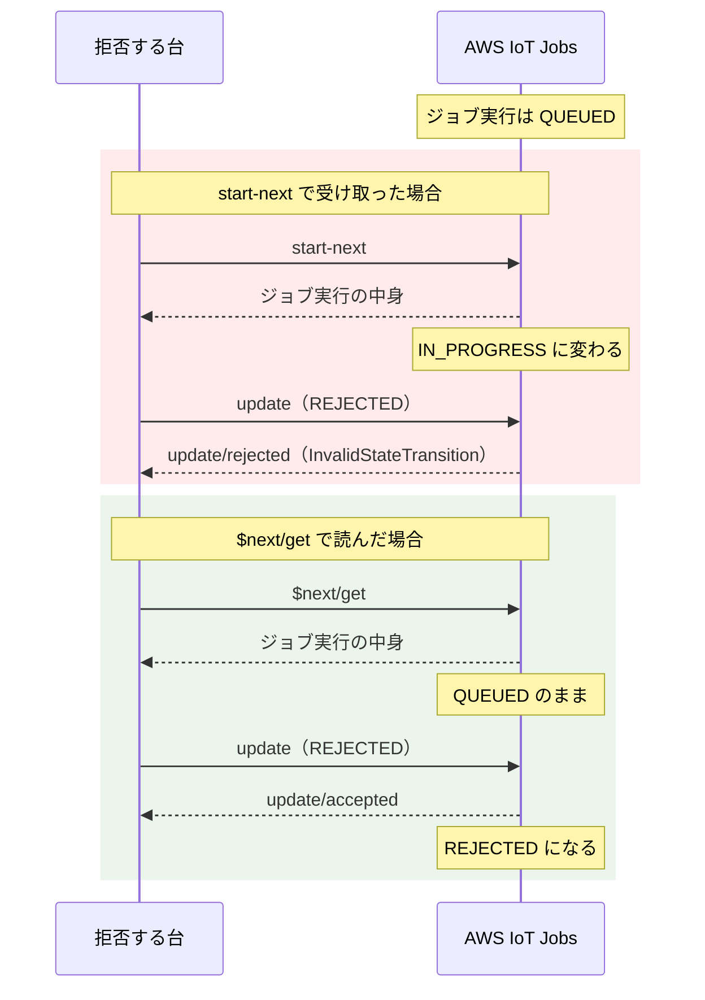

こんにちは、製造ビジネステクノロジー部のはすとです。

IoTデバイスのファームウェアを遠隔で更新する仕組みとして、AWS IoT Jobsがあります。1台に配って成功するところまでの手順はよく見かけますが、実際の運用では何十台、何百台に配り、その一部は失敗したりします。失敗が混ざったとき、Jobsはどこまで面倒を見てくれて、どこからがデバイス側の実装になるのだろう？と気になりました。

そこで、本記事では、Node.jsで100台の仮想デバイスを動かし、ファームウェアを1.0.0から1.1.0に更新するジョブを配り、一部の台をわざと失敗させたときの挙動を確かめます。

## ざっくり AWS IoT Jobs について

Jobsでは、配りたい処理の中身をジョブドキュメントというJSONに書き、配り先のモノやモノグループを指定してジョブを作ります。ジョブを作ると、配り先のモノ1台ごとにジョブ実行が作られ、デバイスはMQTTで自分宛てのジョブ実行を受け取って、結果を報告します。

ジョブ実行の状態は、待ちの `QUEUED` から実行中の `IN_PROGRESS` に進み、成功の `SUCCEEDED`、失敗の `FAILED`、拒否の `REJECTED` などで終わります。今回は、デバイスがこの報告の内容を変えたときに、ジョブ全体がどうなるかを見ていきます。

## 検証の構成

以下のような構成です。


事前に、モノ `jobs-dev-001`〜`jobs-dev-100` と証明書を1台1枚ずつ作り、モノグループ `jobs-fleet` に入れておきました。100台の仮想デバイスは、手元のMacで動く1つのNode.jsのプログラム `sim.js` が、100枚の証明書でMQTT接続を100本張ることで用意しています。

検証環境は次のとおりです（2026年10月28日時点）。

- リージョン: 東京（ap-northeast-1）
- Node.js v24.22.0、mqtt（MQTT.js）5.16.1
- AWS CLI 2.32.30

<!-- TODO: 検証コードのリポジトリを公開するなら URL を置く -->

### デバイスに許可したこと

デバイスのポリシーでは、自分のモノ名で接続することと、自分宛てのJobsのトピックを使うことだけを許可しました。`${iot:Connection.Thing.ThingName}` は、接続してきた証明書に紐づくモノの名前に置き換わるポリシー変数です。

```json
{
  "Version": "2012-10-17",
  "Statement": [
    { "Effect": "Allow", "Action": "iot:Connect",
      "Resource": "arn:aws:iot:ap-northeast-1:<アカウントID>:client/${iot:Connection.Thing.ThingName}" },
    { "Effect": "Allow", "Action": ["iot:Publish", "iot:Receive"],
      "Resource": "arn:aws:iot:ap-northeast-1:<アカウントID>:topic/$aws/things/${iot:Connection.Thing.ThingName}/jobs/*" },
    { "Effect": "Allow", "Action": "iot:Subscribe",
      "Resource": "arn:aws:iot:ap-northeast-1:<アカウントID>:topicfilter/$aws/things/${iot:Connection.Thing.ThingName}/jobs/*" }
  ]
}
```

1枚のポリシーを100台で共有していますが、どの台にも他の台のJobsのトピックは許可していません。

### 仮想デバイスの動き

デバイス側では、Jobsが用意している予約トピック `$aws/things/<モノ名>/jobs/...` を使います。接続したら自分宛ての通知 `notify-next` を購読し、通知が来たら `start-next` に送って次のジョブ実行を始めます。`notify-next`, `start-next` は、Jobsが決めている予約トピックの名前です。以下は、要点だけを抜き出して簡略化したものです。

```js
const base = `$aws/things/${thing}/jobs`;

client.on("connect", () => {
  client.subscribe(
    [`${base}/notify-next`, `${base}/start-next/accepted`, `${base}/+/update/accepted`],
    { qos: 1 },
    () => startNext(), // 接続前から待っているジョブを拾う
  );
});

client.on("message", (topic, payload) => {
  const msg = JSON.parse(payload.toString());
  if (topic.endsWith("/notify-next") && msg.execution) startNext();
  else if (topic.endsWith("/start-next/accepted")) onStarted(msg.execution);
});
```

`start-next/accepted` で受け取ったジョブ実行には、ジョブドキュメントがそのまま入っています。成功させる台は、3〜6秒待ってから「1.1.0になった」と報告します。

```js
function onStarted(exec) {
  if (!exec) return; // 待っているジョブが無い
  const target = exec.jobDocument.version; // "1.1.0"
  setTimeout(() => {
    dev.version = target;
    publish(`${base}/${exec.jobId}/update`, {
      status: "SUCCEEDED",
      statusDetails: { firmwareVersion: dev.version },
      expectedVersion: exec.versionNumber,
    });
  }, workMs());
}
```

失敗させる台は、同じところで `FAILED` を返したり、何も返さなかったりします。

ただ、拒否する台だけは、受け取り方が違います。`start-next` でジョブ実行を受け取ると、その時点で状態が `IN_PROGRESS` に変わります。このあとに `REJECTED` を返したところ、次のエラーで断られました。

```
InvalidStateTransition: Only queued jobs can be rejected. Job was in status IN_PROGRESS
```

`REJECTED` を返せるのは、`QUEUED` のジョブ実行だけでした。そこで、拒否する台だけは `start-next` を使わず、同じく予約トピックの `$next/get` で中身だけを読んでから、`QUEUED` のまま `REJECTED` を返すようにしました。`$next/get` はジョブ実行の状態を変えません。2つの受け取り方を並べると、次のようになります。



```js
// 拒否する台は IN_PROGRESS にせず、次のジョブ実行の中身だけを読む
const startNext = () =>
  behavior === "reject" ? publish(`${base}/$next/get`, {}) : publish(`${base}/start-next`, {});

function onDescribed(exec) { // $next/get/accepted で受け取る
  if (!exec) return; // 待っているジョブが無い
  publish(`${base}/${exec.jobId}/update`, {
    status: "REJECTED",
    statusDetails: { reason: "unsupported hardware revision" },
    expectedVersion: exec.versionNumber,
  });
}
```

## 全台成功させてみる

まずは失敗を混ぜずに、100台すべてを成功させます。

### ジョブドキュメント

ジョブドキュメントには、更新先のバージョンだけを書きました。実際のファームウェアのダウンロードは今回は行いません。

```json
{
  "operation": "firmwareUpdate",
  "version": "1.1.0",
  "releaseNotes": "センサー読み取り間隔の修正"
}
```

### ジョブを作る

コンソールでジョブを作る場合、ジョブドキュメントはS3に置いたファイルを指定します。そのため、先にS3バケットを作ってジョブドキュメントをアップロードしました。

```bash
aws s3 mb s3://<バケット名> --region ap-northeast-1
aws s3 cp jobs/document.json s3://<バケット名>/document.json
```

あとは「リモートアクション」→「ジョブ」→「ジョブを作成」→「カスタムジョブを作成」から、ターゲットにモノグループ `jobs-fleet`、ジョブドキュメントに先ほどのファイルを指定して送信します。配る速さを決めるロールアウト設定や、中止の設定は空のままです。


### 結果

ジョブ `fw-110-a-console` を送信すると、100台とも `SUCCEEDED` を報告し、観測用のプログラムにジョブ全体の完了イベントが届きました。

```json
{
  "topic": "$aws/events/job/fw-110-a-console/completed",
  "status": "COMPLETED",
  "jobProcessDetails": {
    "numberOfCanceledThings": 0,
    "numberOfRejectedThings": 0,
    "numberOfFailedThings": 0,
    "numberOfRemovedThings": 0,
    "numberOfSucceededThings": 100,
    "numberOfTimedOutThings": 0
  }
}
```

コンソールでも、ジョブの詳細画面にある「ジョブの実行」タブの実行の概要で、100台が成功したことを確認できます。


デバイス側のログとイベント通知の時刻から、ジョブを作ってからの経過時間を並べると次のようになりました。

| できごと | ジョブ作成からの経過 |
|---|---|
| 最初の台に通知が届く | 0.8秒 |
| 最後の台に通知が届く | 7.1秒 |
| 最初の台が成功を報告 | 4.2秒 |
| 最後の台が成功を報告 | 12.4秒 |
| ジョブ全体が `COMPLETED` になる | 24.8秒 |

表の時刻は、仮想デバイスのログ `devices.jsonl` と、観測用のプログラムがイベント通知を記録した `events.jsonl` から取りました。どちらも1行1件のJSONです。

```bash
# 通知が届いた時刻の最初と最後（ジョブが無いという通知は除く）
jq -r 'select(.event == "notify-next" and .jobId != null) | .at' runs/a/devices.jsonl | sort | sed -n '1p;$p'
# 成功を報告した時刻の最初と最後
jq -r 'select(.event == "report") | .at' runs/a/devices.jsonl | sort | sed -n '1p;$p'
# ジョブを作った時刻と、COMPLETED になった時刻
jq -r 'select(.operation == "completed") | "\(.createdAt / 1000 | todate)  \(.completedAt / 1000 | todate)"' runs/a/events.jsonl
```

実行結果です。

```
2026-10-28T05:46:07.780Z
2026-10-28T05:46:14.093Z
2026-10-28T05:46:11.185Z
2026-10-28T05:46:19.408Z
2026-10-28T05:46:07Z  2026-10-28T05:46:31Z
```

`todate` は秒より下を切り捨てるため、経過時間はミリ秒まで入っている元の値から計算しました。元の値は、`createdAt` が `1793166367005`、`completedAt` が `1793166391835` です。

ロールアウト設定をしていなくても、100台への通知は一度に届くのではなく、7秒ほどかけて届きました。また、最後の台が成功を報告してから、ジョブ全体が `COMPLETED` になるまでに12秒ほどかかっています。ジョブ全体の状態は、全台の報告と同時に切り替わるわけではありませんでした。

## 一部を失敗させてみる

ここからは設定を変えながら何度もジョブを作るため、ジョブドキュメントをS3に置かず、CLIで作ります。CLIなら、ジョブドキュメントは手元のファイルをそのまま渡せます。ジョブの設定は実験ごとにJSONファイルに書いておき、`--cli-input-json` で読み込みます。

```bash
aws iot create-job \
  --cli-input-json file://jobs/b-no-abort.json \
  --job-id fw-110-b-<日時> \
  --targets arn:aws:iot:ap-northeast-1:<アカウントID>:thinggroup/jobs-fleet \
  --target-selection SNAPSHOT \
  --document file://jobs/document.json
```

`--target-selection SNAPSHOT` は、ジョブを作った時点でモノグループに入っている台だけに配る指定です。最初の実験では、中止やタイムアウトの設定は何も入れず、設定ファイルには説明だけを書きました。

```json:jobs/b-no-abort.json
{
  "description": "B: 一部失敗・中止設定なし"
}
```

100台の振る舞いは、`sim.js` を起動するときのオプションに、台の番号の範囲を渡して割り当てました。どのオプションにも入っていない台は、成功を報告します。

```bash
node scripts/sim.js --run b2 --fail 67-79 --reject 80-86 --hang 87-93 --offline 94-100
```

`--run` はログを書き出すフォルダの名前で、ここでは `runs/b2/` に書き出します。割り当てると、次のようになります。

| 台 | 振る舞い |
|---|---|
| 001〜066 | 成功を報告する |
| 067〜079 | 数秒後に `FAILED` を報告する |
| 080〜086 | 中身を読んですぐ `REJECTED` を報告する |
| 087〜093 | `IN_PROGRESS` にしたまま何も報告しない |
| 094〜100 | 電源が切れているなどで、そもそも接続しない |

### 結果

ジョブ `fw-110-b-11041658` を作り、報告が出そろった約1分半後にジョブの状態を見ました。

```bash
aws iot describe-job --job-id fw-110-b-11041658 \
  --query '{status: job.status, reasonCode: job.reasonCode, comment: job.comment, jobProcessDetails: job.jobProcessDetails}'
```

実行結果です。`jobProcessDetails` は0の項目を省いています。以降も同じです。

```json
{
  "status": "IN_PROGRESS",
  "reasonCode": null,
  "comment": null,
  "jobProcessDetails": {
    "numberOfSucceededThings": 66,
    "numberOfFailedThings": 13,
    "numberOfRejectedThings": 7,
    "numberOfQueuedThings": 7,
    "numberOfInProgressThings": 7
  }
}
```

振る舞いごとに見ると、次のように記録されていました。

| 台 | 振る舞い | 記録された状態 |
|---|---|---|
| 001〜066 | 成功 | `SUCCEEDED` |
| 067〜079 | `FAILED` を報告 | `FAILED` |
| 080〜086 | `REJECTED` を報告 | `REJECTED` |
| 087〜093 | 何も報告しない | `IN_PROGRESS` のまま |
| 094〜100 | 接続しない | `QUEUED` のまま |

報告した台は、報告したとおりの状態になります。一方で、報告しない台と接続しない台は、それぞれ `IN_PROGRESS` と `QUEUED` のまま残りました。この14台が残っているかぎり、ジョブ全体は `IN_PROGRESS` のまま `COMPLETED` になりません。スナップショットのジョブについて、ドキュメントには次のように書かれています。

> For a snapshot job, the job status changes to `COMPLETED` when all of its job executions enter a terminal state, such as `SUCCEEDED`, `FAILED`, `TIMED_OUT`, `REMOVED`, or `CANCELED`.
>
> （和訳）スナップショットのジョブでは、すべてのジョブ実行が `SUCCEEDED`、`FAILED`、`TIMED_OUT`、`REMOVED`、`CANCELED` などの終了の状態になったときに、ジョブの状態が `COMPLETED` に変わります。
>
> [Jobs and job execution states - AWS IoT Core](https://docs.aws.amazon.com/iot/latest/developerguide/iot-jobs-lifecycle.html#iot-jobs-states)

全台成功させたときは、最後の報告から約12秒で `COMPLETED` になりました。今回は、待ち続けても終わりません。

### 手で止める

終わらないジョブは、`cancel-job` で止めます。`--force` を付けると、`QUEUED` だけでなく `IN_PROGRESS` のジョブ実行も取り消されます。

```bash
aws iot cancel-job --force --job-id fw-110-b-11041658
```

10秒ほどでジョブは `CANCELED` になりました。

```json
{
  "status": "CANCELED",
  "reasonCode": null,
  "comment": null,
  "jobProcessDetails": {
    "numberOfCanceledThings": 14,
    "numberOfSucceededThings": 66,
    "numberOfFailedThings": 13,
    "numberOfRejectedThings": 7
  }
}
```

残っていた `IN_PROGRESS` の7台と `QUEUED` の7台、合わせて14台が `CANCELED` になり、報告を終えた86台はそのままです。`IN_PROGRESS` だった台には、待っているジョブ実行が無いことを知らせる、中身の無い `notify-next` が届きました。ジョブ実行が取り消されたことは、デバイスにはこの通知で伝わります。今回の仮想デバイスは何もしていないため問題ありませんが、実際のデバイスでは、この通知を受けたら作業を止める作りにしておく必要がありそうです。

## 途中で中止させてみる

失敗が多いときにジョブを止めるのが、中止の設定 `abortConfig` です。今回は「30台以上の結果がそろったあと、`FAILED` が20%以上なら中止する」にしました。あわせて、ロールアウト設定 `jobExecutionsRolloutConfig` で、配る速さを1分に10台までに絞ります。

```json:jobs/c-abort-slow.json
{
  "description": "C: 中止設定あり・1分あたり10台ずつ配る",
  "jobExecutionsRolloutConfig": {
    "maximumPerMinute": 10
  },
  "abortConfig": {
    "criteriaList": [
      {
        "failureType": "FAILED",
        "action": "CANCEL",
        "thresholdPercentage": 20,
        "minNumberOfExecutedThings": 30
      }
    ]
  }
}
```

仮想デバイスは、003、006、…、099の3の倍数の33台が `FAILED` を報告し、残りの67台は成功します。範囲は「3から99まで3つおき」の意味で `3-99/3` と書けるようにしてあります。

```bash
node scripts/sim.js --run c --fail 3-99/3
```

### 1分に10台ずつ配った場合

ジョブ `fw-110-c-11041631` は、作ってから約4分後に中止されました。`describe-job` の結果です。コマンドは先ほどと同じで、ジョブIDだけを変えています。

```json
{
  "status": "CANCELED",
  "reasonCode": "ABORT_CANCEL",
  "comment": "Abort criteria for failure type FAILED with threshold 20.00% met. Total completed executions: 30, total FAILED executions: 11",
  "jobProcessDetails": {
    "numberOfCanceledThings": 10,
    "numberOfSucceededThings": 19,
    "numberOfFailedThings": 11
  }
}
```

`comment` には、完了したジョブ実行30件のうち、37%にあたる11件が `FAILED` だったため中止した、と書かれています。

100台のうち、ジョブ実行が作られたのは40台だけでした。台ごとに、ジョブ実行が作られた時刻 `queuedAt` と、実行中になった時刻 `startedAt` を並べてみます。

```bash
aws iot list-job-executions-for-job --job-id fw-110-c-11041631 > executions.json
jq -r '.executionSummaries | sort_by(.jobExecutionSummary.queuedAt) | .[]
  | "\(.jobExecutionSummary.queuedAt[11:19])  \(.thingArn | split("/") | last)  \(.jobExecutionSummary.status)  \(.jobExecutionSummary.startedAt[11:19] // "-")"' executions.json
```

実行結果です（日本時間）。

```
16:31:16  jobs-dev-090  FAILED  16:31:18
16:31:22  jobs-dev-024  FAILED  16:31:23
16:31:28  jobs-dev-026  SUCCEEDED  16:31:29
（中略）
16:34:09  jobs-dev-077  SUCCEEDED  16:34:11
16:34:15  jobs-dev-039  FAILED  16:34:16
16:34:21  jobs-dev-003  CANCELED  -
16:34:27  jobs-dev-017  CANCELED  -
（中略）
16:35:09  jobs-dev-097  CANCELED  -
16:35:15  jobs-dev-025  CANCELED  -
```

ジョブ実行は6秒に1件ずつ、台の番号とは関係のない順番で作られていました。1分に10台という設定どおりです。

`CANCELED` になった10台は、どれも `startedAt` がありません。ジョブ実行が作られただけで、まだ `QUEUED` のまま止められた台です。公式ドキュメントにも、中止で取り消されるのは `QUEUED` のジョブ実行だけだと書かれています。

> When the abort criteria is met for canceling a job execution, only `QUEUED` job executions are canceled. Any queued retries for the device will not be attempted. However, current job executions that have an `IN_PROGRESS` status will not be canceled.
>
> （和訳）中止の条件を満たしてジョブ実行を取り消すときに取り消されるのは、`QUEUED` のジョブ実行だけです。その台で待っている再試行も行われません。ただし、`IN_PROGRESS` の状態にある実行中のジョブ実行は取り消されません。
>
> [How job configurations work - AWS IoT Core](https://docs.aws.amazon.com/iot/latest/developerguide/jobs-configurations-details.html#job-retry-configuration)

また、16:34:21以降に作られた31台目から40台目の10台には、中止されるまで通知が届きませんでした。仮想デバイスのログで、ジョブの通知を受けた台を数えると30台です。

```bash
jq -r 'select(.event == "notify-next" and .jobId != null) | .thing' runs/c/devices.jsonl | sort -u | wc -l
```

```
      30
```

30台目の `jobs-dev-039` が失敗を報告したのは16:34:19で、中止が始まったのは16:35:18でした。その間の約1分、ジョブ実行は作られ続けていましたが、どの台にも通知は届いていません。

### 配る速さを絞らなかった場合

同じ中止の設定のまま、ロールアウト設定だけを外して、もう一度試しました。仮想デバイスも、1分に10台ずつ配ったときと同じ割り当てです。

```json:jobs/c2-abort-fast.json
{
  "description": "C2: 中止設定あり・配る速度の制限なし（C との比較）",
  "abortConfig": {
    "criteriaList": [
      {
        "failureType": "FAILED",
        "action": "CANCEL",
        "thresholdPercentage": 20,
        "minNumberOfExecutedThings": 30
      }
    ]
  }
}
```

`describe-job` の結果です。

```json
{
  "status": "CANCELED",
  "reasonCode": "ABORT_CANCEL",
  "comment": "Abort criteria for failure type FAILED with threshold 20.00% met. Total completed executions: 58, total FAILED executions: 23",
  "jobProcessDetails": {
    "numberOfSucceededThings": 67,
    "numberOfFailedThings": 33
  }
}
```

ジョブは `CANCELED` になりましたが、`numberOfCanceledThings` は0です。100台すべてが最後まで作業して、67台が成功、33台が失敗しています。中止の設定が無い場合と同じ結果でした。

時刻を並べると、理由が分かります。時刻は、全台成功させたときと同じコマンドで取り出しました。

| できごと | 時刻（UTC） | ジョブ作成からの経過 |
|---|---|---|
| ジョブを作る | 07:39:25 | 0秒 |
| 最初の台に通知が届く | 07:39:27.4 | 約2秒 |
| 最後の台に通知が届く | 07:39:33.6 | 約8秒 |
| 中止が始まる | 07:39:35 | 約10秒 |
| 最後の台が報告する | 07:39:39.5 | 約14秒 |

中止が始まった時点で、100台すべてに通知が届き、作業が始まっていました。手で `cancel-job --force` を実行したときとは違い、中止の設定では `IN_PROGRESS` のジョブ実行は取り消されません。そのため、取り消せる台は1台も残っていませんでした。配る速さを絞っておかないと、中止の設定が働いたときには、すべての台がもう更新を始めていました。

## タイムアウトと再試行

最後に、実行中のまま報告しない台を止めるタイムアウトと、失敗した台にもう一度配る再試行を設定します。タイムアウトは設定できる最短の1分にし、再試行は `FAILED` に2回、`TIMED_OUT` に1回としました。

```json:jobs/d-timeout-retry.json
{
  "description": "D: タイムアウト1分・再試行あり",
  "timeoutConfig": { "inProgressTimeoutInMinutes": 1 },
  "jobExecutionsRetryConfig": {
    "criteriaList": [
      { "failureType": "FAILED", "numberOfRetries": 2 },
      { "failureType": "TIMED_OUT", "numberOfRetries": 1 }
    ]
  }
}
```

100台の振る舞いは、一部を失敗させてみたときと同じです。

```bash
node scripts/sim.js --run d --fail 67-79 --reject 80-86 --hang 87-93 --offline 94-100
```

### 結果

ジョブを作ってから5分ほど待ち、ジョブ実行を状態ごとに数えました。

```bash
aws iot list-job-executions-for-job --job-id fw-110-d-11041644 > executions.json
jq -r '.executionSummaries[] | .jobExecutionSummary.status' executions.json | sort | uniq -c
```

実行結果です。

```
  39 FAILED
   7 QUEUED
   7 REJECTED
  66 SUCCEEDED
  14 TIMED_OUT
```

合計は133件で、100台より多くなっています。再試行のたびに、同じ台に、実行番号を1つ増やした新しいジョブ実行が作られるためです。振る舞いごとにまとめると、次のようになりました。

| 台 | 振る舞い | 記録された状態 |
|---|---|---|
| 001〜066 | 成功 | `SUCCEEDED` を1回 |
| 067〜079 | `FAILED` を報告 | 最初の1回と再試行2回の、3回とも `FAILED` |
| 080〜086 | `REJECTED` を報告 | `REJECTED` を1回。再試行されない |
| 087〜093 | 何も報告しない | `TIMED_OUT` のあと再試行1回、もう一度 `TIMED_OUT` |
| 094〜100 | 接続しない | `QUEUED` のまま |

`describe-job` の `jobProcessDetails` も、この件数と同じでした。`numberOfFailedThings` は39で、13台が3回ずつ失敗した数です。`numberOfTimedOutThings` は14で、7台が2回ずつタイムアウトした数です。名前は `Things` ですが、数えているのは台の数ではなく、ジョブ実行の数でした。

`REJECTED` が再試行されないことは、ドキュメントにも書かれています。

> In these cases, AWS IoT Jobs will not retry the job execution because it retries the job execution only when it detects a `FAILED` or `TIMED_OUT` status.
>
> （和訳）このような場合、AWS IoT Jobsはジョブ実行を再試行しません。再試行するのは、`FAILED` または `TIMED_OUT` の状態を検知したときだけだからです。
>
> [How job configurations work - AWS IoT Core](https://docs.aws.amazon.com/iot/latest/developerguide/jobs-configurations-details.html#job-retry-configuration)

### 再試行のタイミング

`FAILED` を報告する台のうち、`jobs-dev-067` のログを見てみます。

```bash
jq -r 'select(.thing == "jobs-dev-067" and (.event == "started" or .event == "report"))
  | "\(.at[11:23])  \(.event)  \(.executionNumber // "")\(.status // "")"' runs/d/devices.jsonl
```

実行結果です（UTC）。

```
07:44:58.147  started  1
07:45:02.748  report  FAILED
07:45:04.839  started  2
07:45:10.293  report  FAILED
07:45:11.703  started  3
07:45:17.481  report  FAILED
```

`started` の後ろの数字は実行番号です。失敗を報告してから2秒ほどで、次の実行が届いています。再試行は、間を空けずにすぐ行われました。

### タイムアウトまでの時間

何も報告しない7台について、実行中になった時刻と、`TIMED_OUT` のイベントが届いた時刻を取り出しました。

```bash
# 1回目の実行が始まった時刻
jq -r 'select(.event == "started" and .executionNumber == 1 and .thing >= "jobs-dev-087" and .thing <= "jobs-dev-093")
  | "\(.at[11:23])  \(.thing)"' runs/d/devices.jsonl
# TIMED_OUT になった時刻
jq -r 'select(.operation == "timed_out") | "\(.at[11:23])  \(.thingArn | split("/") | last)  exec#\(.executionNumber)"' runs/d/events.jsonl | sort -k2
```

実行結果のうち、1回目の実行を並べると次のとおりです（UTC）。

| 台 | 実行中になった時刻 | `TIMED_OUT` になった時刻 | 差 |
|---|---|---|---|
| jobs-dev-087 | 07:44:57.594 | 07:46:32.008 | 約94秒 |
| jobs-dev-088 | 07:44:56.781 | 07:45:59.551 | 約63秒 |
| jobs-dev-089 | 07:44:58.147 | 07:46:01.556 | 約63秒 |
| jobs-dev-090 | 07:44:56.786 | 07:46:36.687 | 約100秒 |
| jobs-dev-091 | 07:45:02.176 | 07:46:38.279 | 約96秒 |
| jobs-dev-092 | 07:44:57.637 | 07:46:19.869 | 約82秒 |
| jobs-dev-093 | 07:44:57.694 | 07:45:58.629 | 約61秒 |

1分の設定に対して、実際に `TIMED_OUT` になったのは61〜100秒後でした。1分ちょうどではなく、最大で40秒ほど遅れて判定されています。

一方で、接続しない7台は、5分たっても `QUEUED` のままでした。ドキュメントのとおり、タイムアウトまでの時間は `IN_PROGRESS` になってから数え始めます。

> Whenever a job execution remains in the `IN_PROGRESS` status for longer than this interval, the job execution fails and switches to the terminal `TIMED_OUT` status.
>
> （和訳）ジョブ実行がこの時間より長く `IN_PROGRESS` の状態のままだと、そのジョブ実行は失敗となり、終了の状態である `TIMED_OUT` に変わります。
>
> [How job configurations work - AWS IoT Core](https://docs.aws.amazon.com/iot/latest/developerguide/jobs-configurations-details.html#job-timeout-timers)

接続しない台は `QUEUED` のままのため、タイムアウトにならず、再試行もされません。そのため、ジョブ全体は `IN_PROGRESS` のまま終わりませんでした。

## まとめ

失敗の種類ごとの記録、再試行、タイムアウトは、設定さえ入れればJobsがやってくれました。一方で、`REJECTED` は `QUEUED` のジョブ実行にしか返せないため、デバイスは作業を始める前に中身を読んで判断する必要があります。また、接続しない台はタイムアウトにならず、ジョブはいつまでも終わりませんでした。

今回試してみて意外だったのは、配る速さを絞らなかったときに、中止の条件を満たしたのに1台も止められなかったことです。中止で取り消されるのは `QUEUED` の台だけのため、中止の設定はロールアウト設定とあわせて入れることが大事だと感じました。

私と同じように、IoT Jobsでファームウェアの更新を配ろうとしている方の参考になれば幸いです。

## 参考

- [AWS IoT ジョブ - AWS IoT Core](https://docs.aws.amazon.com/ja_jp/iot/latest/developerguide/iot-jobs.html)
- [Jobs とジョブ実行の状態 - AWS IoT Core](https://docs.aws.amazon.com/ja_jp/iot/latest/developerguide/iot-jobs-lifecycle.html)
- [How job configurations work - AWS IoT Core](https://docs.aws.amazon.com/iot/latest/developerguide/jobs-configurations-details.html)
- [AbortCriteria - AWS IoT API Reference](https://docs.aws.amazon.com/iot/latest/apireference/API_AbortCriteria.html)
- [AWS IoT Device Management の料金](https://aws.amazon.com/iot-device-management/pricing/)
