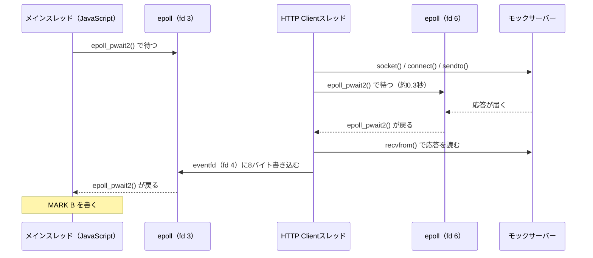

こんにちは、製造ビジネステクノロジー部のはすとです。

これまで[Node.jsのfetch()がOSへI/Oを依頼するところをstraceで覗いてみた](/articles/nodejs-fetch-strace)などの記事で、Node.jsの`fetch()`が最後はLinuxの`epoll_pwait()`で待っていることを確認してきました。そこから「JavaScriptの非同期処理は、OSに`epoll`があるから成り立っている」と理解していました。

一方で、ランタイムを比べると、イベントループの実装は3つとも違います。

| ランタイム | JavaScriptエンジン | イベントループ |
|---|---|---|
| Node.js | V8 | libuv（C） |
| Deno | V8 | Tokio（Rust） |
| Bun | JavaScriptCore | 独自実装（v1.4からRust、それより前はZig） |

このうち、私がこれまで確かめたのはlibuvだけです。TokioやBunでも、最後は同じ`epoll`で待っているのでしょうか。

本記事では、同じスクリプトをNode.js、Deno、Bunで動かし、`epoll`の使われ方を`strace`で覗いてみます。

## 先に結論

ネットワークのI/Oを待つところは、3つとも`epoll`でした。Node.jsとDenoは`epoll_pwait()`、Bunは`epoll_pwait2()`で待っています。

ただし、「JavaScriptの非同期処理は`epoll`があるから成り立っている」という理解は言い過ぎでした。

- 非同期処理のうち、結果を受け取るしくみ（Promiseと`await`）はJavaScriptエンジンの中で動き、OSを使いません
- ファイルの読み込み（`openat()`と`read()`）は、3つともJavaScriptを動かすメインスレッドではなく、別のスレッドで行われていました。`epoll`は、読み込みが終わったという通知を待つところで使われています
- `epoll`はLinuxの仕組みで、macOSではkqueue、WindowsではIOCPなど、OSごとに別の仕組みを使います（今回`strace`で観測したのはLinuxだけで、macOSとWindowsはソースとドキュメントでの確認です）

また、`fetch()`を呼んでからリクエストがOSに渡るタイミングは、3つとも違いました。

## 検証環境

3つのランタイムを同じDebianのコンテナに入れ、同じカーネルで比べます。バージョンは、2026年10月17日時点の安定版の最新にそろえました（Node.jsは最新のLTSです）。

```dockerfile:Dockerfile
# Node.js / Deno / Bun を同じ Debian 上に並べ、strace で比べるためのイメージ
FROM denoland/deno:bin-2.9.7 AS deno
FROM oven/bun:1.4.3-debian AS bun
FROM node:24.22.0-bookworm
RUN apt-get update \
 && apt-get install -y --no-install-recommends strace \
 && rm -rf /var/lib/apt/lists/*
COPY --from=deno /deno /usr/local/bin/deno
COPY --from=bun /usr/local/bin/bun /usr/local/bin/bun
# Deno の更新確認の通信がログに混ざらないようにする
ENV DENO_NO_UPDATE_CHECK=1
WORKDIR /work
```

コンテナの中で確認したバージョンです。

```text
kernel: Linux 6.8.0-64-generic aarch64
os:     Debian GNU/Linux 12 (bookworm)
node:   v24.22.0
deno:   deno 2.9.7
bun:    1.4.3
strace: strace -- version 6.1
```

macOS上のColima（Ubuntu 24.04のVM）で動かしています。`strace`にはptraceの権限が必要なため、`--cap-add SYS_PTRACE --security-opt seccomp=unconfined`を付けて起動します。

```bash
docker build -t runtimes-strace-lab .
docker run --rm -it --cap-add SYS_PTRACE --security-opt seccomp=unconfined \
  -v "$PWD:/work" runtimes-strace-lab bash
```

通信先には、`127.0.0.1:3000`で待ち受けて300ミリ秒後に応答するモックサーバーを使います。モックサーバーはNode.jsで起動し、`strace`の対象にはしません。

```js:mock.mjs
import http from 'node:http';
const server = http.createServer((req, res) => {
  setTimeout(() => {
    res.writeHead(200, { 'content-type': 'text/plain' });
    res.end(`ok ${req.url}`);
  }, 300);
});
server.listen(3000, '127.0.0.1', () => console.log('mock listening on 3000'));
```

`fetch.mjs`は、`await`の前後で`MARK A`と`MARK B`を標準出力に書きます。`strace`のログでこの2行の間を見れば、`await`の間に出たシステムコールが分かります。

```js:fetch.mjs
process.stdout.write('MARK A\n');
const res = await fetch('http://127.0.0.1:3000/a');
await res.text();
process.stdout.write('MARK B\n');
```

Denoも`process`をそのまま使えるため、どのスクリプトも3つのランタイムでそのまま実行できました。

## まずは絞り込まずに数えてみた

Node.jsで使っていた`strace`の絞り込み（`-e trace=epoll_pwait`など）をそのまま使うと、ほかのランタイムが別のシステムコールで待っていたときに見落とします。そこで最初に、`-c`で全部のシステムコールを数えました。

```bash
node mock.mjs &
strace -f -c -o survey-node.txt node fetch.mjs
strace -f -c -o survey-deno.txt deno run -A fetch.mjs
strace -f -c -o survey-bun.txt bun fetch.mjs
```

`epoll`と`io_uring`に関係する行だけを抜き出した実行結果です。

```text:Node.js
 18.86    0.037522        5360         7           epoll_pwait
  0.88    0.001747         582         3           io_uring_setup
  0.04    0.000081          16         5           io_uring_enter
  0.01    0.000024           8         3           epoll_create1
  0.00    0.000000           0         2         1 epoll_ctl
```

```text:Deno
  0.62    0.000942         188         5           epoll_pwait
  0.00    0.000005           1         4           epoll_ctl
  0.00    0.000004           4         1           epoll_create1
```

```text:Bun
 17.74    0.002553         851         3           epoll_pwait2
  0.65    0.000093          15         6           epoll_ctl
  0.19    0.000028          14         2           epoll_create1
```

3つとも`epoll_create1()`で`epoll`のインスタンスを作っています。一方で、Bunだけは`epoll_pwait()`ではなく`epoll_pwait2()`を使っていました。[epoll_wait(2)](https://man7.org/linux/man-pages/man2/epoll_wait.2.html#DESCRIPTION)では、`epoll_pwait2()`は待つ時間の引数だけが`epoll_pwait()`と違うと説明されています。

> It takes an argument of type timespec to be able to specify nanosecond resolution timeout.

和訳すると「ナノ秒単位でタイムアウトを指定できるように、timespec型の引数を取る」です。

Bunだけがこちらを使う理由を調べると、Bunは`setTimeout`などのタイマーの待ち時間を、そのまま`epoll`の待ち時間として渡す作りになっていました（[#11419](https://github.com/oven-sh/bun/pull/11419)）。`epoll_pwait2()`に切り替えたPR（[#12357](https://github.com/oven-sh/bun/pull/12357)）には、理由が次のように書かれています。

> This also uses `epoll_pwait2`, which allows using a higher resolution timer

和訳すると「`epoll_pwait2`も使うようにした。これでより細かい単位のタイマーを使える」というのが理由のようです。ただし、`epoll_pwait2()`はLinux 5.11で追加されたため、使えない環境では`epoll_pwait()`で待ちます（[epoll_kqueue.c](https://github.com/oven-sh/bun/blob/bun-v1.4.3/packages/bun-usockets/src/eventing/epoll_kqueue.c)）。

ここからは、待機に使われうるシステムコールをまとめて指定して`strace`します。

```bash
WAIT=epoll_ctl,epoll_wait,epoll_pwait,epoll_pwait2,io_uring_setup,io_uring_enter,poll,ppoll,select,pselect6
strace -f -tt -T -o fetch-bun.log \
  -e trace=prctl,socket,connect,sendto,recvfrom,write,writev,pwritev2,$WAIT \
  bun fetch.mjs
```

`prctl`は、スレッドに付いた名前（`PR_SET_NAME`）をログに出すために入れています。Bunは標準出力への書き込みに`pwritev2()`を使うことがあり、DenoとBunはリクエストの送信に`sendto()`を使うため、これらも含めています。

## 1. await Promise.resolve()はOSに届くか

`await Promise.resolve()`は、すでに結果が出ているPromiseを待つだけで、時間のかかる処理がありません。そのため、Promiseと`await`のしくみだけを動かして、OSに届くかを確かめるために使います。

```js:resolve.mjs
process.stdout.write('MARK A\n');
await Promise.resolve();
process.stdout.write('MARK B\n');
```

実行したときのログです。

```text:Node.js
42    07:59:45.436947 write(1, "MARK A\n", 7) = 7 <0.000025>
42    07:59:45.437269 write(1, "MARK B\n", 7) = 7 <0.000032>
```

```text:Deno
192   07:59:54.621583 write(1, "MARK A\n", 7) = 7 <0.000016>
192   07:59:54.621924 write(1, "MARK B\n", 7) = 7 <0.000015>
```

```text:Bun
343   08:00:03.237556 write(5, "MARK A\n", 7) = 7 <0.000032>
343   08:00:03.237992 write(5, "MARK B\n", 7) = 7 <0.000029>
```

3つとも、2つの`MARK`の間には何もありません。`await`の続きは、JavaScriptエンジンのマイクロタスクのキューに積まれ、OSを通らずに実行されます。つまり、`epoll`が関わるのは、`await`の先で待っている通信などの処理のほうです。

## 2. fetch()の応答はどこで待っているか

次は`fetch.mjs`です。モックサーバーが応答するまでの300ミリ秒を、どのスレッドがどのシステムコールで待っているかを見ます。左端の数字はスレッドのID、右端の`<秒>`はそのシステムコールにかかった時間です。ログは時刻を省き、本文で触れる行だけを抜き出しています。長い引数も `...` で省略しています。

### Node.js

```text
52  write(1, "MARK A\n", 7) = 7
52  socket(AF_INET, SOCK_STREAM|SOCK_CLOEXEC|SOCK_NONBLOCK, IPPROTO_IP) = 21
52  connect(21, {... 127.0.0.1:3000 ...}) = -1 EINPROGRESS (Operation now in progress)
52  write(21, "GET /a HTTP/1.1\r\nhost: 127.0.0.1"..., 170) = 170
52  epoll_pwait(15, [{events=EPOLLIN, data={u32=21, u64=21}}], 1024, 493, NULL, 8) = 1 <0.305539>
52  write(1, "MARK B\n", 7) = 7
```

JavaScriptを実行しているメインスレッド（52）が、`epoll_pwait()`で0.305秒止まっています。これは、前に検証した際と同じ動きです。Node.jsのlibuvは、[Design overview](https://docs.libuv.org/en/v1.x/design.html)に次のように書かれています。

> epoll on Linux, kqueue on OSX and other BSDs, event ports on SunOS and IOCP on Windows

和訳すると「Linuxではepoll、OSXとその他のBSDではkqueue、SunOSではevent ports、WindowsではIOCP」です。

### Deno

```text
203 write(1, "MARK A\n", 7) = 7
203 socket(AF_INET, SOCK_STREAM|SOCK_CLOEXEC, IPPROTO_TCP) = 20
203 connect(20, {... 127.0.0.1:3000 ...}) = -1 EINPROGRESS (Operation now in progress)
203 sendto(20, "GET /a HTTP/1.1\r\naccept: */*\r\nac"..., 124, MSG_NOSIGNAL, NULL, 0) = 124
203 epoll_pwait(3, [{events=EPOLLIN|EPOLLOUT, ...}], 1024, 498, NULL, 8) = 1 <0.301916>
203 recvfrom(20, "HTTP/1.1 200 OK\r\ncontent-type: t"..., 8192, 0, NULL, NULL) = 172
203 write(1, "MARK B\n", 7) = 7
```

Denoも、メインスレッド（203）が`epoll_pwait()`で0.302秒止まっています。DenoはTokio 1.47.1に依存しており（[Cargo.toml](https://github.com/denoland/deno/blob/v2.9.7/Cargo.toml)）、TokioはI/Oの待機に[mio](https://github.com/tokio-rs/mio)というライブラリを使います。mioのREADMEには、次のように書かれています。

> I/O event queue backed by epoll, kqueue, and IOCP

和訳すると「epoll、kqueue、IOCPを使ったI/Oイベントのキュー」です。つまり、Linuxでは`epoll`が使われ、それがこのログの`epoll_pwait()`です。

ただし、mioが呼んでいるのは`epoll_pwait()`ではなく`epoll_wait()`です（[epoll.rs](https://github.com/tokio-rs/mio/blob/master/src/sys/unix/selector/epoll.rs)）。今回のaarch64には`epoll_wait`というシステムコールがないため、glibcが`epoll_pwait()`に置き換えて呼んでいます（[epoll_wait.c](https://github.com/bminor/glibc/blob/master/sysdeps/unix/sysv/linux/epoll_wait.c)）。x86_64では`epoll_wait()`と出ると見られますが、今回は試していません。

### Bun

```text
349 write(5, "MARK A\n", 7) = 7
349 epoll_pwait2(3,  <unfinished ...>
352 prctl(PR_SET_NAME, "HTTP Client") = 0
352 socket(AF_INET, SOCK_STREAM|SOCK_CLOEXEC|SOCK_NONBLOCK, IPPROTO_IP) = 8
352 connect(8, {... 127.0.0.1:3000 ...}) = -1 EINPROGRESS (Operation now in progress)
352 sendto(8, "GET /a HTTP/1.1\r\nConnection: kee"..., 143, MSG_DONTWAIT|MSG_NOSIGNAL, NULL, 0) = 143
352 epoll_pwait2(6, [{events=EPOLLIN, ...}], 1024, {tv_sec=3, tv_nsec=998694203}, [], 8) = 1 <0.305666>
352 recvfrom(8, "HTTP/1.1 200 OK\r\ncontent-type: t"..., 524288, MSG_DONTWAIT, NULL, NULL) = 172
352 write(4, "\1\0\0\0\0\0\0\0", 8 <unfinished ...>
349 write(5, "MARK B\n", 7) = 7
```

Bunは他と少し違います。`socket()`から`recvfrom()`までを実行しているのは、メインスレッド（349）ではなく`HTTP Client`という名前のスレッド（352）です。このスレッドが、自分専用の`epoll`（fd 6）に対して`epoll_pwait2()`で0.306秒待っています。

メインスレッドも、別の`epoll`（fd 3）に対して`epoll_pwait2()`で待っています。応答を受け取った`HTTP Client`スレッドは、fd 4に8バイトを書き込みます。この書き込みでメインスレッドの`epoll_pwait2()`が戻り、`MARK B`が出ています。`eventfd2()`の戻り値を確認すると、このfd 4はeventfdでした。eventfdは、書き込むと読み取り側に通知が届く、スレッド間の通知に使えるファイルディスクリプタです。

図にすると次のようになります。



このように、Bunは通信を待つ`epoll`と、JavaScriptの続きを動かすための`epoll`を、別々のスレッドで使っていました。ただ、待つしくみが`epoll`であることは、Node.jsやDenoと変わりません。

## 3. fetch()を呼んでから、リクエストがOSに渡るまで

`fetch()`を呼んだ直後に、JavaScriptが1秒間ビジーループを続けるスクリプトも動かしました。

```js:fire.mjs
const base = 'http://127.0.0.1:3000';
const t0 = performance.now();
const ms = () => `${Math.round(performance.now() - t0)}ms`;

// fetch を呼んだ直後に JS が 1 秒間手を離さない（同期ビジーループ）
const pa = fetch(`${base}/a`);
process.stdout.write(`MARK fetch called ${ms()}\n`);
const end = performance.now() + 1000;
while (performance.now() < end) {}
process.stdout.write(`MARK busy done   ${ms()}\n`);
await pa;
console.log(`pa resolved  ${ms()}`);
```

Node.jsの感覚だと、ビジーループが終わるまでリクエストはOSに渡らず、応答は「ビジーループの終了から300ミリ秒後」になるはずだと考えると思います。`fetch.mjs`と同じ絞り込みで`strace`した実行結果です。

```text:Node.js
85  write(1, "MARK fetch called 25ms\n", 23) = 23
85  write(1, "MARK busy done   1026ms\n", 24) = 24
85  socket(AF_INET, SOCK_STREAM|SOCK_CLOEXEC|SOCK_NONBLOCK, IPPROTO_IP) = 21
85  connect(21, {... 127.0.0.1:3000 ...}) = -1 EINPROGRESS (Operation now in progress)
85  write(21, "GET /a HTTP/1.1\r\nhost: 127.0.0.1"..., 170) = 170
85  write(1, "pa resolved  1354ms\n", 20) = 20
```

```text:Deno
237 socket(AF_INET, SOCK_STREAM|SOCK_CLOEXEC, IPPROTO_TCP) = 20
237 connect(20, {... 127.0.0.1:3000 ...}) = -1 EINPROGRESS (Operation now in progress)
237 write(1, "MARK fetch called 52ms\n", 23) = 23
237 write(1, "MARK busy done   1053ms\n", 24) = 24
237 sendto(20, "GET /a HTTP/1.1\r\naccept: */*\r\nac"..., 124, MSG_NOSIGNAL, NULL, 0) = 124
237 recvfrom(20, "HTTP/1.1 200 OK\r\ncontent-type: t"..., 8192, 0, NULL, NULL) = 172
237 write(1, "pa resolved  1363ms\n", 20) = 20
```

```text:Bun
369 socket(AF_INET, SOCK_STREAM|SOCK_CLOEXEC|SOCK_NONBLOCK, IPPROTO_IP) = 6
369 connect(6, {... 127.0.0.1:3000 ...}) = -1 EINPROGRESS (Operation now in progress)
369 sendto(6, "GET /a HTTP/1.1\r\nConnection: kee"..., 143, MSG_DONTWAIT|MSG_NOSIGNAL, NULL, 0) = 143
368 pwritev2(8, [{iov_base="MARK fetch called 8ms\n", iov_len=22}], 1, -1, RWF_NOWAIT) = 22
369 recvfrom(6, "HTTP/1.1 200 OK\r\ncontent-type: t"..., 524288, MSG_DONTWAIT, NULL, NULL) = 172
368 pwritev2(8, [{iov_base="MARK busy done   1008ms\n", iov_len=24}], 1, -1, RWF_NOWAIT) = 24
368 write(1, "pa resolved  1009ms\n", 20) = 20
```

まとめると次のとおりです。

| | `socket()`と`connect()` | リクエストの送信 | 応答の受信 | `pa resolved` |
|---|---|---|---|---|
| Node.js | ビジーループの後 | ビジーループの後 | ビジーループの後 | 1354ms |
| Deno | `fetch()`の呼び出し中 | ビジーループの後 | ビジーループの後 | 1363ms |
| Bun | 別スレッドですぐ | 別スレッドですぐ | ビジーループ中 | 1009ms |

Node.jsは、JavaScriptの処理がイベントループに戻るまで`socket()`すら出ません。Denoは`fetch()`を呼んだ時点で`connect()`まで進みますが、リクエストの送信はイベントループに戻った後です。Bunは`HTTP Client`スレッドがリクエストを送って応答まで受け取っているため、ビジーループが終わった直後に`pa`が解決しています。

`fetch()`を直列に`await`する場合と`Promise.all()`で束ねる場合の所要時間も比べました。

```js:serial.mjs
const base = 'http://127.0.0.1:3000';
const t0 = performance.now();
const a = await fetch(`${base}/a`);
const b = await fetch(`${base}/b`);
await a.text();
await b.text();
console.log(`serial: ${Math.round(performance.now() - t0)} ms`);
```

```js:parallel.mjs
const base = 'http://127.0.0.1:3000';
const t0 = performance.now();
const [a, b] = await Promise.all([fetch(`${base}/a`), fetch(`${base}/b`)]);
await a.text();
await b.text();
console.log(`Promise.all: ${Math.round(performance.now() - t0)} ms`);
```

`strace`は付けずに、それぞれ3回ずつ実行しました。

```bash
for i in 1 2 3; do node serial.mjs; done
for i in 1 2 3; do node parallel.mjs; done
```

DenoとBunも同じように`deno run -A`、`bun`で実行した結果です。

| | 直列（`serial.mjs`） | `Promise.all()`（`parallel.mjs`） |
|---|---|---|
| Node.js | 645〜664ms | 339〜355ms |
| Deno | 618〜628ms | 315〜322ms |
| Bun | 609〜617ms | 303〜309ms |

`await`で1本ずつ待つと、2本目の`fetch()`は1本目の応答が来るまで呼ばれません。そのため、どのランタイムでも直列は約2倍の時間がかかります。一方で、ランタイムごとに違うのは、呼ばれた`fetch()`のリクエストがいつOSに渡るかのほうです。

## 4. ファイルの読み込みはepollを通るか

ネットワークは`epoll`で待っていることが分かりました。では、ファイルの読み込みも同じでしょうか。

```js:readfile.mjs
// ファイル読み込みの await は epoll を通るか
import { readFile } from 'node:fs/promises';
process.stdout.write('MARK A\n');
await readFile('/etc/services');
process.stdout.write('MARK B\n');
```

`openat`と`read`に加え、スレッド間の通知を見るために`futex`も指定して`strace`しました。

```bash
strace -f -tt -T -o readfile-node.log \
  -e trace=prctl,openat,read,pread64,futex,write,writev,pwritev2,$WAIT \
  node readfile.mjs
```

ここでは`futex`の行と時刻を省き、途中で中断された（`<unfinished ...>`）行は結果とまとめて1行にしています。

```text:Node.js
118 write(1, "MARK A\n", 7) = 7
125 openat(AT_FDCWD, "/etc/services", O_RDONLY|O_CLOEXEC) = 20
125 write(19, "\1\0\0\0\0\0\0\0", 8) = 8
118 epoll_pwait(15, [{events=EPOLLIN, data={u32=19, u64=19}}], 1024, -1, NULL, 8) = 1
126 write(19, "\1\0\0\0\0\0\0\0", 8) = 8
118 epoll_pwait(15, [{events=EPOLLIN, data={u32=19, u64=19}}], 1024, -1, NULL, 8) = 1
127 read(20, "# Network services, Internet sty"..., 12813) = 12813
127 write(19, "\1\0\0\0\0\0\0\0", 8) = 8
118 epoll_pwait(15, [{events=EPOLLIN, data={u32=19, u64=19}}], 1024, -1, NULL, 8) = 1
128 write(19, "\1\0\0\0\0\0\0\0", 8) = 8
118 epoll_pwait(15, [{events=EPOLLIN, data={u32=19, u64=19}}], 1024, -1, NULL, 8) = 1
118 write(1, "MARK B\n", 7) = 7
```

```text:Deno
273 write(1, "MARK A\n", 7) = 7
278 openat(AT_FDCWD, "/etc/services", O_RDONLY|O_CLOEXEC) = 20
279 read(21, "# Network services, Internet sty"..., 12813) = 12813
279 write(4, "\1\0\0\0\0\0\0\0", 8) = 8
273 epoll_pwait(3, [{events=EPOLLIN, data={u32=0, u64=0}}], 1024, 284, NULL, 8) = 1
273 write(1, "MARK B\n", 7) = 7
```

```text:Bun
392 write(5, "MARK A\n", 7) = 7
392 epoll_pwait2(3,  <unfinished ...>
395 openat(AT_FDCWD, "/etc/services", O_RDONLY|O_NOCTTY|O_LARGEFILE|O_CLOEXEC) = 6
395 read(6, "# Network services, Internet sty"..., 262144) = 12813
395 write(4, "\1\0\0\0\0\0\0\0", 8) = 8
392 <... epoll_pwait2 resumed>[{events=EPOLLIN, ...}], 1024, ...) = 1
392 write(5, "MARK B\n", 7) = 7
```

3つとも、`openat()`と`read()`はメインスレッドではなく別のスレッド（Node.jsは`libuv-worker`、Denoは`tokio-runtime-w`、Bunは`Bun Pool 0`）で実行されています。なお、Denoで開いたfd 20と読んだfd 21が違うのは、間でメインスレッドがfd 20を`fcntl(20, F_DUPFD_CLOEXEC, 3)`で複製しているためです（`fcntl`も追加して取り直したログで確認しました）。

DenoとBunでは、読み込みを終えたスレッドがeventfd（fd 4）に8バイトを書き込みます。Node.jsでは、`openat()`や`read()`などの処理を1つ終えるたびに、ワーカースレッドがeventfd（fd 19）に書き込んでいます。どちらの場合も、メインスレッドはこのeventfdを`epoll`に登録して待っており、書き込まれると`epoll_pwait()`（Bunは`epoll_pwait2()`）から戻ります。

そもそも別スレッドで読み込むのは、`epoll`を通常のファイルに使えないためです。[epoll_ctl(2)](https://man7.org/linux/man-pages/man2/epoll_ctl.2.html#ERRORS)には、通常のファイルを登録しようとすると`EPERM`になると書かれています。

> EPERM The target file fd does not support epoll. This error can occur if fd refers to, for example, a regular file or a directory.

和訳すると「EPERM 対象のfdがepollに対応していない。fdが通常のファイルやディレクトリを指している場合などに発生する」です。

## Bunのイベントループは、独自実装か

Bunのイベントループは独自実装で、Bun自体はv1.4でZigからRustに書き直されています（[Bun v1.4](https://bun.com/1.4)）。実際、今回使ったタグ`bun-v1.4.3`には`.zig`のファイルが1つもなく、`.rs`のファイルが1,658個ありました。ところが、`strace`で見たBunのソケットの待機は`epoll_pwait2()`で、ログの形はNode.jsとよく似ています。

`bun-v1.4.3`のソースを見ると、ソケットの待機はRustではなく、`packages/bun-usockets`の中にあるCのコードで書かれていました。このコードの先頭には、次の作者表記があります。

```c
/*
 * Authored by Alex Hultman, 2018-2019.
 * Intellectual property of third-party.
```

和訳すると「Alex Hultmanが2018〜2019年に作成。第三者の知的財産」です。Cのソケットライブラリ[uSockets](https://github.com/uNetworking/uSockets)の同じ名前のファイルにも、同じ作者表記があります。そのため、bun-usocketsはuSocketsを取り込んで手を加えたものと見られます。

どの待機のしくみを使うかは[libusockets.h](https://github.com/oven-sh/bun/blob/bun-v1.4.3/packages/bun-usockets/src/libusockets.h)で決めています。

```c
/* Decide what eventing system to use by default */
#if !defined(LIBUS_USE_EPOLL) && !defined(LIBUS_USE_LIBUV) && !defined(LIBUS_USE_GCD) && !defined(LIBUS_USE_KQUEUE) && !defined(LIBUS_USE_ASIO)
#if defined(_WIN32)
#define LIBUS_USE_LIBUV
#elif defined(__APPLE__) || defined(__FreeBSD__)
#define LIBUS_USE_KQUEUE
#else
#define LIBUS_USE_EPOLL
#endif
#endif
```

Linuxでは`epoll`、macOSとFreeBSDではkqueue、Windowsではlibuvを使う設定です。つまり、Windows版のBunのソケットは、Node.jsと同じlibuvの上で動いていることになります。

結論、BunはRustで書かれていますが、ソケットを待つ部分には第三者製のCのライブラリが使われていました。

## まとめ

今回のLinux環境では、Node.js、Deno、Bunのどれも、ネットワークの応答を`epoll`で待っていました。libuv、Tokio、Bunのソケット層は別々に書かれていますが、Linuxで最後に使っているのは同じ`epoll`です。

一方で、非同期処理のすべてが`epoll`を通るわけではなく、Promiseと`await`のしくみ自体はOSを使いません。また、ファイルの読み込みはメインスレッドとは別のスレッドで行われ、`epoll`はその完了の通知を待つところで使われていました。そのため、冒頭の「JavaScriptの非同期処理は`epoll`で成り立っている」という理解は、「I/Oの完了を待つところで`epoll`（Linuxの場合）が使われている」と言い直すのが、今回確かめた範囲では正確です。

意外だったのは、`fetch()`のリクエストがOSに渡るタイミングがランタイムごとに違ったことです。Denoは`fetch()`の呼び出し中に`connect()`まで進み、Bunは`HTTP Client`スレッドがJavaScriptの処理と並行して送受信を済ませていました。これまでNode.jsで確かめてきた「`fetch()`を呼んだだけでは`socket()`すら出ない」は、Node.jsに限った話でした。

今回の検証で、構成の説明を読むだけでは分からなかった違いを、`strace`のログで確かめることができました。私と同じように「Node.js以外のランタイムでも同じなんだろうか」と気になった方の参考になれば嬉しいです。

## 参考

- [Design overview - libuv](https://docs.libuv.org/en/v1.x/design.html)
- [tokio-rs/mio - GitHub](https://github.com/tokio-rs/mio)
- [denoland/deno Cargo.toml (v2.9.7) - GitHub](https://github.com/denoland/deno/blob/v2.9.7/Cargo.toml)
- [oven-sh/bun packages/bun-usockets (bun-v1.4.3) - GitHub](https://github.com/oven-sh/bun/tree/bun-v1.4.3/packages/bun-usockets)
- [Bun v1.4 - Bun](https://bun.com/1.4)
- [uNetworking/uSockets - GitHub](https://github.com/uNetworking/uSockets)
- [epoll_wait(2) - Linux manual page](https://man7.org/linux/man-pages/man2/epoll_wait.2.html)
- [epoll_ctl(2) - Linux manual page](https://man7.org/linux/man-pages/man2/epoll_ctl.2.html)
- [eventfd(2) - Linux manual page](https://man7.org/linux/man-pages/man2/eventfd.2.html)
