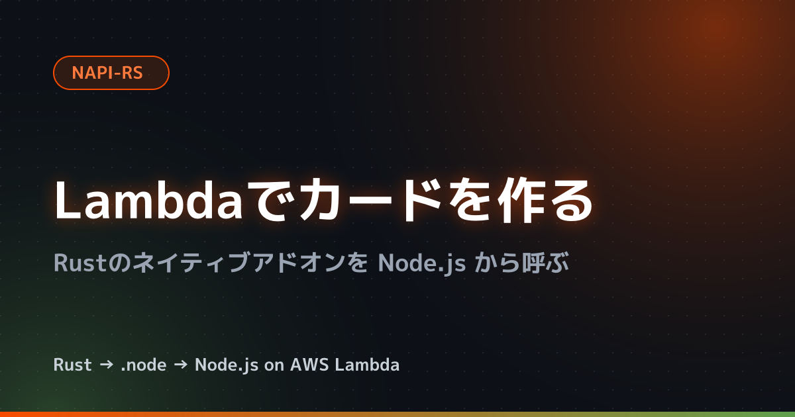

こんにちは、製造ビジネステクノロジー部のはすとです。

NAPI-RSは、RustでNode.jsのネイティブアドオンを作るための仕組みです。Rustのコードは事前に `.node` という共有ライブラリにコンパイルされ、Node.jsが `require()` で読み込みます。実行時にRustのツールチェーンは要らないため、LambdaのNode.jsランタイムでもそのまま使えるのでは？と気になりました。

本記事では、クライアントから受け取った文字を描いたカード画像（PNG）を作る処理をNAPI-RSで書き、LambdaのNode.jsランタイムから呼び出してみます。同じ処理をJavaScriptで書いた関数と、実行時間・コールドスタート・パッケージサイズも比べました。先に結論を書くと、呼び出すことはでき、画像の生成はRust版のほうが10倍以上速くなりました。ただし、CDKの `NodejsFunction` で何も設定せずにバンドルすると `.node` を扱えず、設定を足す必要がありました。

## 検証環境

2026年10月30日時点の環境です。

| 項目 | バージョン・設定 |
|---|---|
| 手元のマシン | Apple M4（macOS） |
| Docker | Colima（VMはUbuntu 24.04、aarch64） |
| Rust | 1.99.1 |
| napi / napi-derive（crate） | 3.15.0 / 3.6.13 |
| image / imageproc / ab_glyph（crate） | 0.25.10 / 0.27.0 / 0.2.32 |
| @napi-rs/cli | 3.10.9 |
| pureimage / pngjs | 0.4.20 / 7.0.0 |
| Lambdaのランタイム | `nodejs24.x`（Amazon Linux 2023） |
| aws-cdk-lib / esbuild | 2.275.0 / 0.28.2 |
| Lambdaの設定 | arm64、メモリ1769MB、タイムアウト30秒、東京リージョン |

アーキテクチャはarm64にしました。手元のMacもarm64のため、ビルドとLambdaのコンテナイメージでの動作確認を、エミュレーションなしでDockerの中で行えるためです。メモリは1769MBにしています。LambdaはメモリにあわせてCPUを割り当てるため、1vCPU分のCPUが割り当てられる値にしました。

> Lambda allocates CPU power in proportion to the amount of memory configured. (中略) At 1,769 MB, a function has the equivalent of one vCPU (one vCPU-second of credits per second).
> （和訳）Lambdaは、設定したメモリの量に比例してCPUの処理能力を割り当てます。（中略）1,769MBでは、関数には1vCPUに相当する処理能力（1秒あたり1vCPU秒のクレジット）が割り当てられます。

https://docs.aws.amazon.com/lambda/latest/dg/configuration-memory.html

検証に使ったコードは以下のリポジトリにまとめています。

<!-- TODO: GitHub に push したら URL を入れる（ローカル: ~/ghq/github.com/HasutoSasaki/napi-rs-lambda-bench） -->

## 作るカード画像

OSSのリポジトリのサムネイルのような、1200×630のカードを作ります。Lambdaに渡したタイトルとサブタイトルを、暗い背景に描きます。

```json:scripts/event.json
{ "title": "Lambdaでカードを作る", "name": "Rustのネイティブアドオンを Node.js から呼ぶ" }
```

Rust版で作ったカードです。JavaScript版でも同じ見た目になりました。



処理は次の4つの工程に分け、工程ごとの時間も測ります。

| 工程 | 内容 | 書き方 |
|---|---|---|
| 背景 | 画素ごとに色を計算して、点の格子、右上と左下の光、角丸のバッジ、下端の線を塗る | Rust版・JavaScript版とも同じ手順を手書き |
| 光彩 | タイトルを別の画像に描き、ぼかしてからオレンジ色で背景に重ねる | ぼかしと重ね合わせは同じ手順を手書き。文字を描くのはライブラリ |
| 文字 | タイトルやバッジの文字を描く | ライブラリ |
| PNG変換 | 画像をPNGに変換する | ライブラリ |

ライブラリは、Rust版が image・imageproc・ab_glyph、JavaScript版が pureimage・pngjs です。光彩のぼかしは、上下左右12画素の平均を取る処理を3回くり返します。Rust版の手書きの部分は、たとえば次のとおりです。

```rust:native/src/lib.rs（抜粋）
// 左右 GLOW_RADIUS 画素の平均を取る
fn blur_horizontal(src: &[u8]) -> Vec<u8> {
  let (w, h) = (WIDTH as i32, HEIGHT as i32);
  let mut dst = vec![0u8; src.len()];
  for y in 0..h {
    for x in 0..w {
      let mut sum = 0u32;
      for k in -GLOW_RADIUS..=GLOW_RADIUS {
        let xx = (x + k).clamp(0, w - 1);
        sum += src[(y * w + xx) as usize] as u32;
      }
      dst[(y * w + x) as usize] = (sum / (GLOW_RADIUS as u32 * 2 + 1)) as u8;
    }
  }
  dst
}
```

JavaScript版も同じ手順で書いています。

```js:lambda/card.mjs（抜粋）
// 左右 GLOW_RADIUS 画素の平均を取る
function blurHorizontal(src) {
  const dst = new Uint8Array(src.length)
  for (let y = 0; y < HEIGHT; y++) {
    for (let x = 0; x < WIDTH; x++) {
      let sum = 0
      for (let k = -GLOW_RADIUS; k <= GLOW_RADIUS; k++) {
        const xx = Math.min(WIDTH - 1, Math.max(0, x + k))
        sum += src[y * WIDTH + xx]
      }
      dst[y * WIDTH + x] = Math.floor(sum / (GLOW_RADIUS * 2 + 1))
    }
  }
  return dst
}
```

背景の光や角丸のバッジも、画素ごとに中心からの距離を計算して色を混ぜる処理を、両方で同じように書いています。

Rust版は、フォントを持つ `CardRenderer` というクラスとして公開しました。`#[napi]` を付けた構造体とメソッドが、JavaScriptから使えるクラスになります。フォントの読み込みはどちらの版もモジュールの読み込み時に1回だけ行い、リクエストごとには `render()` だけを呼びます。

```rust:native/src/lib.rs（抜粋）
#[napi]
pub struct CardRenderer {
  font: FontVec,
}

#[napi]
impl CardRenderer {
  #[napi(constructor)]
  pub fn new(font: Buffer) -> napi::Result<Self> {
    let font = FontVec::try_from_vec(font.to_vec()).map_err(|e| napi::Error::from_reason(e.to_string()))?;
    Ok(Self { font })
  }

  #[napi]
  pub fn render(&self, title: String, name: String) -> napi::Result<Card> {
    // 背景・光彩・文字・PNG変換の順に処理し、PNG と工程ごとの時間を返す
  }
}
```

ビルドすると、NAPI-RSがTypeScriptの型定義も作ります。

```ts:native/index.d.ts（抜粋）
export declare class CardRenderer {
  constructor(font: Buffer)
  render(title: string, name: string): Card
}

export interface Card {
  png: Buffer
  timings: Timings
}
```

:::details Cargo.toml と package.json

```toml:native/Cargo.toml
[package]
name = "card"
version = "0.1.0"
edition = "2021"

[lib]
crate-type = ["cdylib"]

[dependencies]
ab_glyph = "0.2.32"
image = { version = "0.25.10", default-features = false, features = ["png"] }
imageproc = { version = "0.27.0", default-features = false, features = ["text"] }
napi = "3.15.0"
napi-derive = "3.6.13"

[build-dependencies]
napi-build = "2.6.0"

[profile.release]
lto = true
strip = "symbols"
```

`crate-type = ["cdylib"]` は、共有ライブラリとしてビルドする指定です。image と imageproc は既定の機能を外しています。既定の機能には複数のスレッドで処理する rayon が含まれていて、Rust版だけが複数のスレッドを使うと比べられなくなるためです。`cargo tree` で、rayon が依存に入っていないことを確かめました。

```json:native/package.json
{
  "name": "card",
  "version": "0.1.0",
  "private": true,
  "napi": {
    "binaryName": "card",
    "targets": ["aarch64-unknown-linux-gnu"]
  }
}
```

:::

### JavaScript版のフォント選びでつまずいた点

最初は Noto Sans JP（OTF）を使うつもりでした。ところが、JavaScript版の pureimage では日本語を描こうとするとエラーになり、英字も文字が重なって描かれました。pureimage は opentype.js の0.4系を中に取り込んでいて、このフォントの形式（CFF）をうまく扱えないようです（原因は詳しく確かめていません）。TrueType形式（TTF）のフォントでは正しく描けたため、M PLUS 1p（TTF）に変えました。

## Lambdaと同じAmazon Linux 2023でビルドする

LambdaはLinuxで動くため、`.node` もLinux向けにビルドする必要があります。もう1つ気をつけたいのがglibcのバージョンです。Linux向けの共有ライブラリは、ビルドした環境のglibcのバージョンに依存することがあり、Lambdaより新しいglibcの環境でビルドすると読み込めない可能性があります（今回は試していません）。

`nodejs24.x` ランタイムのOSはAmazon Linux 2023です。

https://docs.aws.amazon.com/lambda/latest/dg/lambda-runtimes.html

Lambdaのコンテナイメージで、glibcのバージョンを確かめます。

```bash
docker run --rm --platform linux/arm64 --entrypoint bash public.ecr.aws/lambda/nodejs:24 -c 'ldd --version | head -1'
```

実行結果です。

```text
ldd (GNU libc) 2.34
```

そこで、ビルドもAmazon Linux 2023のコンテナの中で行います。手元のMacにRustを入れずに済むのも利点です。

```dockerfile:docker/Dockerfile.build
# Lambda の Node.js 24 ランタイムと同じ Amazon Linux 2023（glibc 2.34）でビルドする
FROM amazonlinux:2023
RUN dnf install -y gcc nodejs24 tar gzip && dnf clean all
RUN curl --proto '=https' --tlsv1.2 -sSf https://sh.rustup.rs | sh -s -- -y --profile minimal
# AL2023 の nodejs24 には corepack が入っていないため、pnpm 単体のインストーラを使う
ENV PNPM_HOME="/root/.local/share/pnpm" SHELL="/bin/bash"
RUN curl -fsSL https://get.pnpm.io/install.sh | env PNPM_VERSION=12.15.0 sh -
ENV PATH="/root/.cargo/bin:${PNPM_HOME}/bin:${PATH}"
WORKDIR /work
```

イメージを作り、コンテナの中で `napi build` を実行します。`--platform` を付けると、出力するファイル名にプラットフォーム名が入ります。

```bash
docker build --platform linux/arm64 -f docker/Dockerfile.build -t napi-build docker
docker run --rm --platform linux/arm64 \
  -v "$PWD/native:/work" \
  -v napi-cargo-registry:/root/.cargo/registry \
  -v napi-target:/work/target \
  -v napi-pnpm-store:/root/.local/share/pnpm/store \
  napi-build pnpm --package=@napi-rs/cli@3.10.9 dlx napi build --platform --release
```

`native/` には次の3つのファイルができました。

```text
card.linux-arm64-gnu.node
index.d.ts
index.js
```

`.node` がどんなファイルかを `file` コマンドで見てみます。

```bash
file native/card.linux-arm64-gnu.node
```

実行結果です。

```text
native/card.linux-arm64-gnu.node: ELF 64-bit LSB shared object, ARM aarch64, version 1 (SYSV), dynamically linked, BuildID[sha1]=52f99ae0ae679e36e33cf89df867dcbe69eba632, stripped
```

拡張子は `.node` ですが、中身はarm64のLinux向けの共有ライブラリ（ELF）でした。このファイルが要求するglibcのバージョンも確かめます。`objdump -T` は、共有ライブラリが外部から使う関数とそのバージョンを一覧にします。ビルド用のコンテナで実行しました。

```bash
objdump -T card.linux-arm64-gnu.node | grep -o "GLIBC_[0-9.]*" | sort -uV | tail -1
```

実行結果です。

```text
GLIBC_2.34
```

要求するバージョンは最大で2.34で、Lambdaのglibcと一致しています。

もう1つの `index.js` は、NAPI-RSが生成した読み込み用のコードです。実行中のOSやCPUを見て、読み込む `.node` を選びます。linuxでarm64の場合は、以下の部分を通ります（抜粋）。

```js:native/index.js
          return require('./card.linux-arm64-gnu.node')
```

## Lambdaのコンテナイメージで動かしてみる

デプロイの前に、Lambdaのコンテナイメージの中で動くかを確かめます。ハンドラ（Lambdaが呼び出す関数）は、カードを作るのにかかった時間を `performance.now()` で測り、PNGと一緒に返します。後で計測値のばらつきを見るため、どのCPUで動いたかも返すようにしました。

```js:lambda/rust-handler.mjs
import { readFileSync } from 'node:fs'
import { fileURLToPath } from 'node:url'
import { CardRenderer } from '../native/index.js'
import { cpuInfo } from './cpu.mjs'

// Lambda ではバンドルした index.mjs と同じ場所にフォントを置く
const fontPath = process.env.FONT_PATH ?? fileURLToPath(new URL('./MPLUS1p-Bold.ttf', import.meta.url))
const renderer = new CardRenderer(readFileSync(fontPath))
const cpu = cpuInfo()

export const handler = async (event) => {
  const start = performance.now()
  const { png, timings } = renderer.render(event.title, event.name)
  const ms = performance.now() - start
  return { impl: 'rust', ms, timings, bytes: png.length, cpu: cpu.part, png: png.toString('base64') }
}
```

JavaScript版のハンドラは、`./card.mjs` の `createRenderer(fontPath)` で作ったものを使い、`impl` を `'js'` にしています。

:::details lambda/js-handler.mjs と lambda/cpu.mjs

```js:lambda/js-handler.mjs
import { fileURLToPath } from 'node:url'
import { createRenderer } from './card.mjs'
import { cpuInfo } from './cpu.mjs'

// Lambda ではバンドルした index.mjs と同じ場所にフォントを置く
const fontPath = process.env.FONT_PATH ?? fileURLToPath(new URL('./MPLUS1p-Bold.ttf', import.meta.url))
const renderer = createRenderer(fontPath)
const cpu = cpuInfo()

export const handler = async (event) => {
  const start = performance.now()
  const { png, timings } = renderer.render(event.title, event.name)
  const ms = performance.now() - start
  return { impl: 'js', ms, timings, bytes: png.length, cpu: cpu.part, png: png.toString('base64') }
}
```

```js:lambda/cpu.mjs
import { readFileSync } from 'node:fs'

// どの CPU で動いたかを見分けるため、/proc/cpuinfo の 1 つ目の CPU の値を読む
export function cpuInfo() {
  const lines = readFileSync('/proc/cpuinfo', 'utf8').split('\n')
  const pick = (key) => lines.find((line) => line.startsWith(key))?.split(':')[1]?.trim()
  return { part: pick('CPU part'), features: pick('Features') }
}
```

:::

両方のハンドラを5回ずつ呼ぶスクリプトを用意しました。

```js:scripts/local.mjs
// Lambda の Node.js 24 イメージの中で、両方のハンドラを 5 回ずつ呼ぶ
import { handler as jsHandler } from '../lambda/js-handler.mjs'
import { handler as rustHandler } from '../lambda/rust-handler.mjs'

const event = { title: 'Lambdaでカードを作る', name: 'Rustのネイティブアドオンを Node.js から呼ぶ' }

for (let i = 0; i < 5; i++) {
  for (const handler of [jsHandler, rustHandler]) {
    const { png, ...result } = await handler(event)
    console.log(JSON.stringify(result))
  }
}
```

```bash
docker run --rm --platform linux/arm64 -v "$PWD:/var/task:ro" \
  -e FONT_PATH=/var/task/fonts/MPLUS1p-Bold.ttf \
  --entrypoint node public.ecr.aws/lambda/nodejs:24 /var/task/scripts/local.mjs
```

実行結果です（3回目の2行）。

```text
{"impl":"js","ms":297.0347670000001,"timings":{"background":95.71515,"glow":158.62330400000008,"text":7.7458939999999075,"encode":34.932335999999964},"bytes":165722,"cpu":"0x000"}
{"impl":"rust","ms":18.933046999999988,"timings":{"background":3.1839250000000003,"glow":12.990573,"text":0.363251,"encode":2.370297},"bytes":218955,"cpu":"0x000"}
```

Lambdaと同じイメージの中で `.node` を読み込めて、両方ともカードを返しました。5回の中央値は、JavaScript版が313.4ms、Rust版が21.6msで、手元ではRust版のほうが約14倍速い結果でした。

## NodejsFunctionでそのままバンドルすると失敗する

デプロイにはCDKの `NodejsFunction` を使います。`NodejsFunction` は、esbuildでハンドラのコードと依存するモジュールを1つのファイルにまとめてからLambdaに上げます。まずは何も設定せずに書いてみます。

```ts:lib/bench-stack.ts
const common = {
  runtime: Runtime.NODEJS_24_X,
  architecture: Architecture.ARM_64,
  memorySize: 1769,
  timeout: Duration.seconds(30),
}

new NodejsFunction(this, 'RustFunction', {
  ...common,
  functionName: 'napi-bench-rust',
  entry: 'lambda/rust-handler.mjs',
  bundling: { format: OutputFormat.ESM },
})
```

`cdk synth` を実行してみます。

```bash
pnpm cdk synth
```

バンドルの時点で失敗しました。

```text
✘ [ERROR] No loader is configured for ".node" files: native/card.linux-arm64-gnu.node

    native/index.js:350:25:
      350 │           return require('./card.linux-arm64-gnu.node')
          ╵                          ~~~~~~~~~~~~~~~~~~~~~~~~~~~~~
```

esbuildは、`require()` で読み込まれるファイルをすべてバンドルに取り込もうとします。`.node` をどう扱うかが決まっていないため、エラーになりました。

### loaderにfileを指定すると、パスの文字列になる

esbuildには、ファイルをそのまま出力先にコピーする `file` というローダーがあります。`.node` にこれを指定すれば良さそうに見えます。

```ts:lib/bench-stack.ts
bundling: {
  format: OutputFormat.ESM,
  loader: { '.node': 'file' },
},
```

バンドルは成功し、出力先に `.node` もコピーされました。ところが、Lambdaのコンテナイメージで呼び出すと、次のエラーで止まりました。

```text
Error: Dynamic require of "fs" is not supported
```

ESM（`OutputFormat.ESM`）で出力すると、`index.js` の中の `require('fs')` が動きません。ESMには `require` が無いためです。esbuildの `banner` で、`createRequire()` から `require` を作っておきます。

```ts:lib/bench-stack.ts
bundling: {
  format: OutputFormat.ESM,
  loader: { '.node': 'file' },
  banner: "import { createRequire } from 'node:module'; const require = createRequire(import.meta.url);",
},
```

もう一度呼び出すと、今度は別のエラーになりました。

```text
TypeError: Cannot create property 'CardRenderer' on string './card.linux-arm64-gnu-DL557DWB.node'
```

`file` ローダーは、ファイルをコピーしたうえで、`require()` の結果をコピー先のパスの文字列に置き換えます。バンドルの中を見ると、次のようになっていました。

```js
// native/card.linux-arm64-gnu.node
var require_card_linux_arm64_gnu = __commonJS({
  "native/card.linux-arm64-gnu.node"(exports, module) {
    module.exports = "./card.linux-arm64-gnu-DL557DWB.node";
  }
});
```

`index.js` はネイティブアドオンを受け取るつもりで `require()` していますが、実際に返ってくるのはパスの文字列です。そのため、文字列に `CardRenderer` を足そうとして失敗しました。

### .nodeをバンドルの外に置いてコピーする

`.node` はバンドルに取り込まず、`require('./card.linux-arm64-gnu.node')` をそのまま残します。`externalModules` に指定したものは、esbuildがバンドルせずに残します。`externalModules` を指定すると既定値の `@aws-sdk/*` が上書きされるため、あわせて書いておきます。

ファイルそのものは、`commandHooks` の `afterBundling` で出力先にコピーします。`afterBundling` は、バンドルが終わった後に実行するコマンドを返す関数です。フォントも同じようにコピーします。

```ts:lib/bench-stack.ts
new NodejsFunction(this, 'RustFunction', {
  ...common,
  functionName: 'napi-bench-rust',
  entry: 'lambda/rust-handler.mjs',
  bundling: {
    format: OutputFormat.ESM,
    // ESM の出力では require が無いため、index.js の require('fs') などが動くように用意する
    banner: "import { createRequire } from 'node:module'; const require = createRequire(import.meta.url);",
    // .node はバンドルせず require のまま残す
    externalModules: ['@aws-sdk/*', '*.node'],
    commandHooks: {
      beforeBundling: () => [],
      beforeInstall: () => [],
      // index.mjs と同じ場所に .node とフォントをコピーする
      afterBundling: (inputDir, outputDir) => [
        `cp ${inputDir}/native/card.linux-arm64-gnu.node ${outputDir}/`,
        `cp ${inputDir}/fonts/MPLUS1p-Bold.ttf ${outputDir}/`,
      ],
    },
  },
})
```

バンドルの結果は、次の3つのファイルになりました。

```text
-rw-r--r--  1766552 MPLUS1p-Bold.ttf
-rwxr-xr-x   792744 card.linux-arm64-gnu.node
-rw-r--r--    35700 index.mjs
```

`createRequire(import.meta.url)` で作った `require` は、`index.mjs` の場所を基準にファイルを探します。そのため、同じ場所に置いた `.node` を読み込めます。

なお、`banner` はJavaScript版にも必要でした。pureimage や pngjs の中にも `require()` があり、付けずにバンドルすると `Dynamic require of "util" is not supported` で止まりました。JavaScript版の `NodejsFunction` には、`banner` とフォントのコピーだけを書いています。

`NodejsFunction` のドキュメントには、ネイティブの依存を含むモジュールは `nodeModules` に指定する方法も書かれています。こちらは `package.json` の依存として入れたパッケージを `node_modules` ごと含める方法で、今回のようにリポジトリの中でビルドした `.node` を使う構成では試していません。

https://docs.aws.amazon.com/cdk/api/v2/docs/aws-cdk-lib.aws_lambda_nodejs-readme.html

:::details bin/app.ts

```ts:bin/app.ts
import { App } from 'aws-cdk-lib'
import { BenchStack } from '../lib/bench-stack.ts'

const app = new App()
new BenchStack(app, 'NapiRsLambdaBench', {
  env: { region: 'ap-northeast-1' },
})
```

:::

## Lambdaで計測する

`pnpm cdk deploy` でデプロイし、JavaScript版（`napi-bench-js`）とRust版（`napi-bench-rust`）を計測しました。結果は `results/` にファイルとして残し、中央値は `python3 scripts/summarize.py` で出しています。手元の値も同じスクリプトで出しました。

### 同じ実行環境で続けて呼ぶ

Lambdaは、一度作った実行環境を次のリクエストでも使います。続けて呼び出せば、同じ実行環境で何回か測れます。次のスクリプトで、10回ずつ呼び出しました。

```bash:scripts/warm.sh
#!/usr/bin/env bash
# 同じ実行環境に続けてリクエストを送り、ハンドラ内の計算時間と REPORT 行を表示する
# 使い方: scripts/warm.sh <関数名> <回数>
set -euo pipefail
fn=$1
count=$2
for i in $(seq 1 "$count"); do
  aws lambda invoke --function-name "$fn" \
    --cli-binary-format raw-in-base64-out --payload file://scripts/event.json \
    --log-type Tail --query LogResult --output text /tmp/napi-bench-out.json \
    | base64 --decode | grep REPORT
  # PNG の base64 は長いため、結果からは除く
  jq -c 'del(.png)' /tmp/napi-bench-out.json
done
```

```bash
scripts/warm.sh napi-bench-rust 10
```

実行結果です（先頭の1回分）。

```text
REPORT RequestId: 85ef33ab-5b6e-407a-a537-738bb680b56f	Duration: 89.54 ms	Billed Duration: 90 ms	Memory Size: 1769 MB	Max Memory Used: 89 MB
{"impl":"rust","ms":76.23524899996119,"timings":{"background":17.768665,"glow":49.628906,"text":1.272664,"encode":7.459782},"bytes":218955,"cpu":"0xd0c"}
```

10回の中央値は次のとおりです（単位はms）。

| | CPU part | 合計 | 背景 | 光彩 | 文字 | PNG変換 |
|---|---|---|---|---|---|---|
| JavaScript版 | `0xd40` | 893.5 | 348.4 | 400.5 | 31.1 | 107.9 |
| Rust版 | `0xd0c` | 74.5 | 17.0 | 48.7 | 1.3 | 7.4 |

合計で約12倍の差が出ました。2つの関数は別の種類のCPU（`CPU part` の値は後で説明します）で動いていましたが、同じCPUどうしで比べたコールドスタートの計測でも、大きな差が出ています。

JavaScript版で時間がかかっているのは、手書きした背景と光彩の工程です。同じ手順をそのまま書いた部分で、背景は約20倍、光彩は約8倍の差になりました。PNG変換も大きな差に見えますが、ここは2つのライブラリの設定が違います。pngjs は圧縮の強さを最大（`deflateLevel` の既定値が9）にしていて、Rustの image は速さを優先する `Fast` が既定値です。そのため、PNGのサイズもJavaScript版が165,722バイト、Rust版が218,955バイトと違っていて、PNG変換の時間はそのまま比べられません。なお、pngjs の圧縮そのものは、Node.jsに組み込まれた `zlib` モジュールを呼んでいます。

### コールドスタート

コールドスタートは、Lambdaが新しく実行環境を作ってから処理するまでの時間です。REPORT行の `Init Duration` が、実行環境の初期化（ハンドラのファイルの読み込みと、フォントの読み込みを含む）にかかった時間です。関数の設定を変えると、次のリクエストでは新しい実行環境が作られます。そこで、環境変数を毎回書き換えてから呼び出しました。

```bash:scripts/cold.sh
#!/usr/bin/env bash
# 環境変数を書き換えて実行環境を作り直させ、コールドスタートの REPORT 行を表示する
# 使い方: scripts/cold.sh <関数名> <回数>
set -euo pipefail
fn=$1
count=$2
for i in $(seq 1 "$count"); do
  aws lambda update-function-configuration --function-name "$fn" \
    --environment "Variables={COLD_RUN=$i}" --query LastUpdateStatus --output text >/dev/null
  aws lambda wait function-updated --function-name "$fn"
  aws lambda invoke --function-name "$fn" \
    --cli-binary-format raw-in-base64-out --payload file://scripts/event.json \
    --log-type Tail --query LogResult --output text /tmp/napi-bench-out.json \
    | base64 --decode | grep REPORT
  # PNG の base64 は長いため、結果からは除く
  jq -c 'del(.png)' /tmp/napi-bench-out.json
done
```

```bash
scripts/cold.sh napi-bench-js 10
```

実行結果です（先頭の1回分）。

```text
REPORT RequestId: ee9aead2-ae21-4c9b-8b13-ff1fb26956d6	Duration: 1722.64 ms	Billed Duration: 2090 ms	Memory Size: 1769 MB	Max Memory Used: 150 MB	Init Duration: 366.74 ms
{"impl":"js","ms":1706.4912960000001,"timings":{"background":611.597546,"glow":803.034657,"text":69.41714000000002,"encode":222.1172019999999},"bytes":165722,"cpu":"0xd0c"}
```

10回のうち、`CPU part` が違うCPUが混ざっていたため、CPUごとに中央値を出しました（単位はms）。

| CPU part | 関数 | 回数 | Init Duration | 合計 | 背景 | 光彩 |
|---|---|---|---|---|---|---|
| `0xd0c` | JavaScript版 | 3 | 346.2 | 1610.4 | 542.4 | 800.4 |
| `0xd0c` | Rust版 | 8 | 171.5 | 77.8 | 18.8 | 50.1 |
| `0xd40` | JavaScript版 | 7 | 252.9 | 1270.5 | 480.4 | 557.7 |
| `0xd40` | Rust版 | 2 | 132.6 | 62.1 | 11.5 | 44.6 |

同じCPUどうしで比べると、カードの生成はRust版が約20倍速くなりました。JavaScript版は、続けて呼んだ場合（`0xd40` で893.5ms）より1回目のほうが遅くなっています。一方で、Rust版は1回目でも続けて呼んだ場合とほぼ同じ時間でした。

`Init Duration` も、Rust版のほうが短くなりました。`.node` を読み込む分だけRust版のほうが長くなると思っていましたが、実際にはJavaScript版のほうが120ms以上長くかかっています。どの処理に時間がかかっているかは確かめていません。

また、JavaScript版の1回目の `Billed Duration`（2090ms）は、`Duration` と `Init Duration` を足した値になっていました。コールドスタートの時間も、そのまま料金に関わります。

`CPU part` の値は、Armのコアの種類を表します。Linuxのカーネルのソース（`arch/arm64/include/asm/cputype.h`）では、`0xd0c` はNeoverse N1、`0xd40` はNeoverse V1と定義されています。AWSのGraviton向けのガイドによると、それぞれGraviton2、Graviton3のコアです。Lambdaのドキュメントにも、arm64の関数はGravitonの異なる世代で動くことがあると書かれています。

> Lambda manages the underlying hardware and does not guarantee a specific processor generation: your function might run on different generations of the Graviton processor depending on regional hardware availability.
> （和訳）Lambdaは基盤となるハードウェアを管理しており、特定のプロセッサの世代を保証しません。関数は、リージョンでのハードウェアの空き状況に応じて、Gravitonの異なる世代で実行されることがあります。

https://docs.aws.amazon.com/lambda/latest/dg/foundation-arch.html#foundation-arch-adv

### メモリとパッケージサイズ

REPORT行の `Max Memory Used` は、JavaScript版が137〜173MB、Rust版が85〜91MBでした。

デプロイしたパッケージ（zip）のサイズは、`get-function` で確かめます。

```bash
aws lambda get-function --function-name napi-bench-rust --query 'Configuration.{FunctionName:FunctionName,CodeSize:CodeSize}'
```

| 関数 | CodeSize | 中身 |
|---|---|---|
| JavaScript版 | 1,137,105バイト | フォント、pureimage と pngjs を含む `index.mjs`（322KB） |
| Rust版 | 1,431,135バイト | フォント、`.node`（793KB）、`index.mjs`（36KB） |

どちらもフォント（1.77MB）が大きな割合を占めていて、Rust版は `.node` の分だけ大きくなりました。

## まとめ

NAPI-RSで作ったRustのネイティブアドオンは、Amazon Linux 2023でビルドすれば、LambdaのNode.jsランタイムからそのまま呼び出せました。`NodejsFunction` を使う場合は、`.node` を `externalModules` でバンドルの外に出し、`afterBundling` でコピーする必要があります。ESMで出力するなら、`banner` で `require` を用意することも必要でした。

カード画像の生成では、Rust版のほうが続けて呼んだ場合で約12倍、1回目では約20倍速くなりました。`.node` を読み込む分だけコールドスタートが遅くなると思っていましたが、今回はRust版のほうが短かったのが意外でした。パッケージは `.node` の分だけ大きくなります。

関数全体をRustで書き、`provided.al2023` ランタイムで動かす方法もあります。こちらとの比較は試していないため、機会があれば試してみたいと思います。Node.jsのLambdaのまま、重い処理だけを速くしたいと考えている方の参考になれば嬉しいです。

## 参考

- [NAPI-RS](https://napi.rs/)
- [Lambda runtimes - AWS Lambda](https://docs.aws.amazon.com/lambda/latest/dg/lambda-runtimes.html)
- [Selecting and configuring an instruction set architecture for your Lambda function - AWS Lambda](https://docs.aws.amazon.com/lambda/latest/dg/foundation-arch.html)
- [Configure Lambda function memory - AWS Lambda](https://docs.aws.amazon.com/lambda/latest/dg/configuration-memory.html)
- [aws-cdk-lib.aws_lambda_nodejs module - AWS CDK](https://docs.aws.amazon.com/cdk/api/v2/docs/aws-cdk-lib.aws_lambda_nodejs-readme.html)
- [esbuild - Content Types (file)](https://esbuild.github.io/content-types/#file)
- [aws-graviton-getting-started - GitHub](https://github.com/aws/aws-graviton-getting-started)
- [arch/arm64/include/asm/cputype.h - Linux](https://github.com/torvalds/linux/blob/master/arch/arm64/include/asm/cputype.h)
- [M PLUS 1p - Google Fonts](https://fonts.google.com/specimen/M+PLUS+1p)
