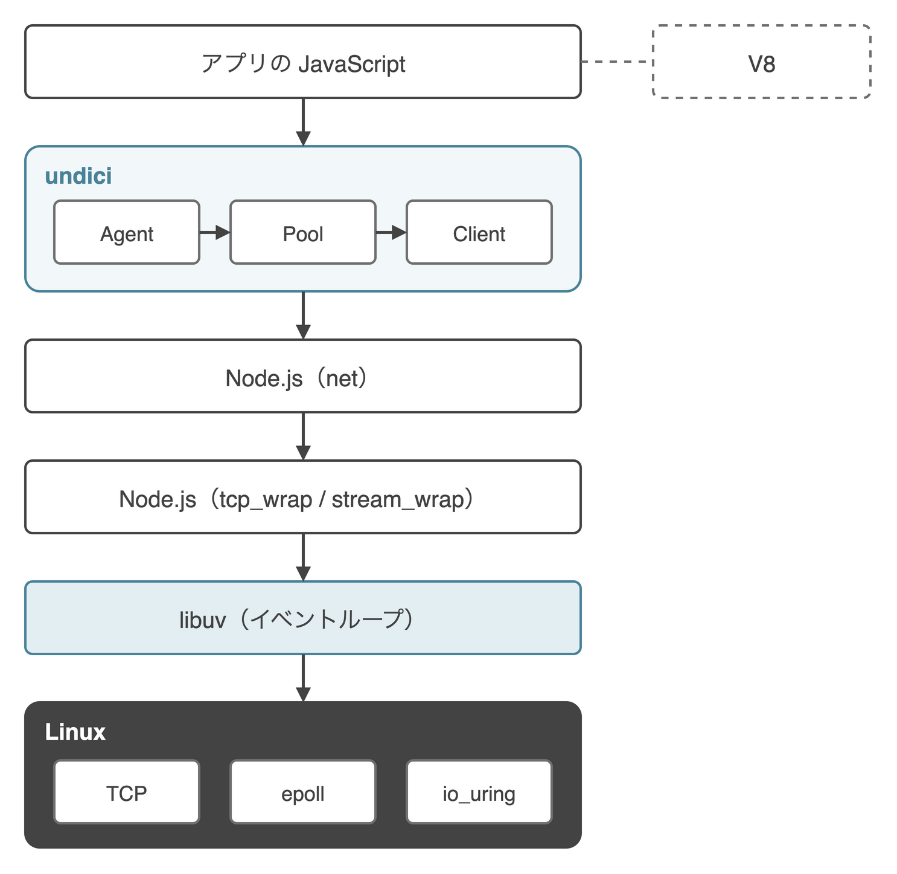
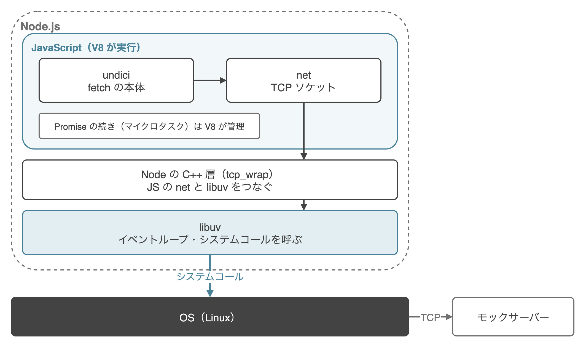
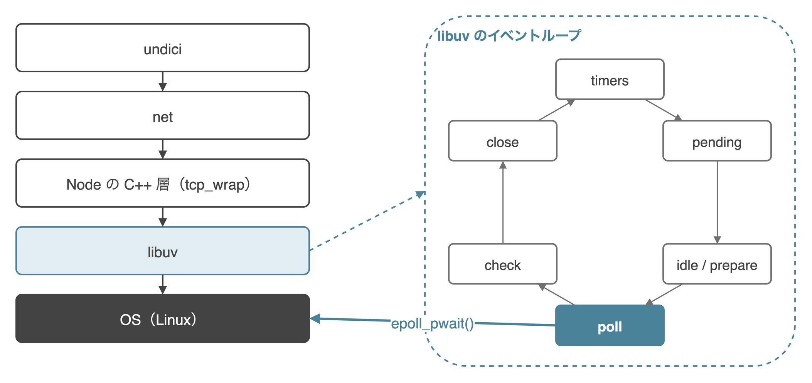

こんにちは、製造ビジネステクノロジー部のはすとです。

これまで[Node.jsのfetch()がOSへI/Oを依頼するところをstraceで覗いてみた](/articles/nodejs-fetch-strace)などの記事で、`fetch()`を呼ぶと最後はLinuxの`epoll_pwait()`で待っていることを確認してきました。ただ、`fetch()`の本体であるundici、Node.jsの`net`モジュール、libuv、OSのうち、どこまでが何の担当で、どう受け渡しているのかは曖昧なままでした。

本記事では、`fetch()`を1本呼んだときと、`Promise.all()`で2本呼んだときについて、ソースの行とstraceのログの行を対応させながら、各層の担当を整理してみます。

## 先に結論

`fetch()`に関わる要素を図にすると、次のとおりです。



`fetch()`を1本呼んだときの各層の担当は、次のとおりでした。

| 層 | 担当 | この記事で見る箇所 |
|---|---|---|
| V8 | Promiseとマイクロタスクのキュー | `await`の続きの実行 |
| undici | `fetch()`の本体。Agent → Pool → Clientと渡し、HTTPの文字列を組み立てて書き、応答を解析する | `dispatch`、`net.connect()`、`socket.write()` |
| Node.js（JS） | `net.connect()`でソケットを作る準備をし、C++の層を呼ぶ | `lookupAndConnect`、`internalConnect` |
| Node.js（C++） | JSからの依頼をlibuvの関数に渡す | `tcp_wrap`、`stream_wrap` |
| libuv | ソケットのシステムコールを出し、イベントループで`epoll_pwait()`を呼んで待つ | `uv__tcp_connect`、`uv__io_poll`、`uv__stream_io` |
| OS（Linux） | TCPの接続と送受信、`epoll`での待機 | `socket()`、`connect()`、`epoll_pwait()` |

`Promise.all()`で2本呼ぶと、undiciのPoolが接続を2つ作るため、ソケットが2本になります。2本の`connect()`はどちらもイベントループの同じ1周のうちに出て、epollへの登録も、接続の完了の受け取りも1回にまとまっていました。

また、今回のlibuv 1.51.0では、epollへの登録（ADDとMOD）は`epoll_ctl()`のシステムコールではなく、io_uringを使って`epoll_pwait()`の直前にまとめて送られていました。

## 検証環境

Vue Fes Japan 2026の登壇に向けた検証と同じく、Node.js 22のDebianのイメージにstraceを入れて使いました。`node:22-bookworm`のタグは中身が更新されていくため、ここでは、ログを取ったイメージと同じ版に固定したDockerfileを載せます。

```dockerfile:Dockerfile
FROM node:22.23.3-bookworm
RUN apt-get update \
 && apt-get install -y --no-install-recommends strace \
 && rm -rf /var/lib/apt/lists/*
WORKDIR /work
```

```bash
docker build -t node22-strace .
docker run --rm -it --cap-add SYS_PTRACE --security-opt seccomp=unconfined \
  -v "$PWD:/work" node22-strace bash
```

コンテナの中で確認したバージョンです。

```text
Linux 6.8.0-64-generic aarch64
v22.23.3
uv 1.51.0 undici 6.28.1 v8 12.4.254.21-node.57
strace -- version 6.1
```

macOS上のColima（Ubuntu 24.04のVM）で動かしています。`strace`にはptraceの権限が必要なため、`--cap-add SYS_PTRACE --security-opt seccomp=unconfined`を付けてコンテナを起動しました。

通信先には、`127.0.0.1:3000`で待ち受けて300ミリ秒後に応答するモックサーバーを使います。モックサーバーは`strace`の対象にはしません。

```js:mock.mjs
import http from 'node:http';
const server = http.createServer((req, res) => {
  setTimeout(() => {
    res.writeHead(200, { 'content-type': 'text/plain' });
    res.end(`ok ${req.url}`);
  }, 300);
});
server.listen(3000, '127.0.0.1', () => console.log('mock listening on 3000'));
```

`fetch()`を1本呼ぶスクリプトです。`await`の前後で`MARK A`と`MARK B`を標準出力に書いています。

```js:fetch.mjs
process.stdout.write('MARK A\n');
const res = await fetch('http://127.0.0.1:3000/a');
await res.text();
process.stdout.write('MARK B\n');
```

`strace`は次のように指定しました。今回はepollへの登録を見るため、`epoll_ctl`と`io_uring_enter`、通知に使われる`eventfd2`も含めています。

```bash
node mock.mjs &
TR="strace -f -tt -T -e trace=prctl,eventfd2,pipe2,epoll_create1,epoll_ctl,epoll_pwait,io_uring_setup,io_uring_enter,socket,connect,write,writev,read"
$TR -o fetch.log node fetch.mjs
$TR -o parallel.log node parallel.mjs
$TR -o serial.log node serial.mjs
```

## 登場する層とそれぞれの担当

`fetch()`を呼んでから`epoll_pwait()`で待つまでに、処理は次の順に渡っていきます。



`fetch()`の本体はundiciで、`lib/web/fetch/index.js`がグローバルなAgentに`dispatch`しています（[370行目](https://github.com/nodejs/undici/blob/v6.28.1/lib/web/fetch/index.js#L370)、[2065行目](https://github.com/nodejs/undici/blob/v6.28.1/lib/web/fetch/index.js#L2065)）。Agentは接続先ごとのPoolに、PoolはClientに依頼を渡し、Clientが接続とHTTPの読み書きを担当します。

一方で、`await`の続きを管理しているのはV8です。Node.jsのドキュメントには、次のように書かれています（[globals.md](https://github.com/nodejs/node/blob/v22.23.3/doc/api/globals.md)）。

> The microtask queue is managed by V8

和訳すると「マイクロタスクのキューはV8が管理している」です。`await`はV8の中で続きを予約するだけで、OSに何かを依頼するのはlibuvのシステムコールです。

## fetch 1本がepoll_pwaitに届くまで

### undiciがnet.connect()を呼ぶまで

undiciのPoolは、空いているClientがあればそれを使い、なければ新しいClientを作ります（[lib/dispatcher/pool.js 92〜99行目](https://github.com/nodejs/undici/blob/v6.28.1/lib/dispatcher/pool.js#L92-L99)）。

```js:undici lib/dispatcher/pool.js
  [kGetDispatcher] () {
    for (const client of this[kClients]) {
      if (!client[kNeedDrain]) {
        return client
      }
    }

    if (!this[kConnections] || this[kClients].length < this[kConnections]) {
```

ここで作ったClientが接続するときに、`lib/core/connect.js`で`net.connect()`を呼びます（[126行目](https://github.com/nodejs/undici/blob/v6.28.1/lib/core/connect.js#L126)）。ここからはNode.jsの`net`モジュールの話です。

### net.connectからsocket()とconnect()まで

Node.jsの`net.connect()`は`lookupAndConnect`に進みます（[lib/net.js 1311行目](https://github.com/nodejs/node/blob/v22.23.3/lib/net.js#L1311)）。接続先がIPアドレスのときは名前解決を飛ばし、`process.nextTick`で`internalConnect`を呼びます。`internalConnect`が呼ぶ`_handle.connect()`の`_handle`は、C++で書かれた`tcp_wrap`です（[lib/net.js 71行目](https://github.com/nodejs/node/blob/v22.23.3/lib/net.js#L71)）。

`tcp_wrap`は、libuvの`uv_tcp_connect`を呼びます（[src/tcp_wrap.cc 339行目](https://github.com/nodejs/node/blob/v22.23.3/src/tcp_wrap.cc#L339)）。ここからはlibuvの中の話です。

libuvの`uv__tcp_connect`は、ソケットを作り、`connect()`を呼び、書き込めるようになるのを待つ監視を登録します（[src/unix/tcp.c 277〜343行目](https://github.com/libuv/libuv/blob/v1.51.0/src/unix/tcp.c#L277-L343)）。

```c:libuv src/unix/tcp.c（抜粋）
    r = connect(uv__stream_fd(handle), addr, addrlen);
  /* 中略 */
  uv__io_start(handle->loop, &handle->io_watcher, POLLOUT);
```

ソケットはノンブロッキングのため、`connect()`は接続の完了を待たずに`EINPROGRESS`で戻ります。ログでも、`socket()`の直後に`connect()`が`EINPROGRESS`で返っていました。

左端の数字はスレッドのIDです。ここからのログは、時刻を省き、本文で触れる行だけを抜き出しています。長い引数は`...`で省き、途中で中断された（`<unfinished ...>`）行は結果とまとめて1行にしています。

```text:fetch.log
20 socket(AF_INET, SOCK_STREAM|SOCK_CLOEXEC|SOCK_NONBLOCK, IPPROTO_IP) = 21
20 connect(21, {... 127.0.0.1:3000 ...}) = -1 EINPROGRESS (Operation now in progress)
```

`socket()`と`connect()`を出しているのは、`MARK A`を書いたスレッド（20）と同じスレッドです。JavaScriptを動かしているメインスレッドが、そのままシステムコールを出しています。

### epollへの登録は、io_uringでまとめて送られる

`uv__io_start`は、監視を`watcher_queue`に積むだけで、その場ではepollに登録しません（[src/unix/core.c 939〜940行目](https://github.com/libuv/libuv/blob/v1.51.0/src/unix/core.c#L939-L940)）。登録は、次にイベントループが待ちに入る`uv__io_poll`でまとめて行われます。

ところが、今回のログには`epoll_ctl(…, EPOLL_CTL_ADD, …)`が1行も出ていませんでした。`epoll_ctl`として出ていたのは、最後にソケットを閉じるときの`EPOLL_CTL_DEL`だけです。代わりに、`connect()`の直後に`io_uring_enter()`が出ています。

```text:fetch.log
20 connect(21, {... 127.0.0.1:3000 ...}) = -1 EINPROGRESS (Operation now in progress)
20 io_uring_enter(16, 3, 3, IORING_ENTER_GETEVENTS, NULL, 0) = 3
20 epoll_pwait(15, [{events=EPOLLIN, data={u32=19, u64=19}}, {events=EPOLLOUT, data={u32=21, u64=21}}], 1024, 0, NULL, 8) = 2
```

libuv 1.51.0の`uv__io_poll`を読むと、`watcher_queue`に積まれた監視を、io_uringの`IORING_OP_EPOLL_CTL`として積んでいました（[src/unix/linux.c 1406〜1422行目](https://github.com/libuv/libuv/blob/v1.51.0/src/unix/linux.c#L1406-L1422)）。積んだ分は`epoll_pwait()`の直前に`io_uring_enter()`でまとめて送られます（[1450〜1451行目](https://github.com/libuv/libuv/blob/v1.51.0/src/unix/linux.c#L1450-L1451)、`epoll_pwait()`は[1465行目](https://github.com/libuv/libuv/blob/v1.51.0/src/unix/linux.c#L1465)）。

```c:libuv src/unix/linux.c（抜粋）
    if (ctl->ringfd != -1) {
      uv__epoll_ctl_prep(epollfd, ctl, &prep, op, fd, &e);
      continue;
    }

    if (!epoll_ctl(epollfd, op, fd, &e))
      continue;
```

io_uringが使えないときは、その下の`epoll_ctl()`を直接呼ぶ作りになっています。`EPOLL_CTL_DEL`だけは、カーネルが処理する前にfdが閉じられるおそれがあるため、すぐに`epoll_ctl()`を呼ぶとソースのコメントに書かれていました（[1242〜1244行目](https://github.com/libuv/libuv/blob/v1.51.0/src/unix/linux.c#L1242-L1244)）。

なお、`io_uring_enter(16, 3, 3, …)`の「3」は、まとめて送った登録の件数です。straceはio_uringで送った中身（どのfdを登録したか）を表示しないため、3件の内訳は今回確かめていません。

### 接続の完了をepoll_pwaitで受け取る

`epoll_pwait()`の4つ目の引数はtimeoutで、`0`は待たずにすぐ戻ることを表します。ここでは、fd 21の`EPOLLOUT`（書き込めるようになった、つまり接続が完了した）が返っています。

timeoutの値は、libuvの`uv__backend_timeout`で決まります（[src/unix/core.c 401行目](https://github.com/libuv/libuv/blob/v1.51.0/src/unix/core.c#L401)）。次のどれかに当てはまれば、timeoutは0です。

- 持ち越したコールバックやidleハンドルがある
- 閉じかけのハンドルがある
- アクティブなハンドルやリクエストが無い

それ以外は、一番近いタイマーまでの時間になり、タイマーが無ければ-1（無期限）です。

一緒に返っているfd 19は、libuvのイベントループが初期化のときに作るeventfdです。ログでは、起動時にメインスレッドが`epoll_create1()`で15を、`eventfd2()`で19を作っていました。

```text:fetch.log
20 epoll_create1(EPOLL_CLOEXEC) = 15
20 eventfd2(0, EFD_CLOEXEC|EFD_NONBLOCK) = 19
```

libuvの`uv_loop_init`は、epollの作成（[src/unix/loop.c 79行目](https://github.com/libuv/libuv/blob/v1.51.0/src/unix/loop.c#L79)）の後に`uv_async_init`を呼びます（[97行目](https://github.com/libuv/libuv/blob/v1.51.0/src/unix/loop.c#L97)）。そこから呼ばれる`uv__async_start`が、同じフラグで`eventfd()`を作っています（[src/unix/async.c 269行目](https://github.com/libuv/libuv/blob/v1.51.0/src/unix/async.c#L269)）。このeventfdは、別のスレッドなどから`uv_async_send()`でイベントループを起こすときに書き込まれます。今回のログで、誰が書き込んでいるかまでは確かめていません。

### GETを書いて、応答を待つ

接続が完了すると、libuvの`uv__stream_io`が呼ばれ（[src/unix/stream.c 1189行目](https://github.com/libuv/libuv/blob/v1.51.0/src/unix/stream.c#L1189)）、`uv__stream_connect`を通ってNode.jsとundiciに接続の完了が伝わります。undiciは`client-h1.js`の`writeH1`で、HTTPのリクエストを`socket.write()`で書きます（[lib/dispatcher/client-h1.js 1268行目](https://github.com/nodejs/undici/blob/v6.28.1/lib/dispatcher/client-h1.js#L1268)）。

`socket.write()`はNode.jsの`stream_wrap`を通り、libuvの`uv_try_write`や`uv_write2`になります（[src/stream_wrap.cc 361行目](https://github.com/nodejs/node/blob/v22.23.3/src/stream_wrap.cc#L361)、[396行目](https://github.com/nodejs/node/blob/v22.23.3/src/stream_wrap.cc#L396)）。libuvは、書くバッファが1つなら`write()`、複数なら`writev()`を呼びます（[src/unix/stream.c 662〜667行目](https://github.com/libuv/libuv/blob/v1.51.0/src/unix/stream.c#L662-L667)）。

ただし、ログを見ると、接続の完了を受け取ってすぐにGETを書いているわけではありませんでした。間にもう1回、待たずに戻る`epoll_pwait()`を挟んでいます。

```text:fetch.log
20 epoll_pwait(15, [{events=EPOLLIN, data={u32=19, u64=19}}, {events=EPOLLOUT, data={u32=21, u64=21}}], 1024, 0, NULL, 8) = 2
20 read(19, "\1\0\0\0\0\0\0\0", 1024) = 8
20 write(19, "\1\0\0\0\0\0\0\0", 8) = 8
20 io_uring_enter(16, 1, 1, IORING_ENTER_GETEVENTS, NULL, 0) = 1
20 io_uring_enter(16, 1, 1, IORING_ENTER_GETEVENTS, NULL, 0) = 1
20 epoll_pwait(15, [{events=EPOLLIN, data={u32=19, u64=19}}], 1024, 0, NULL, 8) = 1
20 read(19, "\1\0\0\0\0\0\0\0", 1024) = 8
20 write(21, "GET /a HTTP/1.1\r\nhost: 127.0.0.1"..., 170) = 170
```

メインスレッドが自分でfd 19に書き込み、`io_uring_enter()`で1件ずつ2回送った後、fd 19で起こされた`epoll_pwait()`から戻ってGETを書いています。なぜ1周挟むのか、この2回で何を送っているのかは確かめていません。

GETを書いた後の流れです。

```text:fetch.log
20 write(21, "GET /a HTTP/1.1\r\nhost: 127.0.0.1"..., 170) = 170
20 epoll_pwait(15, [], 1024, 0, NULL, 8) = 0
20 epoll_pwait(15, [{events=EPOLLIN, data={u32=21, u64=21}}], 1024, 470, NULL, 8) = 1 <0.311292>
20 read(21, "HTTP/1.1 200 OK\r\ncontent-type: t"..., 65536) = 172
```

timeout 470の`epoll_pwait()`で0.311秒止まり、fd 21の`EPOLLIN`（読めるデータが届いた）で戻っています。右端の`<秒>`は、そのシステムコールにかかった時間です。この間、メインスレッドはCPUを使わずに待っています。

### 応答を読んでから、Promiseが解決するまで

`EPOLLIN`で戻ると、libuvの`uv__stream_io`から`uv__read`に進み、`read()`で応答を読みます（[src/unix/stream.c 1064行目](https://github.com/libuv/libuv/blob/v1.51.0/src/unix/stream.c#L1064)）。読んだデータはundiciに渡り、llhttp（WebAssembly）で解析されます。

解析が終わると`fetch()`のPromiseが解決し、`await`の続きはV8のマイクロタスクとして実行されます。ログでは、`read()`の後にfd 19への`write()`が1回だけあり、その次が`MARK B`でした。この`write()`がどの処理から出ているかは確かめていません。

```text:fetch.log
20 read(21, "HTTP/1.1 200 OK\r\ncontent-type: t"..., 65536) = 172
20 write(19, "\1\0\0\0\0\0\0\0", 8) = 8
20 write(1, "MARK B\n", 7) = 7
```

## イベントループの1周のどこで、何が起きているか

libuvのイベントループの1周と、`epoll_pwait()`が呼ばれる位置を図にすると、次のようになります。



ログに何度も出てくる`epoll_pwait()`は、libuvの`uv_run`の1周のうち、pollの段階で呼ばれます。libuv 1.51.0の`uv_run`は、1周を次の順で回していました（[src/unix/core.c 427行目〜](https://github.com/libuv/libuv/blob/v1.51.0/src/unix/core.c#L427)）。

```c:libuv src/unix/core.c（抜粋）
    uv__run_pending(loop);
    uv__run_idle(loop);
    uv__run_prepare(loop);

    timeout = 0;
    if ((mode == UV_RUN_ONCE && can_sleep) || mode == UV_RUN_DEFAULT)
      timeout = uv__backend_timeout(loop);

    uv__metrics_inc_loop_count(loop);

    uv__io_poll(loop, timeout);
```

pollの後は、check、close、timersの順に進みます。epollへの登録をまとめて送る`io_uring_enter()`も、この`uv__io_poll`の中で`epoll_pwait()`の直前に呼ばれます。

一方で、poll以外の段階の関数（timersの[`uv__run_timers`](https://github.com/libuv/libuv/blob/v1.51.0/src/timer.c#L165)、idleとprepareとcheckの[`uv__run_##name`](https://github.com/libuv/libuv/blob/v1.51.0/src/unix/loop-watcher.c#L48)、pendingの[`uv__run_pending`](https://github.com/libuv/libuv/blob/v1.51.0/src/unix/core.c#L842)、closeの[`uv__run_closing_handles`](https://github.com/libuv/libuv/blob/v1.51.0/src/unix/core.c#L368)）は、登録されたコールバックを順に呼ぶ作りで、関数そのものはシステムコールを呼んでいませんでした。ただし、pendingの段階で呼ばれるコールバックにはlibuv自身の処理も含まれ、`socket.end()`の後の`shutdown(2)`はそこから出ます。

`process.nextTick`とマイクロタスクは、libuvの段階には含まれません。Node.jsの公式ガイド「[The Node.js Event Loop](https://nodejs.org/en/learn/asynchronous-work/event-loop-timers-and-nexttick)」には、nextTickのキューについて次のように書かれています。

> the nextTickQueue will be processed after the current operation is completed, regardless of the current phase of the event loop.

和訳すると「nextTickのキューは、イベントループのどの段階にいるかに関係なく、今の処理が終わった後に処理される」です。マイクロタスクとの順番については、Node.jsのドキュメントに次のように書かれています（[process.md](https://github.com/nodejs/node/blob/v22.23.3/doc/api/process.md)）。

> Within Node.js, every time the "next tick queue" is drained, the microtask queue is drained immediately after.

和訳すると「Node.jsでは、nextTickのキューが空になるたびに、その直後にマイクロタスクのキューも空にする」です。

## Promise.allで2本出したとき

### PoolがClientを2つ作り、ソケットが2本になる

`Promise.all()`で2本の`fetch()`を呼ぶスクリプトです。

```js:parallel.mjs
const base = 'http://127.0.0.1:3000';
const t0 = performance.now();
const [a, b] = await Promise.all([fetch(`${base}/a`), fetch(`${base}/b`)]);
await a.text();
await b.text();
console.log(`Promise.all: ${Math.round(performance.now() - t0)} ms`);
```

1本目の`fetch()`がClientを使っている間に2本目が来ると、Poolには空いているClientがありません。そのため、Poolは2つ目のClientを作り、ソケットが2本になります。ログでも、`socket()`と`connect()`が2組続けて出ていました。

```text:parallel.log
31 socket(AF_INET, SOCK_STREAM|SOCK_CLOEXEC|SOCK_NONBLOCK, IPPROTO_IP) = 21
31 connect(21, {... 127.0.0.1:3000 ...}) = -1 EINPROGRESS (Operation now in progress)
31 socket(AF_INET, SOCK_STREAM|SOCK_CLOEXEC|SOCK_NONBLOCK, IPPROTO_IP) = 22
31 connect(22, {... 127.0.0.1:3000 ...}) = -1 EINPROGRESS (Operation now in progress)
31 io_uring_enter(16, 4, 4, IORING_ENTER_GETEVENTS, NULL, 0) = 4
31 epoll_pwait(15, [{events=EPOLLIN, data={u32=19, u64=19}}, {events=EPOLLOUT, data={u32=21, u64=21}}, {events=EPOLLOUT, data={u32=22, u64=22}}], 1024, 0, NULL, 8) = 3
```

### 登録と接続の完了が、1回にまとまる

2本の`connect()`の後、epollへの登録は1回の`io_uring_enter(16, 4, 4, …)`でまとめて送られていました。続く1回の`epoll_pwait()`では、fd 21とfd 22の`EPOLLOUT`が両方返っています。2本の接続の登録も、完了の受け取りも、イベントループの同じ1周のうちに済んでいます。

### 応答の待ちは1回で済む

```text:parallel.log
31 write(21, "GET /a HTTP/1.1\r\nhost: 127.0.0.1"..., 170) = 170
31 write(22, "GET /b HTTP/1.1\r\nhost: 127.0.0.1"..., 170) = 170
31 epoll_pwait(15, [], 1024, 0, NULL, 8) = 0
31 epoll_pwait(15, [{events=EPOLLIN, data={u32=21, u64=21}}], 1024, 493, NULL, 8) = 1 <0.302758>
31 read(21, "HTTP/1.1 200 OK\r\ncontent-type: t"..., 65536) = 172
31 epoll_pwait(15, [{events=EPOLLIN, data={u32=22, u64=22}}, {events=EPOLLIN, data={u32=19, u64=19}}], 1024, 0, NULL, 8) = 2
31 read(22, "HTTP/1.1 200 OK\r\ncontent-type: t"..., 65536) = 172
```

2本のGETを続けて書いた後、実際に待っている`epoll_pwait()`は、timeout 493で0.303秒の1回だけです。このときに返ったのはfd 21の`EPOLLIN`だけで、fd 22は直後のtimeout 0の`epoll_pwait()`で返っていました。2本の応答を待つ時間が重なっているため、2本分でも待ちは約0.3秒で済んでいます。

### 直列で2本出したときとの違い

比べるために、`fetch()`を1本ずつ`await`するスクリプトも動かしました。

```js:serial.mjs
const base = 'http://127.0.0.1:3000';
const t0 = performance.now();
const a = await fetch(`${base}/a`);
const b = await fetch(`${base}/b`);
await a.text();
await b.text();
console.log(`serial: ${Math.round(performance.now() - t0)} ms`);
```

```text:serial.log
42 epoll_pwait(15, [{events=EPOLLIN, data={u32=21, u64=21}}], 1024, 496, NULL, 8) = 1 <0.305203>
42 read(21, "HTTP/1.1 200 OK\r\ncontent-type: t"..., 65536) = 172
42 socket(AF_INET, SOCK_STREAM|SOCK_CLOEXEC|SOCK_NONBLOCK, IPPROTO_IP) = 22
42 connect(22, {... 127.0.0.1:3000 ...}) = -1 EINPROGRESS (Operation now in progress)
42 io_uring_enter(16, 1, 1, IORING_ENTER_GETEVENTS, NULL, 0) = 1
42 epoll_pwait(15, [{events=EPOLLIN, data={u32=19, u64=19}}, {events=EPOLLOUT, data={u32=22, u64=22}}], 1024, 0, NULL, 8) = 2
```

直列では、1本目の応答を`read()`で読み終えるまで、2本目の`socket()`と`connect()`が出ません。2本目のepollへの登録も、`io_uring_enter(16, 1, 1, …)`として1件だけ別に送られています。所要時間は、`Promise.all()`が350ms、直列が652msでした（どちらも`strace`を付けて1回ずつ実行した値です）。

## まだ確かめていないこと

- `epoll_pwait()`のtimeoutに出てくる470や493といった値の出どころ。undiciの`lib/util/timers.js`が499ms間隔のタイマーを張っており、値の大きさは合っていますが、タイマーを追跡して確かめてはいません
- fd 19（eventfd）に、どの処理が書き込んでいるか
- `io_uring_enter()`でまとめて送った登録の内訳（ソケットのほかに何が含まれるか）
- 接続の完了からGETを書くまでに、fd 19で起こされる1周を挟む理由と、その間の`io_uring_enter(16, 1, 1, …)`2回の中身

## まとめ

`fetch()`を1本呼んだとき、undiciが接続とHTTPの読み書きを受け持ち、Node.jsの`net`と`tcp_wrap`、`stream_wrap`がそれをlibuvに渡し、libuvがシステムコールを出していました。待つのはlibuvのイベントループで、pollの段階で`epoll_pwait()`を呼んでいます。`await`はV8の中で続きを予約するだけで、OSに依頼しているのはlibuvでした。

`Promise.all()`で2本呼ぶと、undiciのPoolがClientを2つ作り、2本の`connect()`がイベントループの同じ1周のうちに出ます。そのため、epollへの登録も、接続の完了の受け取りも、応答の待ちも、1回にまとまっていました。

意外だったのは、今回のlibuvではepollへの登録が`epoll_ctl()`ではなく、io_uringでまとめて送られていたことです。

私と同じように「`fetch()`はどこを通ってOSまで届いているんだろう」と気になった方の参考になれば嬉しいです。

## 参考

- [undici v6.28.1 - GitHub](https://github.com/nodejs/undici/tree/v6.28.1)
- [Node.js v22.23.3 lib/net.js - GitHub](https://github.com/nodejs/node/blob/v22.23.3/lib/net.js)
- [libuv v1.51.0 src/unix/linux.c - GitHub](https://github.com/libuv/libuv/blob/v1.51.0/src/unix/linux.c)
- [Design overview - libuv](https://docs.libuv.org/en/v1.x/design.html)
- [epoll_wait(2) - Linux manual page](https://man7.org/linux/man-pages/man2/epoll_wait.2.html)
- [io_uring_enter(2) - Linux manual page](https://man7.org/linux/man-pages/man2/io_uring_enter.2.html)
- [eventfd(2) - Linux manual page](https://man7.org/linux/man-pages/man2/eventfd.2.html)
