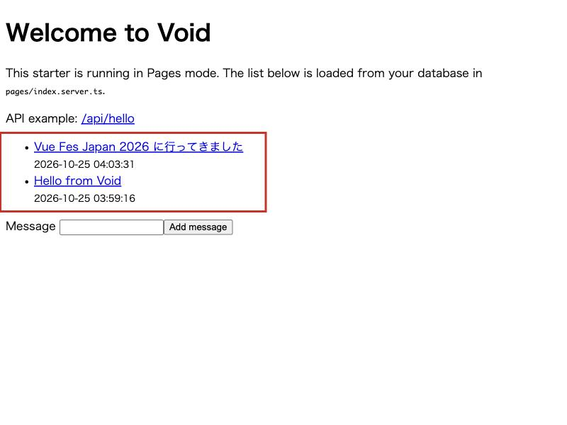
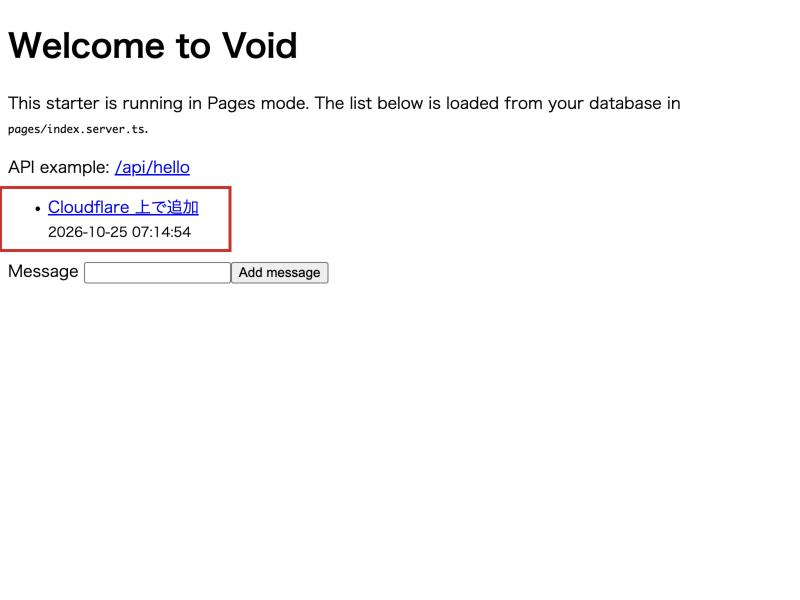

こんにちは、製造ビジネステクノロジー部のはすとです。

昨日Vue Fes Japan 2026に参加していて、Evan YouさんのセッションでVoidの話題が出ていました。Viteで作ったアプリを `void deploy` の1コマンドでCloudflareに出せる、というものです。帰ってから日本語の記事を探すと、試している方はみなさんReactで動かしていて、Vueで動かすとどうなるのかが分かりませんでした。Vueのカンファレンスで聞いた話なのに、Vueで試した記事がないのは少し気になります。

本記事では、VoidのVueアダプターでPagesスターターを作り、D1との連携、フォーム、遅延して届くprops、ページ遷移の4点をローカルで確かめた結果をまとめます。最後に、同じアプリを自分のCloudflareアカウントへデプロイするところまで進めます。

## Voidとは

Voidは、ViteとVitestを開発しているVoidZeroが作ったフレームワークとデプロイ基盤です。2026年3月のVue.js Amsterdamで発表され、当初は商用サービスとして早期アクセスを募っていました。その後、VoidZeroが2026年6月にCloudflareに加わり、2026年10月15日にMITライセンスのオープンソースとして公開されました。

Evan Youさんは公開時の投稿で次のように書いています。

> We started working on Void before the acquisition, originally intended to make it a commercial product. But now we no longer need to, so we've made it open source!
>
> （買収前からVoidの開発を始めていて、もともとは商用製品にするつもりだった。でも今はその必要がなくなったので、オープンソースにした）
>
> [Evan You on X](https://x.com/evanyou/status/2110747206584267234)

Voidは3つの要素からできています。

- **Void SDK**：ファイル配置で決まるAPIルートとページ、D1やKVなどへの型付きAPIを提供する部分
- **Void CLI**：ビルド、Cloudflareリソースの作成、マイグレーション、デプロイを1コマンドで行う部分
- **Void Platform**：チームで共有するデプロイ環境を自分のCloudflareアカウントに立てる部分

個人で試す範囲では、SDKとCLIだけを使い、自分のCloudflareアカウントへ直接デプロイします。Platformは使いません。

Voidの特徴は、使うリソースを設定ファイルに書かないことです。コードのimportを見て、必要なCloudflareのリソースをVoidが判断します。公式ドキュメントのResource Inferenceのページには次のように書かれています。

> Void automatically detects which Cloudflare resources your project uses by scanning source files at startup. In most cases, there is no manual configuration. Use a resource in code, and Void provisions the matching binding for local development.
>
> （Voidは起動時にソースファイルを走査して、プロジェクトが使うCloudflareリソースを自動で検出します。ほとんどの場合、手動の設定は要りません。コードでリソースを使えば、Voidがローカル開発用に対応するバインディングを用意します）
>
> [Resource Inference - Void](https://void.cloud/reference/resource-inference)

たとえば `void/db` をimportすればD1が、`void/kv` をimportすればKVが使われるものとして扱われます。この「起動時に走査する」という一文が、あとで関係してきます。

## 検証環境

2026年10月25日時点の環境です。

| 項目 | バージョン |
|---|---|
| macOS | 26.7.1 |
| Node.js | 24.22.1 |
| pnpm | 12.15.0 |
| void / @void/vue | 1.2.1 |
| vite-plus | 1.4.0 |
| vue | 3.5.44 |
| hono | 4.13.13 |
| typescript | 7.0.2 |

VoidはNode.js 24.21.0以上を要求します。

## プロジェクトを作る

公式のクイックスタートどおり、空のディレクトリで `void` を入れてから `void init` を実行します。

```bash
mkdir void-vue-lab && cd void-vue-lab
pnpm add -D void
```

pnpm 12では、ここで止まりました。

```
Error: ERR_PNPM_IGNORED_BUILDS

  × adding a new package
  ╰─▶ Ignored build scripts: esbuild@0.18.20, esbuild@0.25.12, esbuild@0.28.2,
      workerd@1.20261012.1, workerd@1.20261019.1
  help: Run "pnpm approve-builds" to pick which dependencies should be allowed
        to run scripts.
```

pnpm 10以降は依存パッケージのビルドスクリプトを既定で実行しないため、Cloudflareのローカル実行環境であるworkerdなどの許可が要ります。クイックスタートの末尾にも案内があり、`esbuild`、`sharp`、`workerd` を許可し、`better-sqlite3` はVoid同梱のバイナリを使うため `false` にします。`pnpm approve-builds` は対話式のため、`pnpm-workspace.yaml` に直接書きました。

```yaml
# pnpm-workspace.yaml
allowBuilds:
  esbuild: true
  sharp: true
  workerd: true
  better-sqlite3: false
```

```bash
pnpm install
```

次に `void init` です。対話式で進めてもよいのですが、何を選んだかを記事に残したかったので、フラグで指定しました。

```bash
pnpm void init --toolchain vite-plus --framework vue --starter sqlite --deploy none --no-git
```

| フラグ | 選んだ値 | 他の選択肢 |
|---|---|---|
| `--toolchain` | `vite-plus` | `vite` |
| `--framework` | `vue` | `react`、`svelte`、`solid` |
| `--starter` | `sqlite`（D1） | `postgresql`、`mysql`、`static` |
| `--deploy` | `none` | `cloudflare`、`void` |

### 気をつけること

ここで2つ引っかかりました。

1つめは `--deploy cloudflare` です。最初はこれを付けて実行したところ、`void init` の途中でCloudflareのデバイス認証が始まり、ブラウザが開いてコードの入力を求められました。放置すると5分でタイムアウトし、「あとで `void connect --platform cloudflare` を実行してください」と案内されてスキャフォールドは続行されます。デプロイ先は後から設定できるため、まずローカルで動かしたい場合は `--deploy none` で進めるほうが落ち着いて作業できます。

2つめは `--tsconfig` です。ヘルプに「Update tsconfig.json and set up coding agents」とあったので、tsconfigも一緒に整えてもらうつもりで付けたところ、`tsconfig.json`、`.gitignore`、`AGENTS.md` の3ファイルだけが作られ、`pages/` も `vite.config.ts` も生成されませんでした。実装を読むと、`--tsconfig` と `--github` は「その作業だけを行う限定モード」のフラグで、このモードではスキャフォールドの処理に入らない作りになっていました。既存プロジェクトのtsconfigを直すためのフラグのようです。新規作成のときは付けません。

### 生成されたファイル

`void init` が終わると、次のファイルができていました。

```
.
├── AGENTS.md
├── db
│   ├── migrations
│   │   └── 20261025024522_white_pixie.sql
│   ├── schema.ts
│   └── seed.ts
├── package.json
├── pages
│   ├── index.server.ts
│   └── index.vue
├── routes
│   └── api
│       └── hello.ts
├── tsconfig.json
├── vite.config.ts
└── void.config.ts
```

`vite.config.ts` は、Void本体のプラグインとVueアダプターのプラグインを並べるだけです。

```ts
// vite.config.ts
import { defineConfig } from "vite";
import { voidPlugin } from "void";
import { voidVue } from "@void/vue/plugin";

export default defineConfig({
  plugins: [voidPlugin(), voidVue()],
});
```

公式ドキュメントによると、各アダプターはそのフレームワークのViteプラグインを内包しているため、`@vitejs/plugin-vue` を別途足す必要はありません。実際に `package.json` の依存にも入っていませんでした。

Vueで書く上で中心になるのは `pages/` の2ファイルです。ページ本体の `.vue` と、同じ名前の `.server.ts` が対になります。

```ts
// pages/index.server.ts
import { defineHandler, type InferProps } from "void";
import { db, desc } from "void/db";
import { messages } from "@schema";
import { createInsertSchema } from "void/drizzle-zod";

export type Props = InferProps<typeof loader>;

export const loader = defineHandler(async () => {
  const rows = await db.select().from(messages).orderBy(desc(messages.id));
  return { messages: rows };
});
export const action = defineHandler.withValidator({
  body: createInsertSchema(messages, { text: schema => schema.trim().min(1).max(1000) }).pick({ text: true }),
})(async (_c, { body }) => {
  await db.insert(messages).values(body);
});
```

`loader` はGETのときに動いてデータを返し、その戻り値がそのままページコンポーネントのpropsになります。`action` はフォーム送信を受けます。`InferProps<typeof loader>` でloaderの戻り値からpropsの型を作り、`.vue` 側はそれを `defineProps` に渡すだけです。

```vue
<!-- pages/index.vue（抜粋） -->
<script setup lang="ts">
import type { Props } from "./index.server";
import { Form, useForm } from "@void/vue";

defineProps<Props>();
const form = useForm("/", { text: "" });
</script>

<template>
  <main>
    <ul>
      <li v-for="message in messages" :key="message.id">
        <strong>{{ message.text }}</strong>
      </li>
    </ul>
    <Form :form="form">
      <label>Message <input v-model="form.data.text" /></label>
      <button :disabled="form.pending">Add message</button>
    </Form>
  </main>
</template>
```

Nuxtの `useFetch` のようにコンポーネント側でデータを取りに行く形ではなく、サーバー側のloaderがpropsを渡してくる形です。公式ドキュメントもInertia.jsから着想を得たと書いています。`useForm` の第2引数の `{ text: "" }` は、action側の `withValidator` で定義したbodyの型と突き合わされます。なお、`.vue` ファイルの型チェックには `vue-tsc` が別途必要で、スターターには入っていません。今回は `.vue` 側の型チェックまでは行っていません。

テーブル定義はDrizzle ORMです。Voidが `void/schema-d1` として同梱しているため、Drizzleを自分で入れる必要はありません。

```ts
// db/schema.ts
import { sql } from "void/db";
import { integer, sqliteTable, text } from "void/schema-d1";

export const messages = sqliteTable("messages", {
  id: integer("id").primaryKey({ autoIncrement: true }),
  text: text("text").notNull(),
  createdAt: text("created_at").notNull().default(sql`(datetime('now'))`),
});
```

## ローカルで動かす

```bash
pnpm dev
```

起動ログの1行目で、マイグレーションが自動で適用されていました。

```
11:46:20 AM [void] Applied 1 migration(s): 20261025024522_white_pixie.sql

  VITE+ v1.4.0  ready in 2135 ms

  ➜  Local:   http://localhost:5173/
  ➜  Debug:   http://localhost:5173/__debug
```

D1の設定ファイルは1行も書いていません。`pages/index.server.ts` が `void/db` をimportしているため、VoidがD1を使うものと判断し、ローカルのD1を用意してマイグレーションまで流しています。ローカルのD1の実体は `.void/v3/d1/` 配下にあり、`.void/v3/` には `kv` や `r2` 用のディレクトリも並んでいました。開発時のバックエンドにはCloudflareのローカル実行環境であるminiflareが使われています。

初期データは `void db seed` で入れます。ローカルDBをいったん作り直してから `db/seed.ts` を実行するコマンドです。

```bash
pnpm void db seed --yes
pnpm void db execute "select * from messages"
```

実行結果です。

```
◇ Reset database. Applied 1 migration.
● Restart your dev server if it's running.

✓ Seeded from db/seed.ts.

id  text             created_at
────────────────────────────────────────
1   Hello from Void  2026-10-25 03:59:16

✓ SQL executed successfully.
```

ブラウザで `http://localhost:5173/` を開くと、この行が一覧に出ます。フォームから1件追加したあとの画面で、赤枠がD1から読み込んだ一覧です。



## 詳細ページを足して、Vueアダプターの動きを見る

スターターのままだと一覧しかないため、詳細ページを足して3つのことを確かめました。`Link` によるページ遷移、`defer` で遅れて届くprops、フォームのバリデーションエラーの3つです。

### Linkでページ遷移する

`pages/messages/[id].vue` と `pages/messages/[id].server.ts` を追加しました。URLのパラメータはHonoのContextから `c.req.param("id")` で取れます。

```ts
// pages/messages/[id].server.ts
import { defineHandler, defer, type InferProps } from "void";
import { db, eq } from "void/db";
import { messages } from "@schema";
import { HTTPException } from "hono/http-exception";

export type Props = InferProps<typeof loader>;

export const loader = defineHandler(async (c) => {
  const id = Number(c.req.param("id"));
  const [message] = await db.select().from(messages).where(eq(messages.id, id));
  if (!message) {
    throw new HTTPException(404, { message: "メッセージが見つかりません" });
  }
  return {
    message,
    // 重い集計のつもりで 1.5 秒待ってから返す（defer の動きを見るため）
    stats: defer(async () => {
      await new Promise((resolve) => setTimeout(resolve, 1500));
      return { length: message.text.length };
    }),
  };
});
```

```vue
<!-- pages/messages/[id].vue -->
<script setup lang="ts">
import type { Props } from "./[id].server";
import { Link } from "@void/vue";

defineProps<Props>();
</script>

<template>
  <main>
    <Link href="/">一覧へ戻る</Link>
    <h1>{{ message.text }}</h1>
    <p>作成日時: {{ message.createdAt }}</p>
    <p v-if="stats.loading">文字数を集計中...</p>
    <p v-else-if="stats.error">集計に失敗しました: {{ stats.error.message }}</p>
    <p v-else>文字数: {{ stats.value.length }}</p>
  </main>
</template>
```

一覧側の `<strong>` を `<Link :href="`/messages/${message.id}`">` に置き換えて、一覧から詳細へ遷移できるようにしました。遷移後の画面で、赤枠が `defer` で遅れて届いた文字数です。


`Link` は見た目こそ `<a href>` ですが、クリックするとページ全体を読み込み直さずに遷移します。ブラウザの開発者ツールでネットワークを見ると、遷移時に `/messages/1` へのリクエストが1本飛んでいて、HTMLではなくJSONが返っていました。このリクエストには `x-voidpages: true` というヘッダーが付いていたため、curlで同じヘッダーを付けて叩いてみます。

```bash
curl -s -D - -H "x-voidpages: true" http://localhost:5173/messages/2
```

実行結果です。

```
HTTP/1.1 200 OK
vary: X-VoidPages
content-type: application/x-ndjson
transfer-encoding: chunked
x-powered-by: Void
x-voidpages: true

{"component":"messages/[id]","props":{"message":{"id":2,"text":"Vue Fes Japan 2026 に行ってきました","createdAt":"2026-10-25 04:03:31"},"stats":{"value":null,"loading":true,"error":null}},"params":{"id":"2"},"shared":{},"url":"/messages/2","errors":null,"deferred":["stats"],"deferredKeys":{"stats":"stats"}}
{"__deferred":"stats","data":{"length":27}}
```

同じURLでも、このヘッダーがあるとページのコンポーネント名とpropsだけを返し、クライアント側のVueがそれを受け取って描画し直す仕組みでした。Inertia.jsを使ったことがある方には馴染みのある流れだと思います。

### deferで遅れて届くprops

上の応答で、`stats` が最初は `{"value":null,"loading":true,"error":null}` で届き、2行目で `{"__deferred":"stats","data":{"length":27}}` が追いかけてきている点に注目してください。`content-type` が `application/x-ndjson` で、1行目のページデータと2行目の遅延データが別々のチャンクとして流れています。

React版のドキュメントでは `defer` の値を `use()` と `Suspense` で受けますが、Vueでは `loading`、`value`、`error` の3状態を持つオブジェクトとして届きます。`.vue` 側で `v-if="stats.loading"` から順に分岐したのはそのためです。TypeScript上は判別可能なunion型になっていて、`v-else` の分岐の中では `stats.value` が `{ length: number }` に絞り込まれます。

初回アクセス（ヘッダーなし）のときはどうなるのか、HTMLの方も見てみます。

```bash
curl -s http://localhost:5173/messages/1 | grep -o "<main>.*</main>"
curl -s -o /dev/null -w "ttfb=%{time_starttransfer} total=%{time_total}\n" http://localhost:5173/messages/1
```

実行結果です。

```
<main><a href="/" style="touch-action:manipulation;">一覧へ戻る</a><h1>Hello from Void</h1><p>作成日時: 2026-10-25 03:59:16</p><p>文字数を集計中...</p></main>
ttfb=0.010134 total=1.515332
```

サーバーレンダリングされたHTMLには「文字数を集計中...」が入っていて、最初の1バイトは10ミリ秒で届いています。一方で応答全体が終わるまでは1.5秒かかっているため、loaderで1.5秒待っている `stats` の分だけが後から同じ接続で流れてきている動きです。`defer` を使わずに `await` で待っていたら、HTMLの1バイト目が1.5秒遅れていたことになります。

### フォームのバリデーションエラー

action側の `withValidator` は、`text` をtrimして1文字以上と定義しています。空白だけを送るとどうなるか、curlで確かめました。

```bash
curl -s -D - -X POST http://localhost:5173/ -H "Content-Type: application/json" -d '{"text":"   "}'
```

実行結果（抜粋）です。

```
HTTP/1.1 200 OK
content-type: text/html; charset=utf-8

<script id="__VOID_PAGE_DATA__" type="application/json">{"component":"index","props":{...},"url":"/","errors":{"text":"Too small: expected string to have >=1 characters"} ...
```

400が返ってくるものだと考えていましたが、200でページのHTMLがそのまま返り、埋め込まれたページデータの `errors` にZodのメッセージが入っていました。ブラウザから送った場合はこの `errors` が `form.errors.text` に入ります。

ここで1つ引っかかりました。スターターの `.vue` にはエラーを表示する要素がなかったため、`<p v-if="form.errors.text">{{ form.errors.text }}</p>` を足して空白だけを送ったところ、同じメッセージが2回表示されました。`@void/vue` の `Form` コンポーネントの実装を読むと、`form.errors` か `form.error` にメッセージがあるとき、`role="alert"` の `div` をフォームの先頭に自動で描画する作りになっていました。表示を自分で制御したい場合は `Form` の `renderError` プロパティを使うか、`Form` を使わず `useForm` の `post()` を直接呼ぶ形になります。何もしなければエラーは出る、と覚えておけばよさそうです。

## importを増やしたら再起動が要る

冒頭で引用した「起動時にソースファイルを走査する」という一文を確かめたくて、devサーバーを動かしたままKVを使うAPIを1本足してみました。

```ts
// routes/api/visits.ts
import { defineHandler } from "void";
import { kv } from "void/kv";

// 訪問回数を KV に保存して返す
export const GET = defineHandler(async () => {
  const current = Number((await kv.get("visits")) ?? "0") + 1;
  await kv.put("visits", String(current));
  return { visits: current };
});
```

ViteのHMRの感覚だと、ファイルを保存すればそのまま `/api/visits` が動くはずだと考えると思います。実際には500が返り、devサーバーのログには次の2行が出ていました。

```
2:25:04 PM [void] New KV (void/kv) binding detected. Restart to apply.
Error: env: Missing Cloudflare binding 'KV'.
```

新しいimport自体は検出されていますが、バインディングの用意は起動時にしか行われないため、再起動を促されています。devサーバーが配信しているクライアント側のスクリプトを読むと、この検出をブラウザの画面右上に通知し、クリックで再起動させる実装も入っていました。devサーバーを起動し直すと、設定を何も足さずに動きました。

```bash
curl -s http://localhost:5173/api/visits
curl -s http://localhost:5173/api/visits
```

```
{"visits":1}
{"visits":2}
```

D1のときは `void init` の時点でimportがあったため意識しませんでしたが、開発の途中で新しいリソースを使い始めるときは、この再起動が1回入ります。

なお、Resource Inferenceが走査するのは `.ts` や `.js` のファイルで、公式ドキュメントには「Vue and Svelte component files are not scanned directly.」（VueとSvelteのコンポーネントファイルは直接走査されない）とあります。`void/db` のようなリソースのimportは `.vue` ではなく `.server.ts` や `routes/` 側に書く必要があります。今回の構成ではloaderとactionが `.server.ts` にあるため、自然とそうなっていました。

## Nuxtから使う場合

VueアダプターのPagesモードとは別に、NuxtアプリをそのままVoidでデプロイする道もあります。公式ドキュメントのNuxtのページでは、`nuxt.config.ts` に次の設定を足す手順が示されています。

```ts
// nuxt.config.ts（公式ドキュメントより）
import { resolve } from 'node:path';
import { voidPlugin } from 'void';

export default defineNuxtConfig({
  alias: {
    '@schema': resolve(import.meta.dirname, 'db/schema.ts'),
  },
  nitro: {
    preset: 'cloudflare-module',
    modules: ['void/nitro'],
    cloudflare: { dev: { configPath: './.void-wrangler.jsonc' } },
  },
  vite: { plugins: [voidPlugin()] },
});
```

この場合、ルーティングとSSRはNuxtが担当し、Voidが担当するのはリソースの推論、`void/db` による型付きクエリ、マイグレーション、デプロイです。Nuxtのサーバールートから `import { db } from 'void/db'` でそのままD1を引けるようになります。ただし同じページに「Void-managed auth is not supported in framework mode yet.」（Voidが管理する認証は、フレームワークモードではまだ対応していない）とあり、認証はBetter AuthのNuxt向け統合を直接使う形になります。Nuxt連携は今回は試していません。

## Cloudflareへデプロイする

`void init` のときに後回しにしたデプロイ先の設定を、`void connect` で行います。

```bash
pnpm void connect --platform cloudflare
```

実行するとブラウザでCloudflareの認証ページが開き、ターミナルに表示された8文字のコードと同じものが画面に出ているかを確認してContinueを押す、という流れでした。承認すると「Connected to Cloudflare. Run `void deploy` to deploy this project.」と表示されます。以降のコマンドではログインを求められません。

続けてデプロイします。

```bash
pnpm void deploy
```

1回目は途中で止まりました。

```
◇ Preparing deployment...
◇ Applying D1 migrations...
▲ Worker deployment stopped.
■ deploy: D1 migrations were applied before the deploy stopped. Fix the error and deploy again.
```

`~/.void/logs/` に残ったログを見ると、原因はCloudflare側の次のエラーでした。

```
You can either deploy your worker to one or more routes by specifying them in
your wrangler.json file, or register a workers.dev subdomain here:
https://dash.cloudflare.com/<account-id>/workers/onboarding
```

Workerを `*.workers.dev` のURLで公開するには、アカウントごとに1回だけworkers.devのサブドメイン名を登録しておく必要があります。今回使ったアカウントではまだ登録していなかったため、Workerのアップロードの手前で止まっていました。ログに出ていたURLをブラウザで開いてサブドメイン名を登録し、もう一度 `pnpm void deploy` を実行します。

```
void-vue-lab → Cloudflare
✓ 288 modules transformed.
✓ built in 129ms
✓ 21 modules transformed.
✓ built in 60ms
◇ Preparing deployment...
◇ Applying D1 migrations...
╭─ https://void-vue-lab.hasuto.workers.dev ──╮
│                                            │
│  Worker: void-vue-lab                      │
│  D1 migrations up to date                  │
│                                            │
╰────────────────────────────────────────────╯
✓ Successfully deployed!
```

2回目は最後まで通りました。1回目でD1とKVの作成とマイグレーションまで済んでいたため、2回目の「Applying D1 migrations」は適用するものがなく、Workerのアップロードだけが行われています。

Cloudflare側に何が作られたかは、デプロイで生成された `void.lock.json` に記録されています。

```json
{
  "version": 1,
  "resolved": {
    "account_id": "<account-id>",
    "compatibility_date": "2026-02-24",
    "d1_databases": [
      {
        "binding": "DB",
        "database_name": "void-vue-lab-db",
        "database_id": "<database-id>",
        "migrations_dir": "./db/migrations"
      }
    ],
    "kv_namespaces": [
      {
        "binding": "KV",
        "id": "<namespace-id>"
      }
    ],
    "name": "void-vue-lab"
  }
}
```

`wrangler.jsonc` に相当する設定を自分では1行も書いていませんが、`void/db` と `void/kv` のimportから `DB` と `KV` の2つのバインディングが作られ、D1には `void-vue-lab-db` という名前が付いていました。公式ドキュメントはこのファイルを `void.config.ts` と一緒にコミットするよう案内しています。

公開されたURLに対して、ローカルと同じ確認をしました。

```bash
curl -s https://void-vue-lab.hasuto.workers.dev/api/hello
curl -s https://void-vue-lab.hasuto.workers.dev/api/visits
curl -s https://void-vue-lab.hasuto.workers.dev/api/visits
curl -s -X POST https://void-vue-lab.hasuto.workers.dev/ -H "Content-Type: application/json" -d '{"text":"Cloudflare 上で追加"}' -o /dev/null -w "%{http_code}\n"
curl -s https://void-vue-lab.hasuto.workers.dev/messages/1 | grep -o "<main>.*</main>"
```

実行結果です。

```
{"message":"Hello from Void","framework":"Vue","database":"D1"}
{"visits":1}
{"visits":2}
200
<main><a href="/" style="touch-action:manipulation;">一覧へ戻る</a><h1>Cloudflare 上で追加</h1><p>作成日時: 2026-10-25 07:14:54</p><p>文字数を集計中...</p></main>
```

KVのカウンターもD1への書き込みも、本番のリソースで動いています。本番D1の中身はCLIから `--remote` を付けて確認できます。

```bash
pnpm void db execute --remote "select id, text from messages"
```

```
id  text
───────────────────
1   Cloudflare 上で追加
```

公開ページをブラウザで開いた画面です。赤枠が本番のD1から読み込んだ1件です。



なお、ローカルで `void db seed` を実行してもデータは本番には入りません。本番の一覧が空から始まったのはそのためです。

## まとめ

VueアダプターでVoidを動かしてみて、`.server.ts` のloaderが返したものがそのまま `.vue` のpropsになり、`InferProps` で型までつながる作りは、Nuxtの `useFetch` とは違う書き味でした。`defer` の値がVueでは `loading`、`value`、`error` の3状態のオブジェクトで届く点と、`Form` コンポーネントがエラー表示を自動で行う点は、React版のドキュメントだけを読んでいると気づきにくいところです。

意外だったのは、新しいリソースのimportを足したときにdevサーバーの再起動が要ることでした。設定ファイルを書かずに済む代わりに、起動時の走査に依存している、と考えると納得できます。デプロイでは、Void側の設定は何も書かずにD1とKVが作られた一方で、workers.devのサブドメイン登録というCloudflare側の初回設定で1回止まりました。Cloudflareのアカウントを作ったばかりの方は、先にダッシュボードで登録しておくと1回で通ります。

VoidをVueで触ってみようと思っている方の参考になれば嬉しいです。

## 参考

- [Void - Build with Vite. Deploy with Void.](https://void.cloud/)
- [Quickstart - Void](https://void.cloud/guide/quickstart)
- [Pages Routing - Void](https://void.cloud/guide/pages-routing/overview)
- [Loaders & Props - Void](https://void.cloud/guide/pages-routing/loaders)
- [Resource Inference - Void](https://void.cloud/reference/resource-inference)
- [Nuxt - Void](https://void.cloud/integrations/frameworks/nuxt)
- [Deploy with Void - The Cloudflare Blog](https://blog.cloudflare.com/deploy-with-void/)
- [VoidZero is Joining Cloudflare - VoidZero](https://voidzero.dev/posts/voidzero-cloudflare)
- [voidzero-dev/void - GitHub](https://github.com/voidzero-dev/void)
