こんにちは、製造ビジネステクノロジー部のはすとです。

これまでAWS IoT Core周りでは、[仮想デバイス1台](https://dev.classmethod.jp/articles/aws-iot-nodejs-virtual-device/)や[M5StickS3 1台](https://dev.classmethod.jp/articles/m5sticks3-iot-core-firehose-athena-grafana/)をつないで分析パイプラインを作るところまで試してきました。
しかし、実際の案件では、複数種類のセンサーかつ、数十台扱うケースがほとんどだと思います。
そこで、本記事では、公開されているセンサーデータ（52台 × 4項目 × 約1か月）を使い、架空のビル管理会社から依頼を受けたつもりで、要件定義から構築、月次レポートまで通してみた結果をまとめます。

## 架空の依頼と要件

依頼はこう置きました。
「テナントのオフィスフロアに温湿度センサーを置いて遠隔で監視したい。今は常駐の設備担当が巡回して温度を確認していて、空調の不具合に気づくのが遅れ、テナントから暑い・寒いと苦情が来てから対応することがある」

最初の案では、温度が決めた範囲を外れたら担当者にメールする要件も入れていましたが、監視の目的を詰めていくうちに、この要件は外しました。
目的はテナントの快適性を保つことで、使うのは常駐の設備担当です。
火災のような急な異常は火災報知器などの防災設備が受け持ち、快適かどうかは画面の色で分かれば足ります。
快適さの基準には、建築物衛生法の建築物環境衛生管理基準にある、温度18〜28℃・相対湿度40〜70%を使いました（[建築物衛生法 - 厚生労働省](https://www.mhlw.go.jp/bunya/kenkou/seikatsu-eisei10/)）。
温度の下限は、2022年4月に17℃から18℃に改正されています。

要件は5つに分けました。

| 要件 | お客様の言葉 |
|---|---|
| 現在値一覧 | フロアマップ上で各センサーの今の温湿度を見たい。基準を外れている場所は色で分かるようにしてほしい |
| 推移グラフ | センサーを選んで直近の推移を見たい |
| 停止検知 | 電池切れや故障で止まったセンサーを知りたい |
| 電池警告 | 電池切れになる前に交換したい |
| 月次レポート | 月ごとにセンサー別の平均・最大・最小を出したい |

非機能要件も仮で置きました。
温湿度は数秒で大きく変わるものではないため、画面への反映は1分以内としています。

| 項目 | 仮の値 |
|---|---|
| 画面への反映 | 届いてから1分以内 |
| 基準の表示 | 温度18〜28℃、相対湿度40〜70%を外れた値を色で示す |
| 停止の判定 | 5分間データが届かなければ停止とみなし、メールで知らせる |
| 電池警告のしきい値 | データを見てから決める |

## 使ったデータ

Intel Berkeley Research Labが公開している[センサーデータ（Intel Lab Data）](http://db.csail.mit.edu/labdata/labdata.html)を使いました。
研究室のフロアに置いた54台のセンサー端末が、2004年2月28日から4月5日まで、約31秒ごとに温度・湿度・照度・電池電圧を送ったものです。
約230万行あります。

元ファイルはスペース区切りのテキストで、1行が1回の計測です。
左から、日付、時刻、連番、端末ID、温度（℃）、湿度（%）、照度、電池電圧（V）が並びます。

```text
2004-03-31 03:38:15.757551 2 1 122.153 -3.91901 11.04 2.03397
2004-02-28 00:59:16.02785 3 1 19.9884 37.0933 45.08 2.69964
2004-02-28 01:03:16.33393 11 1 19.3024 38.4629 45.08 2.68742
```

ただ、実データらしく、きれいではありませんでした。

- 元ファイルは時刻順に並んでいない（1行目が3月31日のデータ）
- 約9.4万行は温度・湿度・照度が無く、電池電圧だけが入っている
- 端末は54台と書かれているが、実際には55台ぶんのIDがあり、座標ファイルに無いIDが3つある
- 台ごとの欠損率は30〜70%。31秒間隔は名目で、実際はかなり抜けている

座標の無い3台はフロアマップに置けないため除外し、52台で進めました。

### 1台の37日間を眺めてみる

電池警告のしきい値を決める前に、1台ぶんのデータをグラフにしました。

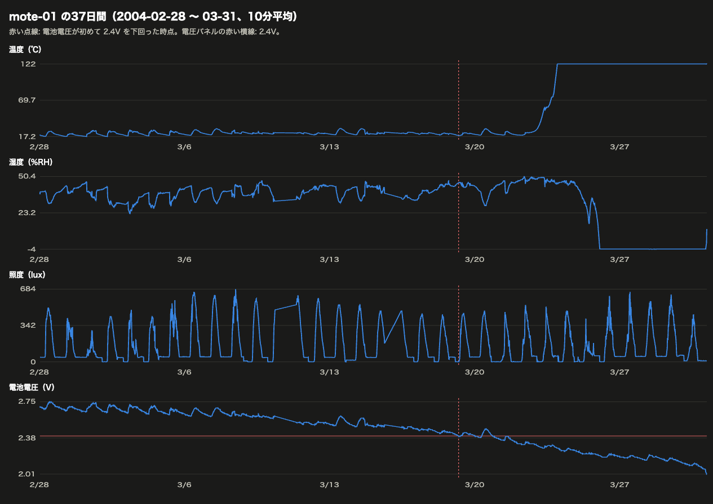

一番下の電池電圧は、37日かけて2.75Vから2.0Vへ下がり続けます。
温度は、電圧が2.4Vを切ってからも4日間は正常な値のままで、2.3Vを割った数時間後に50℃を超え、そのまま122.2℃から動かなくなりました。
さらに3日後、電圧が2.2Vまで下がったところで湿度が負の値になり、戻らなくなりました。
一方で照度だけは、温度が異常値になった後も昼夜の変化を最後まで記録しています。
端末そのものは動いていて、温度と湿度の計測回路だけが電圧不足で先に使えなくなった、と読めます。

:::details なぜ温度と湿度だけが電圧に左右されるのか
温度や湿度のアナログセンサーは、計測した量をいったん電圧に変え、基準となる電圧との比で値を決めます。
基準の電圧が決まった値に保たれていれば正しく計測できますが、電池の電圧がその基準を下回ると、比の計算が成り立たなくなり、何を信じてよいか分からない値になります。
リチウム電池は寿命の終わりに電圧が急に下がるため、ある時点を境に一気におかしくなります。
一方で照度は、電池の電圧を基準にしない別の方式で読んでいると見られ、最後まで正しく取れています。
配布元のページには「Mica2Dotとweather board」としか書かれておらず、どのセンサー部品が載っていたかは確かめられていません。
:::

全台で集計すると、関係はよりはっきりしました。

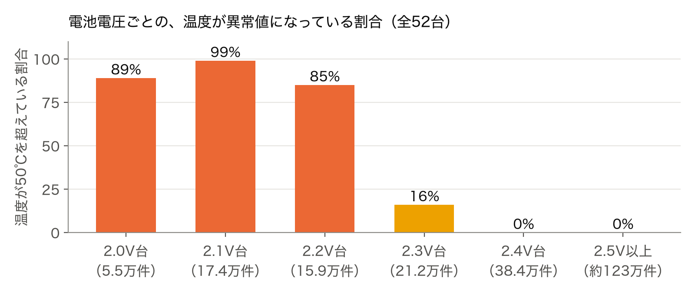

この結果から、電池警告のしきい値は2.45Vとしました。
計測値がおかしくなり始める2.4Vより少し手前で知らせて、電池を交換する時間を確保するためです。また、2.4Vを切ってから温度が異常値になるまでは、3〜4日あったため、警告が出てから電池を替えに行く時間は取れそうです。

## 構成

構成は以下のようにしました。

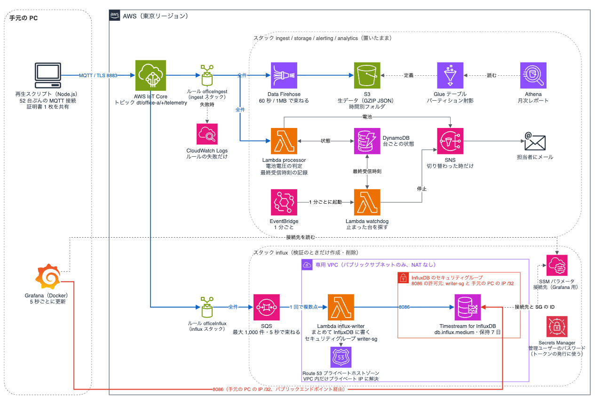

センサー（再現用のスクリプト）がIoT CoreにMQTTでデータを送り、IoTルールがそれを3方向に振り分けます。

- 保存：Data Firehoseが届いたデータを60秒ごとにまとめて、S3にGZIP圧縮したJSONファイルとして書き出す。月次レポートはAthenaでS3のデータを集計して作る
- 直近データ：IoTルールがSQSにデータを入れ、Lambdaが最大1,000件をまとめて受け取ってTimestream for InfluxDBに書き込む。手元のDockerで動かしたGrafanaが、それを5秒ごとに読み出して表示する
- 電池警告：Lambdaが台ごとの最終受信時刻と電圧の状態をDynamoDBに記録し、電圧が下がった状態が続いたらSNSでメールを送る

停止検知だけは、データが届いたときには動かせません。
EventBridgeで1分ごとに起動する見回り用のLambdaが、DynamoDBの最終受信時刻を見て、5分以上届いていない台をSNSでメールします。

CDKのスタックは6つに分けました。
分けた基準は、まず「作る・消すタイミング」です。
S3とDynamoDBは消すとデータを失うため、別のスタックにしました。
InfluxDBはインスタンス課金のため、検証のときだけ作って消せるように別のスタックにしました。
残りは置いたままでよいもので、役目ごとに分けました。

| スタック | 中身 | 作る・消すタイミング |
|---|---|---|
| storage | S3、DynamoDB（台ごとの最終受信時刻、電池と停止の状態） | 消さない（消すとデータを失う） |
| devices | IoTポリシー | 置いたまま |
| alerting | SNSトピック、メール購読 | 置いたまま |
| ingest | IoTルール、Firehose、電池警告のLambda、見回り用のLambdaとEventBridgeのスケジュール | 置いたまま（従量課金のみ） |
| analytics | Glueテーブル、Athenaワークグループ、保存したクエリ | 置いたまま（読んだ量だけ課金） |
| influx | 専用VPC、Timestream for InfluxDB、SQS、書き込み用のLambdaと専用ルール | 検証のたびに作成・削除 |

### なぜInfluxDB側だけ別のルールと別のLambdaにしたのか

最初は、電池警告のLambdaの中でInfluxDBへの書き込みもしていました。
分けることにしたきっかけはSecurity Hubです。

Timestream for InfluxDBはVPCが必須です。
手元のGrafanaから接続できるようにパブリックエンドポイントを付け、8086番ポートへの接続をすべての送信元（0.0.0.0/0）に開けたところ、6分後にSecurity HubのEC2.18（許可されていないポートを無制限に開けている）が緊急度「高」で通知されました。

VPC外にいるLambdaには固定の送信元IPが無いため、セキュリティグループで絞るには、LambdaをVPC内に入れるしかありません。
ただ、電池警告のLambdaごと入れると、SNSやDynamoDBに接続するためのVPCエンドポイントが必要になり、月15ドルほどの固定費がかかってしまいます。
そこでInfluxDBに書くだけのLambdaを切り出してVPC内に置くことにしました。

結果的に、InfluxDBのセキュリティグループで8086番ポートへの接続を許可しているのは、書き込み用Lambdaのセキュリティグループと、手元PCのグローバルIP /32の2つです。
Lambda側をIPではなくセキュリティグループで指定しているのは、VPC内のLambdaが実行時に作るネットワークインターフェース（ENI）のプライベートIPが増えたり変わったりするためです。
手元のPCのIPは、Dockerで動かしているGrafanaがパブリックエンドポイントに接続するために許可しています。

書き込み用のLambdaはInfluxDBと同じスタックに置き、IoTルールも専用のものを1本、同じスタックに作りました。
ルールをingest側に置くと、InfluxDBを消したときに存在しない送り先を指すアクションが残るためです。
IoT Coreは同じトピックに複数のルールを付けられるため、ingestスタックとinfluxスタックは互いを参照せずに済みます。

ただ、この構成で1つ詰まったことがありました。
VPC内のLambdaからInfluxDBのホスト名を名前解決すると、パブリックIPが返ってきます。
Lambdaはパブリックサブネットに置いていますが、VPCの中のLambdaにはパブリックIPが付かず、NATもないため、そのIPに接続できず、書き込みが10秒でタイムアウトし続けました。

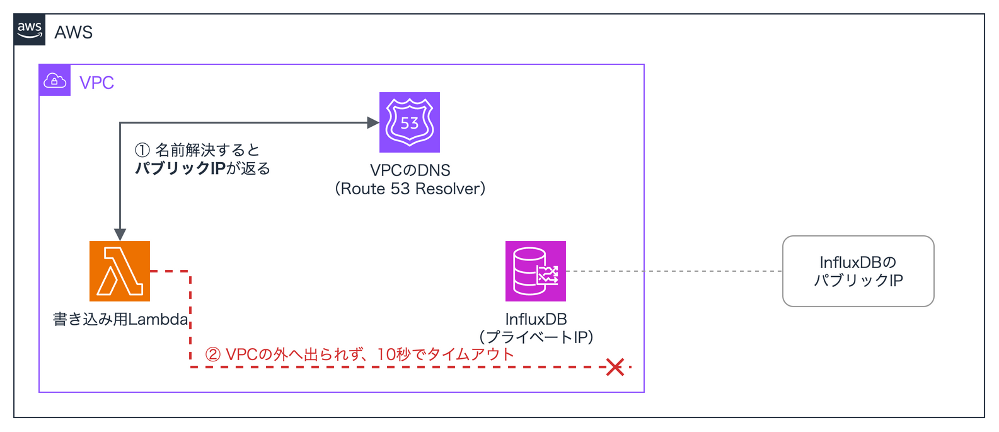

RDSの場合、パブリックアクセスを有効にしたDBインスタンスのエンドポイントは、VPCの中からはプライベートIPに解決されると[ドキュメント](https://docs.aws.amazon.com/AmazonRDS/latest/UserGuide/USER_VPC.WorkingWithRDSInstanceinaVPC.html#USER_VPC.Hiding)に書かれています。
Timestream for InfluxDBのエンドポイントは、VPCの中から名前解決してもパブリックIPがそのまま返りました。
そこで、Route 53にエンドポイントのホスト名と同じ名前のプライベートホストゾーンを作り、InfluxDBのプライベートIPを返すAレコードを登録しました。

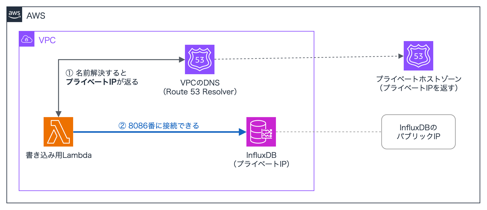

結果、VPCの中でだけプライベートIPが返り、接続先のホスト名は変わらないため、TLSの証明書の検証もそのまま通ります。
InfluxDBのプライベートIPはCloudFormationから取得できないため、カスタムリソースでInfluxDBのENIを調べて取得しています。

## 約1か月のデータを流してみる

スクリプトでは、センサー1台につき1本のMQTT接続を開き、元データの時刻順にpublishします。
そのため、IoT Coreからは、52台のセンサーが別々に接続しているように見えます。
実時間で流すと37日かかるため、時間を短縮できるように、タイムスタンプは送信した時刻に置き換え、元の時刻は別の項目に残しています。

```bash
# 全期間を 600 倍で流す（約 85 分）
node --env-file=.env scripts/replay.js --speed 600

# 区間を選んで 10 倍で流す
node --env-file=.env scripts/replay.js --from 2004-03-09T12:00 --duration 2h --speed 10
```

1件のメッセージはこの形です。
トピックは `dt/office-a/mote-01/telemetry` のように台ごとに分けています。
[AWSのホワイトペーパー](https://docs.aws.amazon.com/whitepapers/latest/designing-mqtt-topics-aws-iot-core/mqtt-design-best-practices.html)にならい、データのトピックは `dt`（data）で始め、拠点・台の順に並べました。

```json
{
  "v": 1,
  "deviceId": "mote-01",
  "ts": 1761018660000,
  "srcTs": "2004-02-28T00:59:16.02785",
  "epoch": 3,
  "temperature": 19.9884,
  "humidity": 37.0933,
  "light": 45.08,
  "voltage": 2.69964,
  "seq": 1
}
```

`ts` が送信した時刻（ミリ秒）、`srcTs` が元データの計測時刻です。
全期間を600倍で流したときのログはこうなりました。

```text
[replay] 52 台 / 2210084 件 / 元データ 35.3 日分を 600 倍 → 実時間 約 85 分
[replay] 1.0 分経過 sent=34204 dup=0 partial=0 held=0 inflight=0 pubErr=0
[replay] 2.0 分経過 sent=71655 dup=0 partial=0 held=0 inflight=2 pubErr=0
...
[replay] 83.0 分経過 sent=2210083 dup=0 partial=0 held=0 inflight=0 pubErr=0
[replay] 完了 sent=2210084 dup=0 partial=0 pubErr=0
```

わざとトラブルを起こす引数も付けました。
`--stop mote-07@1m` で1分後にmote-07（センサー1台）を止める、`--dup 0.05` で5%を二重に送る、`--hold` で数分溜めてからまとめて送る、といった感じです。
停止検知が狙いどおり動くかは、こうした引数で確かめました。
また、実運用の52台・31秒間隔なら毎秒2件弱ですが、600倍では毎秒約400件が届きます。

## 各要件をどう満たしたか

### 現在値一覧とフロアマップ

画面は、全期間を600倍で流している途中、元データの3月9日ごろにあたる時点のものです。

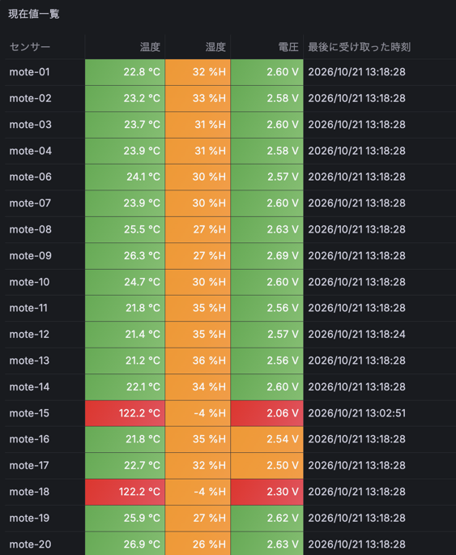

現在値一覧は、センサーごとの最新値を並べた表です。
温度は18〜28℃を緑、28℃超を赤、18℃未満を青で色分けし、湿度は40〜70%を緑、40%未満を橙、70%超を青にしています。
湿度がほぼ全台で橙なのは、元データの研究室が30%前後と乾燥していたためで、基準どおりの表示です。
電圧は2.55V以上を緑、2.45〜2.55Vを橙、2.45V未満を赤にしています。
最後にデータを受け取った時刻も表示しているため、mote-15のように他より時刻が古いセンサーは、データが途切れていると分かります。

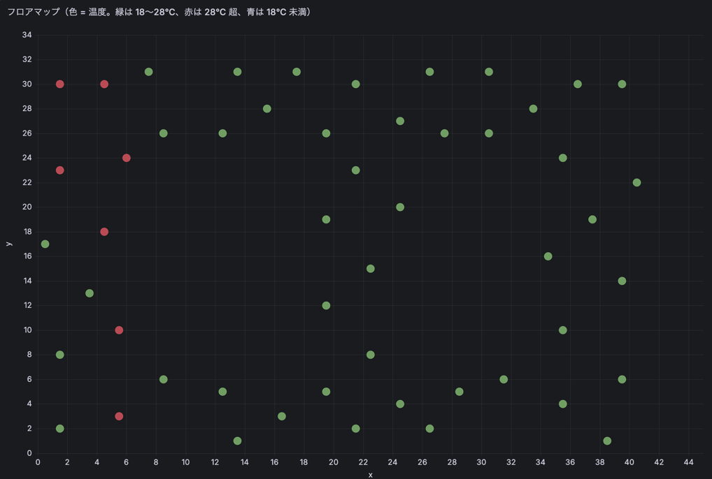

フロアマップは、データの配布元にある設置位置のファイルをもとに、各センサーを研究室の配置どおりに点で描いたものです。
この時点では28℃を超えたものがフロアの左側に集まっており、巡回しなくても見に行く場所が分かります。

### Grafanaの設定でつまずいた点
Fluxで台ごとの最新値を1つの表にまとめるには、`pivot` の前に `group()` で、台ごとに分かれたグループを1つにまとめ直す必要がありました。
これを忘れると、表に1台ぶんしか出ません。
もう1つ、XYチャートで、系列の指定を `mapping: "manual"` にすると `Err` とだけ表示されて描けませんでした。
Grafana 13.0.2では、`"auto"` のままX・Y・色の項目を指定すると表示されました。

### 停止検知と電池警告

最初は、どちらもGrafanaのアラート機能で判定していましたが、今回のGrafanaは手元のDockerで動かしているため、PCを閉じれば監視が止まり、アラートが出ても誰にも届きません。
「止まったセンサーを知りたい」「電池切れの前に交換したい」を満たすには、常に動いている仕組みが必要なため、作り直しました。

電池警告は、IoTルールから呼ばれるLambdaで判定します。
電圧が2.45Vを下回る状態が3回続いたら警告を、2.6V以上が3回続いたら復旧をSNSでメールします。
復旧の基準を警告より高くしているのは、電圧が昼夜で2.45Vの前後を上下するためです。

届くメールは件名と3行の本文だけにしました。
mote-15は元データの開始から3時間半で2.45Vを3回続けて下回り、こう通知されます。

```text
件名: [警告] mote-15 の電池電圧が下がっています

[警告] mote-15 の電池電圧が下がっています
電圧: 2.44412V（警告は 2.45V 未満、復旧は 2.6V 以上、3 回連続で判定）
元データ時刻: 2004-02-28T04:34:16.88263
```

停止検知のメールも同じ形で、最後に受け取った時刻と、停止とみなす秒数を書いています。

ただ、停止検知は同じ作りにはできません。
止まったセンサーからはメッセージが届かないため、メッセージが届いたときに動くLambdaはそもそも起動しないからです。
そこで、電池警告のLambdaにはメッセージが届くたびに台ごとの最終受信時刻をDynamoDBへ記録させ、それとは別に、EventBridgeで1分ごとに起動する見回り用のLambdaを置きました。
見回り用のLambdaは、最後に受け取ってから300秒を過ぎた台を見つけると、止まったときと、また届き始めたときに1回ずつ通知します。
停止の判定は300秒ですが、見回りが1分ごとのため、実際に通知が出るまでは最大で6分ほどかかります。

どちらの通知も、状態の切り替えはDynamoDBの条件付き書き込みにしています。
600倍で流すと同じ台のメッセージが約50ms間隔で届き、Lambdaの処理時間と重なります。
そのため同じLambdaが2つ同時に動き、両方が同じ古い状態を読んでから書くと、同じ警告が2通出てしまいます。
なので、「今が正常のときだけ警告に書く」という条件を付けると、先に切り替えた方だけが通知します。

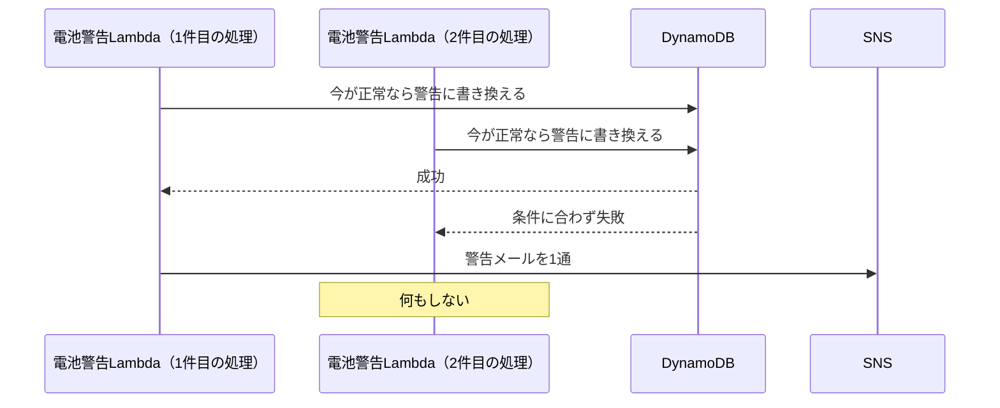

全期間を600倍で流した結果、電池警告は61通（警告56、復旧5）で、試算と同じでした。

### 月次レポート

S3に置いた生データをGlueのテーブルとして定義し、Athenaで集計します。
S3にあるのはGZIPで圧縮したJSONファイルだけなので、列の名前と型をテーブルに書いておき、AthenaがJSONを読むときに当てはめます。
最後の `dt` が、時間ごとのフォルダに対応するパーティションの列です。

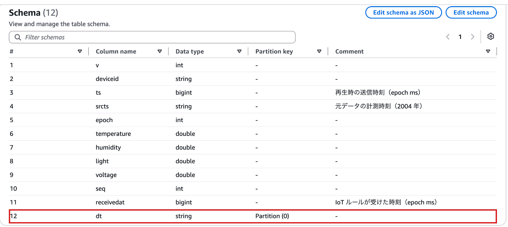

パーティション射影を使い、Firehoseが作る時間ごとのフォルダを、クローラを使わずにテーブルのパーティションとして認識させています。
テーブルのプロパティに、`dt` は1時間刻みの日時で、`yyyy/MM/dd/HH` の形でフォルダ名になる、という規則を書いておきます。
Athenaはクエリの条件からフォルダを計算するので、Firehoseが新しいフォルダを作っても、パーティションを登録し直す作業は要りません。

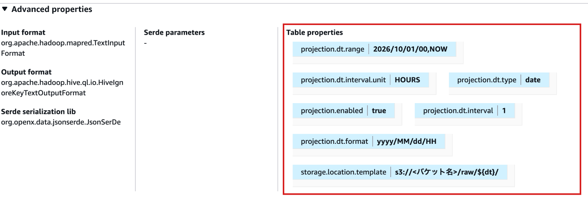

ここで2つ決めることがありました。
1つは月の区切りです。
S3のフォルダは「クラウドが受け取った時刻」で分かれているため、そのまま集計すると全部2026年10月になります。
月次レポートは「デバイスが計測した時刻」で月を分ける必要があります。
再生するときに元の時刻を別の項目に残しておいたため、その項目で分けられました。

もう1つは、信用できない値の扱いです。
最初は「-10〜50℃の範囲外」だけを外して平均を出しました。
すると、電池が切れかけた4月の台で、平均温度が39.9℃と出ます。
50℃未満でも正しくない値は混ざっているため、電圧の分析で分かった「2.4V未満の計測は信用できない」を判定に加えました。

```sql
-- 信用できない値は平均・最大・最小から外し、件数だけ数える
voltage >= 2.4 AND temperature BETWEEN -10 AND 50 AS temp_valid
```

全期間のデータを流した後の結果です。
試験で同じデータを何度か流しているため、台と計測時刻で重複を除いてから集計しています。

| 月 | 台数 | 件数 | 信用できない温度 | 電池警告が出た台 | 台ごとの平均温度 |
|---|---|---|---|---|---|
| 2004-02（2日分） | 52 | 174,826 | 4（0%） | 2 | 17.5〜20.5℃ |
| 2004-03 | 52 | 2,005,474 | 571,731（29%） | 51 | 20.3〜24.8℃ |
| 2004-04（5日分） | 25 | 29,784 | 29,784（100%） | 25 | 出せない |

重複を除いた合計は2,210,084件で、送った件数と一致しました。

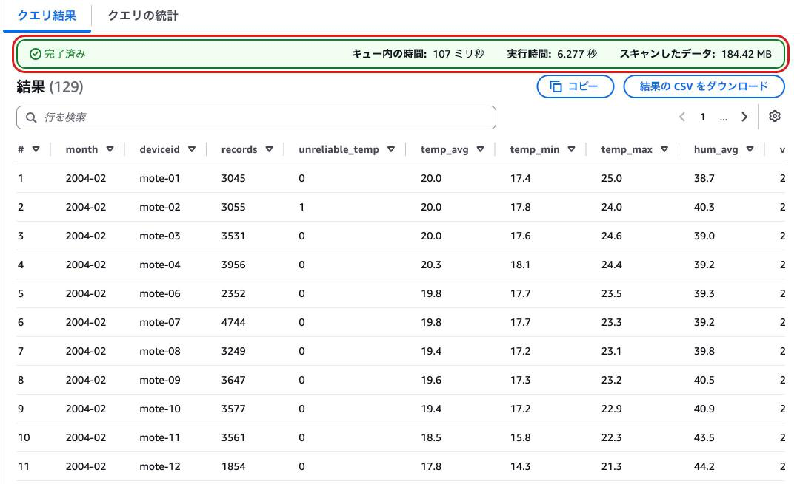

試験で何度も流した後のS3に対して、実行時間は6.3秒、読み込んだデータ量は184MBでした。
Athenaは読み込んだ量で課金されるため、この1回は約0.001ドルです。

台ごとの行を抜き出すとこうなります。

| 月 | 台 | 件数 | 信用できない温度 | 平均 | 最小 | 最大 | 電圧の最小 | 2.45V未満の件数 |
|---|---|---|---|---|---|---|---|---|
| 2004-03 | mote-01 | 40,002 | 9,339 | 22.2℃ | 17.2℃ | 29.0℃ | 2.01V | 11,821 |
| 2004-03 | mote-15 | 680 | 390 | 24.4℃ | 21.3℃ | 27.8℃ | 2.06V | 675 |
| 2004-03 | mote-18 | 28,912 | 16,234 | 22.6℃ | 16.4℃ | 31.5℃ | 1.99V | 21,151 |
| 2004-03 | mote-25 | 47,240 | 13,597 | 24.8℃ | 15.5℃ | 36.6℃ | 2.06V | 15,788 |
| 2004-04 | mote-02 | 179 | 179 | — | — | — | 1.95V | 179 |
| 2004-04 | mote-07 | 1,884 | 1,884 | — | — | — | 2.03V | 1,884 |

mote-15は3月に入って3日で止まり、680件のうち390件が信用できない値です。
4月に残っていた25台はすべて電池切れ間際で、平均を出せる値が1件もありません。
この月次レポートは、「どの台の電池をいつ替えるべきだったか」を判断する資料になります。

## 検証して分かった設計上の注意点

### Lambdaの同時実行の枠はスタックを分けても共有される

全期間を最初に600倍で流したとき、InfluxDB側は書き込みを処理しきれなくなりました。
InfluxDB（db.influx.medium）は開始直後からCPUが100%になったまま下がらず、書き込み用のLambdaは応答を10秒待ってタイムアウトし、同時実行数はアカウントの上限400に達しました。

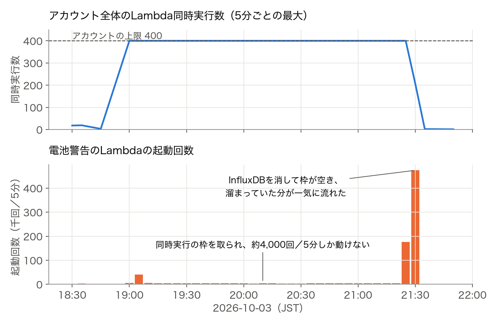

ここまではInfluxDB側の話で済むと思っていましたが、実際には、別のスタック・別のルールに置いた電池警告のLambdaまで止まっていました。
これは、Lambdaの同時実行の枠はアカウント全体で共有されるためです。
さらにIoTルールはLambdaを非同期で呼ぶため、動けなかった分はLambda側のキューに溜まり、InfluxDBを消して枠が空いた時点で1時間分のメールが一気に届きました。
一方、Firehoseはルールの直接アクションでLambdaを通らないため、S3には全件届いていました。

ここから学んだのは2つです。
動かなくなってもよいLambdaには予約同時実行で上限を付けて、他を巻き込まないようにすること。
古い現在値や遅れた通知には価値が無いため、非同期の保持時間は最初から短くしておくことです。
今は、電池警告のLambdaは非同期の保持時間60秒・リトライ0、書き込み用のLambdaは予約同時実行5にしています。

### InfluxDBへの認証はAPIトークンで行う

毎秒400件という量が多すぎたのだと考えていましたが、そうではありませんでした。
30倍（毎秒約30件）で流したときも、InfluxDBのCPUは100%になり、書き込み用のLambdaはほぼ全件が10秒でタイムアウトしました。

書き込み用のLambdaは、実行環境が立ち上がるたびに、InfluxDBにユーザー名とパスワードでサインインしてから書き込んでいました。
パスワードの照合は意図的に重く作られている処理のため、実行環境が何十個も立ち上がると、それだけでInfluxDBのCPUを使い切ります。
応答が遅れてLambdaがタイムアウトすると実行環境が作り直され、またサインインする、という悪循環でした。
書き込み用のLambdaを、InfluxDBのバケットへの書き込みだけを許可したAPIトークンで認証するように変えると、30倍ではエラー0、CPUは12%以下になりました。

### 1件ずつ書くと600倍には追いつかないため、SQSでまとめる

トークン認証にして全期間を600倍で流し直すと、InfluxDBのCPUはまた92〜100%になりました。
今度は書き込み用のLambdaはエラーにならず、電池警告のLambdaも巻き込まれていません。
ただ、毎秒約400件を1件ずつ書く量にdb.influx.mediumが追いつかず、非同期のキューで60秒待っても処理されなかった分が捨てられました。
開始8分の時点で、届いた分の約75%です。

要件の「画面への反映は1分以内」には余裕があるため、書き込みをまとめることにしました。
IoTルールの送り先をLambdaからSQSに変え、Lambdaは最大1,000件か5秒待ったぶんをまとめて受け取り、改行でつないで1回のリクエストでInfluxDBに書きます。
同時に動くLambdaは5つまでにし、3回失敗したバッチはデッドレターキューに移します。
InfluxDBが400や422を返したときは、送り直しても同じ結果になるため、ログに記録してそのデータを捨てます。
5xxやタイムアウトのときだけ例外を投げて、バッチ全体をSQSに戻します。
[InfluxDBのドキュメント](https://docs.influxdata.com/influxdb/v2/write-data/troubleshoot/)によると、400は形式に誤りのある行が1行でもあると要求全体が拒否され、422は一部の点だけが拒否されて残りは書き込まれます。
同じ点を書き直しても、measurement・tag・timeが同じなら上書きされるため、重複にはなりません。
また、書き込み用のLambdaはVPC内のままですが、SQSからの受け取りはLambdaのサービス側が行うため、VPCエンドポイントもNATも足さずに動きました。

この構成で全期間を600倍で流した結果です。

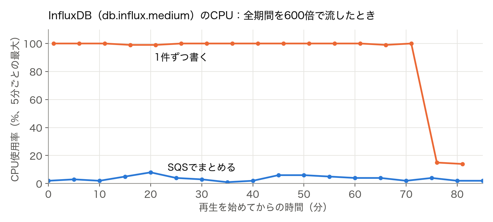

1件ずつ書いたときのCPUが開始70分後に下がったのは、この時点で全体の約96%を送り終え、届く量が減ったためと見られます。

| 項目 | 1件ずつ書く | SQSでまとめる |
|---|---|---|
| InfluxDBのCPU | 92〜100% | 最大8% |
| InfluxDBに入った件数 | 届いた分の約25%（開始8分の時点） | 2,210,084件中2,209,945件（139件少ない） |
| 書き込み用Lambdaの起動回数 | 届いた件数分 | 4,662回（1回で平均約470点） |
| SQSで待った時間 | — | 最大5秒 |
| デッドレターキュー | — | 0件 |

InfluxDBに入った点が139件少ないのは、同じ台で送信時刻がミリ秒まで同じメッセージが139組あり、上書きされたためです。

## 要件ごとの達成状況

機能要件は5つとも動くところまで作れました。
非機能要件は、届いてから画面に出るまでの秒数そのものは測っていませんが、600倍の再生でも途中で捨てられるデータは無くなりました。

| 要件 | 結果 |
|---|---|
| 現在値一覧 | Grafanaの表とフロアマップ。基準を外れた温湿度を色で表示 |
| 推移グラフ | Grafanaで台を選んで表示 |
| 停止検知 | EventBridgeで1分ごとに見回り、5分以上届いていない台をメール。全期間の再生が終わった後に52台ぶんが1回ずつ出た |
| 電池警告 | 2.45V未満が3回続いたら警告、2.6V以上が3回続いたら復旧をメール。全期間で61通 |
| 月次レポート | Athenaで月 × 台の集計。信用できない値は件数だけ出す |

| 非機能要件 | 結果 |
|---|---|
| 画面への反映1分以内 | SQSで待つ時間が最大5秒、Grafanaの更新が5秒ごと |
| 停止の判定5分 | 300秒を過ぎた台を通知。見回りが1分ごとのため、実際には最大6分 |

## まとめ

今回はGrafanaの画面の見た目よりも、分析パイプラインのインフラ側を中心に検証しました。
その途中で、要件も変わりました。
最初に入れていた「温度が範囲を外れたらメール」は、監視の目的を詰めるうちに外し、代わりに「基準を外れた場所を色で示す」を入れました。
誰が、何のために、どのくらいの速さで知りたいのかを先に決めると、通知の要否も、画面の反映を何秒にするかも、そこから決まることを実感しました。

私と同じように、1台は動いたけれど、実案件のような数十台ぶんの運用を試してみたい、という方の参考になれば嬉しいです。

本記事では、Intel Berkeley Research Labで収集され、MIT CSAILで公開されているIntel Lab Dataを使いました。
データを収集・公開してくださった皆さんに感謝します。

## 参考

- [Intel Lab Data - MIT CSAIL](http://db.csail.mit.edu/labdata/labdata.html)
- [建築物衛生法 - 厚生労働省](https://www.mhlw.go.jp/bunya/kenkou/seikatsu-eisei10/)
- [AWS IoT ルールアクション - AWS IoT Core 開発者ガイド](https://docs.aws.amazon.com/iot/latest/developerguide/iot-rule-actions.html)
- [Amazon Timestream for InfluxDB - ユーザーガイド](https://docs.aws.amazon.com/timestream/latest/developerguide/timestream-for-influxdb.html)
- [EC2.18 Security Hub コントロールリファレンス - AWS Security Hub ユーザーガイド](https://docs.aws.amazon.com/securityhub/latest/userguide/ec2-controls.html#ec2-18)
- [Lambda の非同期呼び出し - AWS Lambda 開発者ガイド](https://docs.aws.amazon.com/lambda/latest/dg/invocation-async.html)
- [Using Lambda with Amazon SQS - AWS Lambda 開発者ガイド](https://docs.aws.amazon.com/lambda/latest/dg/with-sqs.html)
- [Troubleshoot issues writing data - InfluxDB OSS v2 Documentation](https://docs.influxdata.com/influxdb/v2/write-data/troubleshoot/)
- [パーティション射影 - Amazon Athena ユーザーガイド](https://docs.aws.amazon.com/athena/latest/ug/partition-projection.html)
