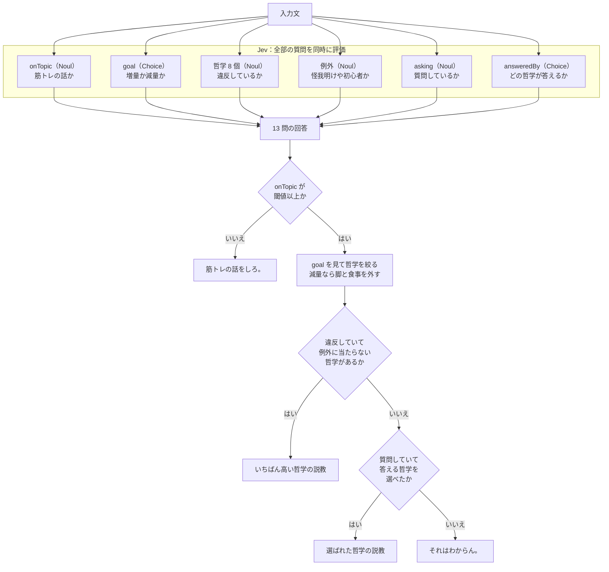

こんにちは、クラスメソッド製造ビジネステクノロジー部のはすとです。

以前、自分の筋トレ哲学を LoRA でローカル LLM に学習させて、[筋トレ哲学を押し付けてくるトレーナー](https://dev.classmethod.jp/articles/muscle-philosophy-trainer-lora/)を作りました。人格自体は付いたのですが、30 問の質問を投げて求める回答になっていたのは、17% という低い結果でした。学習データを増やしても話題のずれは直らず、筋トレと関係ない質問を投げるとキャラクターごと崩れてしまいました。

私が作りたかったものを振り返ると、押し付けトレーナーは、突き詰めると「この発言はどの哲学に反しているか」を判定することなので、Jev を使えば簡単に作れるのでは？と思いました。

本記事では、同じトレーナーをファインチューニングなしで作り直した過程と、判定の精度を上げるときに分かったことをまとめます。なお哲学そのものも改めて精査して、18 個から 8 個に減らしています。

## 結論

ファインチューニングをやめても同じ振る舞いは作れました。ただし返す文章は自分で書くことになり、判定の精度は質問文の書き方で大きく変わりました。

## Jev とは

[Jev](https://typesafe.ai/blog/introducing-system-one-models-and-jev) は TypeSafe AI が System One model と呼んでいるモデルです。2026 年 9 月 15 日にアーリーアクセスが始まりました。

公式ドキュメントには、次のように書かれています。

> Jev is TypeSafe's flagship model and the first System One model. Send state and typed questions; get structured answers your code can use directly.
>
> （Jev は TypeSafe のフラッグシップモデルで、最初の System One モデルです。状態と型付きの質問を送ると、コードがそのまま使える構造化された回答が返ってきます）

質問の型は 3 つあります。

| 型 | 答えるもの | 返るもの |
| --- | --- | --- |
| Choice | どの選択肢か | `choice`、各選択肢の確率、`confidence` |
| Score | どの段階か | `score`、各段階の確率、`confidence` |
| Noul | それは正しいか | `noul`（0〜1） |

文章は生成しません。公式が「苦手なこと」を並べたページでも、生成の項には対処法として一行だけ書かれています。

> Use a generative model
>
> （生成モデルを使ってください）

料金は入力 100 万トークンあたり 0.042 ドルで、出力は無料です。今回使ったモデルは `jev-1.13.0` です。

## 哲学を重みからデータへ移す

前回は、主張を書いたファイルから Q&A を 306 ペア生成して、それを LoRA で学習させていました。哲学はモデルの重みの中にあり、外からは読めません。

今回は哲学を TypeScript のデータとして置いて、Jev には判定だけをさせます。1 つの主張はこういう形になります。

```typescript
{
  id: "legs",
  title: "脚から逃げるな",
  fires: "この人は、脚のトレーニングをやりたくない、または上半身だけでいいと言っている",
  yes: "「脚トレやりたくない」「上半身だけでいいですか」「脚トレの翌日歩けないから嫌だ」",
  no: "「脚トレやってます」「スクワットの重量を伸ばしたい」",
  reply: "いいから脚やれ。土台がなきゃ高重量なんか一生扱えない。逃げてると後で辛い目を見るぞ。",
  skipWhenGoal: ["diet"],
}
```

`fires` が Jev に投げる質問文（`instructions`）で、`yes` と `no` が判定の境界（`criteria`）です。`skipWhenGoal` は例外で、減量が目的の人には脚トレを強制しない、という私のスタンスをそのまま書いています。

`reply` が説教の文面です。生成しないモデルなので、当然ながらここは自分で書くことになります。判定だけさせれば済むと思っていましたが、実際には哲学 8 個ぶんの説教を全部自分で書く必要がありました。人格の部分は学習ではなく、ただのベタ書きになります。

## 質問をまとめて 1 回のリクエストで投げる

公式ドキュメントには、複数の質問を投げたときの挙動が次のように書かれています。

> Every question in a request sees the same state, is evaluated independently, and returns a typed answer under the ID you chose.
>
> （リクエスト内のすべての質問は同じ state を見て、それぞれ独立に評価され、指定した ID の下に型付きの回答が返ります）

独立に評価されるので、8 個の主張をまとめて 1 回で投げられます。これに「筋トレの話か」「目的は増量か減量か」「質問しているのか」「どの哲学が答えるか」の 4 問を足します。

```typescript
const { answers } = await client.systemOne({
  model: "jev-1.13.0",
  state: input,
  questions: {
    onTopic: noul("この発言は、筋力トレーニング、ジムでの運動、..."),
    goal: choice("この人の目的はどちらか", { bulk: "...", diet: "...", unspecified: "..." }),
    asking: noul("この人は質問している、または助言を求めている", { ... }),
    answeredBy: choice("この人の質問に答えるとしたら、どの考え方が当てはまるか", { ... }),
    ...violationQuestions(), // 哲学ごとの「違反しているか」
  },
});
```

`violationQuestions()` は、哲学ごとに Noul を 1 つずつ作る関数です（中身は後で出てきます）。

Jev は全部の質問を同時に評価するので、Jev の中に「どれから判定するか」という順番はありません。順番を決めているのはコード側で、返ってきた回答を上から順に見ていきます。全体は以下のような流れになります。



最後の分岐の「選べたか」は、`answeredBy` が「どれも当てはまらない」以外の選択肢を、確信度が下限以上で選んだかどうかです。例外の質問は精度を上げる途中で足したもので、理由は後半で書きます。質問は最終的に 13 問になりました。

最後の「わからん」に落ちる分岐が効いていて、哲学を持っていない領域では何も出しません。減量について私は詳しくないので、減量の質問には答えを作らずに黙ります。

## 動かしてみた

実行結果です。

```bash
pnpm judge "脚トレやりたくないです"
```

```
いいから脚やれ。土台がなきゃ高重量なんか一生扱えない。逃げてると後で辛い目を見るぞ。
```

```bash
pnpm judge "痩せたいんですが何食べればいい？"
```

```
それはわからん。俺が答えられる話じゃない。
```

```bash
pnpm judge "今日の天気は？"
```

```
筋トレの話をしろ。
```

1 判定あたりの入力は 2,537 トークンでした。入力 100 万トークンで 0.042 ドルなので、1 回あたり 0.0001 ドルほどです。学習も GPU も要りません。

ただ、最初からこの結果が出たわけではありません。最初に作った版では、用意した 30 問のうち 8 問が期待と違う結果でした。ここからは、判定の精度を上げるときに分かったことです。

公式ドキュメントには、Jev の読み方について次のように書かれています。

> `jev-1.13` answers the question you wrote, not the one you meant.
>
> （`jev-1.13` は、あなたが意図した質問ではなく、あなたが書いた質問に答えます）

書いたとおりにしか読まない、ということです。以下の結果には、ほぼすべてこの性質が効いています。

## criteria の具体例だけでスコアが変わる

最初に詰まったのが「筋トレの話かどうか」を判定する質問でした。「ストラップって甘えですよね」に対して 0.34 しか返らず、筋トレの話ではないと判定されていました。

そこで 3 通り試しました。A が元の文面、B は `instructions` を具体的に書き直したもの、C は **B と同じ `instructions` のまま** `criteria` に実際の言い回しを入れたものです。

| 入力 | A 元の文面 | B 文面を具体化 | C B + criteria に例 |
| --- | --- | --- | --- |
| ストラップって甘えですよね | 0.34 | 0.59 | 0.91 |
| 背中が効かない | 0.51 | 0.44 | 0.83 |
| 何日休めばいい？ | 0.16 | 0.16 | 0.82 |
| 今日の天気は？ | 0.01 | 0.01 | 0.01 |
| プログラミング言語何がおすすめ？ | 0.01 | 0.01 | 0.01 |

「何日休めばいい？」に注目すると、A と B はどちらも 0.16 です。`instructions` をいくら具体的に書き直しても動いていません。C で 0.82 になりました。B と C は `instructions` が同じ文字列なので、動かしたのは `criteria` だけです。

公式ドキュメントにも、対処法として同じことが書かれています。

> **Instead:** state the exact condition in the `instructions`. Be specific. Put boundary cases in the criteria.
>
> （対処法：`instructions` に正確な条件を書いてください。具体的に。境界事例は criteria に入れてください）

ここで気になったのが、`criteria` に「何日休めばいい？」と書いたから当たっただけではないか、という点です。言い換えて測りました。

| 入力 | A criteria なし | C criteria 付き |
| --- | --- | --- |
| 何日休めばいい？（criteria に書いた文そのもの） | 0.15 | 0.80 |
| どれくらい休めばいい？ | 0.45 | 0.76 |
| 休みは何日取ればいい？ | 0.07 | 0.59 |
| 次のトレーニングまで何日空ける？ | 0.79 | 0.92 |
| 回復にどれくらいかかりますか | 0.05 | 0.02 |

言い換えても上がっているので、書いた文だけを覚えているわけではありません。ただし「休みは何日取ればいい？」の 0.59 は、私が使っている閾値 0.5 のすぐ上です。

「回復にどれくらいかかりますか」は 0.02 のままで、`criteria` を足しても救えていません。この文には筋トレを示す語が 1 つも入っていないためです。逆に「次のトレーニングまで何日空ける？」は `criteria` なしの時点で 0.79 あります。`criteria` の具体例は、筋トレ語彙が薄い文を引き上げます。ただし語彙がゼロの文は引き上げられません。

## 意図を推論させず、観測できる事実を聞く

次に詰まったのが「基本種目を避けてマシンに逃げている」を判定する質問です。「ダンベルプレスから始めようと思うんですが」で 0.41 しか返りませんでした。

元の質問文はこうでした。

> この人は、ベンチプレス・バーベルスクワット・懸垂のいずれかを避けて、マシンやスミスマシンやダンベルで代わりにやろうとしている

この人は「避けている」とは言っていません。ダンベルプレスから始めたい、と言っただけです。「避けている」を導くには一段の推論が要ります。公式ドキュメントでも、この種の質問は信頼性が下がると書かれています。

> Instructions carrying double negatives or complex indirection are answered less reliably.
>
> （二重否定や複雑な間接性を含む指示は、回答の信頼性が下がります）

そこで、推論を挟まず「挙げている種目名がダンベルプレス・スミスマシン・ラットプルダウン・マシンのいずれかである」と聞く形に変えました。

| 入力 | 避けて（意図） | 種目名（事実） |
| --- | --- | --- |
| ダンベルプレスから始めたい | 0.41 | 0.90 |
| 背中はラットプルダウンで | 0.42 | 0.88 |
| フリーウェイトが怖い | 0.53 | 0.90 |
| 怪我明けなのでマシン（発火させない） | 0.60 | 0.35 |
| ベンチの重量を伸ばしたい（発火させない） | 0.11 | 0.05 |

拾ってほしい側だけでなく、拾ってほしくない側も改善しています。「怪我明けなのでマシンでやってます」は私が例外にしたかったケースで、意図で聞く版は 0.60 で拾ってしまっていました。

## 「該当するか」と「例外か」を 1 つの質問に混ぜると壊れる

種目名で聞く形にしたことで、別の問題が出ました。列挙していない種目は拾えません。レッグプレスは 0.21、ケーブルクロスオーバーは 0.05 で、列挙した 4 つ以外はほとんど素通りしていました。

「基本種目ではなく、マシンやケーブルやダンベルを使う種目である」という意味で聞く形に戻すと、今度は全部拾えるようになります。ただし、例外側が壊れました。

| 入力 | 列挙で聞く | 意味で聞く |
| --- | --- | --- |
| レッグプレス | 0.21 | 0.97 |
| ケーブルクロスオーバー | 0.05 | 0.95 |
| 怪我明けなのでマシン（発火させない） | 0.35 | 0.74 |
| 初心者なので感覚を掴んでいる（発火させない） | 0.39 | 0.61 |

1 つの質問に「該当するか」と「例外か」を両方担わせていたので、拾う範囲を広げると例外まで一緒に拾ってしまいます。そこで、例外だけを聞く質問を別に立てて、コード側で打ち消すようにしました。

質問を作る側では、例外を持つ哲学にだけ、例外を聞く Noul を 1 つ足します。

```typescript
/** 例外を聞く質問のキー。質問を作る側と判定する側で同じものを使う */
const excuseKey = (id: string) => `${id}__excuse`;

function violationQuestions() {
  const questions: Record<string, ReturnType<typeof noul>> = {};
  for (const p of PHILOSOPHIES) {
    questions[p.id] = noul(p.fires, { true: p.yes, false: p.no });
    // 例外を持つ哲学だけ、例外を聞く質問を足す
    if (p.excuse) {
      questions[excuseKey(p.id)] = noul(p.excuse.fires, { true: p.excuse.yes, false: p.excuse.no });
    }
  }
  return questions;
}
```

判定する側では、違反のスコアが高くても、例外のスコアも高ければ発火させません。

```typescript
const hits = live
  .map((philosophy) => ({ philosophy, noul: violations[philosophy.id]!.noul }))
  .filter((h) => h.noul >= t.violation)
  // 例外が立っていたら発火させない
  .filter((h) => (violations[excuseKey(h.philosophy.id)]?.noul ?? 0) < t.violation);
```

例外を聞く質問の結果です。

```
0.95  怪我明けなのでマシンでやってます
0.97  初心者なのでマシンで感覚を掴んでます
0.24  レッグプレスでやってます
0.10  フリーウェイトが怖いので避けてます
```

これで両立しました。質問はすべて同じリクエストに入るので、分けても往復は増えません。

## criteria のキー名もモデルに渡っている

Choice で「この質問にはどの哲学が答えるか」を選ばせていたときの話です。

「筋トレ続かないんですがコツありますか」に対して、`consistency` というキーの選択肢を 0.92 という高い確信度で選びました。この選択肢の中身は「種目をコロコロ変えるな、主要種目を毎回やれ」で、継続の話ではありません。

原因は公式ドキュメントに書いてありました。

> The option names and their descriptions are both sent to the model, so write descriptions that separate the options from each other.
>
> （選択肢の名前と説明はどちらもモデルに送られるので、選択肢どうしを区別できる説明を書いてください）

`consistency` という英単語の意味（一貫性、継続）が「続かない」を引き寄せていました。キーを `same_menu` に変えただけで、この誤りは消えています。キーは内部の識別子のつもりで付けていたので、ここは盲点でした。

## 評価に使った問題で満点を出しても意味がない

ここまでの調整で、評価に使っていた 34 問は全問正解になりました。

ただ、この 34 問は私が書いて、結果を見ながら質問文を直したものです。当てはまるように直したのだから当たるのは当然です。そこで、調整に一切使っていない 20 問を別に書いて、一度だけ流しました。

| セット | 正解数 |
| --- | --- |
| 調整に使った 34 問 | 34 / 34 |
| 調整に使っていない 20 問 | 16 / 20 |

80% でした。落ちた 4 問のうち「スクワットラックが空いてないのでレッグプレスにしてます」は列挙した種目しか拾えない問題そのもので、「毎週メニュー組み直してるんですけど良くないですか」は筋トレ語彙がない文を拾えない問題に当たります。検証用の問題を分けていなければ、どちらにも気づかないまま終わっていたと思います。

## 前回と何が変わったか

前回いちばん崩れていたのは、筋トレと関係ない質問を投げたときでした。天気を聞かれてもトレーナーの口調で何か答えようとして、内容が壊れます。今回は「筋トレの話か」を最初に判定して、違えば黙るので、構造上この崩れ方はしません。哲学を持っていない話題も同じで、それらしい答えをでっち上げずに済みます。

代わりに失ったものもあります。前回は曲がりなりにも文章を生成していたので、想定していない質問にも何かは返していました。今回返せるのは、私が書いた 8 通りの説教だけです。会話として成立する範囲は狭くなりました。

押し付けトレーナーのように「言うことが決まっている」相手なら、この作りで足ります。逆に、知らないことにも何か答えてほしいなら、生成できるモデルが必要です。

## まとめ

ファインチューニングでやっていた「人格を乗せる」は、哲学をデータに書いて判定だけをモデルに任せる形に置き換えられました。学習もモデルの用意も要らず、1 回の判定が 0.0001 ドルです。ただし文章は生成されないので、人格の部分は全部自分で書くことになります。

精度を上げる段階で効いたのは、`instructions` を練ることではなく、`criteria` に実際の言い回しを入れることと、1 つの質問に複数の判断を詰め込まないことでした。選択肢のキー名まで判断材料になっているのは、実際に誤りを見るまで気づきませんでした。

コードは GitHub に置いてあります。

[HasutoSasaki/muscle-philosophy-judge](https://github.com/HasutoSasaki/muscle-philosophy-judge)

ファインチューニングで人格や方針を学習させている方は、その仕事が本当に生成を必要としているか、一度切り分けてみると面白いかもしれません。

## 参考

- [Introducing System One Models & Jev - TypeSafe AI Blog](https://typesafe.ai/blog/introducing-system-one-models-and-jev)
- [Introduction - TypeSafe AI Docs](https://docs.typesafe.ai/introduction)
- [Primitives (Questions) - TypeSafe AI Docs](https://docs.typesafe.ai/primitives)
- [Choice - TypeSafe AI Docs](https://docs.typesafe.ai/primitives/choice)
- [Jev 1.13 jaggedness - TypeSafe AI Docs](https://docs.typesafe.ai/model-jaggedness/jev-1.13)
- [Models - TypeSafe AI Docs](https://docs.typesafe.ai/models)
- [筋トレ哲学 押し付け トレーナーを作ってみた 〜 ローカルLLM × LoRA で人格をのせる - DevelopersIO](https://dev.classmethod.jp/articles/muscle-philosophy-trainer-lora/)
