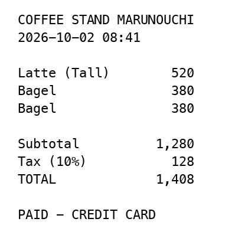

こんにちは、クラスメソッド製造ビジネステクノロジー部のはすとです。

LLM に「JSON で返して」と頼み、返ってきた文字列をパースして、型が合わなければリトライする、という処理を書いたことがある方は多いと思います。先日 GitHub で見つけた [TypeLLM](https://github.com/TypeLLM/TypeLLM) は、この問題を出力の段階で解決するライブラリで、宣言した型以外の答えが出てこないという触れ込みです。README の冒頭に「Inspired by TypeSafe AI's Jev」とあり、以前 Jev を触っていたこともあって、何が嬉しくて何ができるのか気になりました。

本記事では、TypeLLM のホスト版 API を使って、型付きの出力、確率、質問どうしの分岐、思考、選択肢の並び順の補正、画像入力を順に試します。あわせて、できないことも確かめます。

## TypeLLM とは

[TypeLLM](https://typellm.ai/) は、既存の自己回帰型 LLM に「JSON Schema で宣言した型どおりの答えしか返せない」出力を付けるオープンソースのライブラリです。ライセンスは Apache-2.0 で、README には次のように書かれています。

> TypeLLM brings type-safe generation to existing autoregressive LLMs without changing their architecture or weights. Inspired by TypeSafe AI's Jev, it lets models retain their native thinking and free-form generation while producing schema-guaranteed outputs through JSON Schema.
>
> （TypeLLM は、アーキテクチャや重みを変えずに、既存の自己回帰型 LLM に型安全な生成を持ち込みます。TypeSafe AI の Jev に着想を得ており、モデル本来の思考や自由な生成を残したまま、JSON Schema によってスキーマどおりの出力を保証します）

モデルを学習し直すのではなく、モデルが次のトークンを選ぶ段階で候補を絞ります。公式ブログによると、選択肢の問いでは各選択肢を 1 文字のラベルに割り当て、そのラベルのトークン確率だけを読みます。数値は、符号付きの整数や小数として読めるトークンの並びしか許しません。選択肢や真偽値の答えは 1 トークンで済むため、ホスト版では型付きの出力に料金がかかりません。

使い方は 2 通りあります。[SGLang](https://github.com/sgl-project/sglang) で自分の GPU サーバーにモデル（公式で動作確認されているのは Qwen3.8-27B と Qwen3.5 系）を立てる方法と、2026 年 9 月に公開されたホスト版 API を使う方法です。今回はホスト版を使いました。料金は入力 100 万トークンあたり 0.05 ドル、思考トークンは 100 万トークンあたり 0.5 ドル、型付きの出力は無料です。新規アカウントには 5 ドル分のクレジットが付きます。

ホスト版のモデル名は `typellm-latest` で、裏でどのモデルが動いているかはドキュメントに書かれていませんでした（未確認）。

### Jev との違い

DevelopersIO には Jev の記事がいくつかあるので、Jev を知っている方向けに README の比較表から抜き出します。

| 機能 | TypeLLM | Jev |
| --- | --- | --- |
| 選択肢（enum）と真偽値 | ✓ | ✓ |
| 整数・小数・文字列 | ✓ | — |
| 答える前の思考（thinking） | ✓ | — |
| 画像入力 | ✓ | ドキュメントなし |
| 質問どうしの依存関係（`depends_on`） | ✓ | — |
| 複数質問の実行 | 一括、または依存グラフ | 一括 |

Jev が選択や判定に特化した専用モデルなのに対して、TypeLLM は汎用の LLM を縛って同じことをさせるので、数値や文字列や思考といった LLM の能力がそのまま残っています。

## セットアップ

公式 SDK は Python だけです。TypeScript から使うなら HTTP API を直接呼ぶことになります（エンドポイントは `POST /v1/generate` の 1 つだけです）。今回は Python SDK を使います。

```bash
uv add typellm
export TYPELLM_API_KEY="tl-sk-..."
```

API キーは、ダッシュボードにサインインしてアクセスコードを入れると発行できます。最小のコードはこれだけです。

```python
from typellm import TypeLLMClient

client = TypeLLMClient()  # TYPELLM_API_KEY を環境変数から読む
res = client.generate(
    context="先日購入したスーツケースのキャスターが初日に壊れました。",
    questions={
        "category": {"type": "string", "enum": ["refund", "complaint", "question"]},
    },
)
print(res.result)  # {'category': 'complaint'}
```

`context` が読ませる本文、`questions` が答えてほしい項目です。

以降の検証は、項目ごとに 1 つの Python ファイルにして、プロジェクトのルートで `uv run python 01_types.py` のように実行しています。記事に載せるコードは、所要時間とトークンを表示するための共通の関数（`common.py` の `generate()`）を外して、`client.generate()` を直接呼ぶ形に直しています。所要時間は `client.generate()` の呼び出しの前後を手元で計ったもので、トークンと料金はレスポンスの `usage` から計算しました。実際に動かしたファイルは記事末尾のリポジトリにあります。

## 1. 型どおりに返る

まず、経費メモから 7 項目を取り出します。string、integer、number、boolean、enum、null を許す integer を混ぜました。

```python
context = """
2026年9月28日、ヒルトン東京に1泊。合計 32,450円（税込）。
顧客との打ち合わせのための出張で、領収書は受け取り済み。
"""

res = client.generate(
    context=context,
    questions={
        "merchant": {"type": "string", "instructions": "店舗名・施設名だけを返す"},
        "total_yen": {"type": "integer", "instructions": "合計金額（円）"},
        "nights": {"type": "integer", "instructions": "宿泊数"},
        "expense_type": {"type": "string", "enum": ["meal", "travel", "equipment"], "instructions": "経費の種類"},
        "has_receipt": {"type": "boolean", "instructions": "領収書はあるか"},
        "tip_yen": {"type": ["integer", "null"], "instructions": "チップの金額（円）。記載がなければ null"},
        "tax_rate": {"type": "number", "instructions": "日本の消費税率を小数で（例: 0.1）"},
    },
)
for k, v in res.result.items():
    print(f"{k:14} {type(v).__name__:8} {v!r}")
```

`uv run python 01_types.py` の実行結果です。

```
merchant       str      'ヒルトン東京'
total_yen      int      32450
nights         int      1
expense_type   str      'travel'
has_receipt    bool     True
tip_yen        NoneType None
tax_rate       float    0.1
```

所要時間 1,205ms、入力 218 トークン、約 0.00001 ドルでした。`32,450円` がカンマ抜きの `int` で返り、記載のないチップは `None` になっています。パースもバリデーションも書いていません。

### 選択肢に正解が無いと、無理やり選ぶ

型が保証されるということは、選択肢の中に正解が無くても、どれかを選ぶということです。交通費の文に対して、わざと `travel` を抜いた選択肢で聞いてみました。

```python
res = client.generate(
    context="新幹線で大阪へ出張。乗車券 14,720円。",
    questions={
        "expense_type": {
            "type": "string",
            "enum": ["meal", "equipment"],
            "instructions": "経費の種類",
            "return_probabilities": True,
        },
    },
)
```

同じファイルの続きで投げた結果です。

```json
{
  "expense_type": {
    "value": "meal",
    "probabilities": { "meal": 0.56, "equipment": 0.44 }
  }
}
```

新幹線の乗車券が `meal` になりました。確率が 0.56 と 0.44 で割れているので「迷っている」ことは読み取れますが、答えだけを見ていると気づけません。選択肢に `other` を足すと `other` が 0.98 で選ばれます。公式ドキュメントにも次のように書かれています。

> Probabilities describe the supplied candidates, not the likelihood that an answer is factually correct.
>
> （確率は与えた候補についてのものであって、答えが事実として正しい確率ではありません）

型の保証は「スキーマの外に出ない」保証であって、「正しい」保証ではありません。「どれでもない」があり得る質問には、その選択肢を用意しておく必要があります。

## 2. 確率が返るので、自信の無いものを人に回せる

`return_probabilities` を付けると、選択肢ごとの確率が返ります。問い合わせの振り分けで、確率が 0.8 未満なら人が確認する、という閾値を置いてみました。

```python
THRESHOLD = 0.8
res = client.generate(
    context=ticket,
    questions={
        "queue": {
            "type": "string",
            "enum": ["billing", "technical", "account"],
            "instructions": "どのチームが担当すべきか",
            "return_probabilities": True,
        },
        "urgent": {"type": "boolean", "instructions": "至急対応が必要か", "return_probabilities": True},
    },
)
q = res.result["queue"]
top = q["probabilities"][q["value"]]
print(q["value"], f"({top:.2f})", "自動で振り分け" if top >= THRESHOLD else "人が確認")
```

`uv run python 02_probabilities.py` で 3 件流した結果です。

```
先月分の請求額が二重に引き落とされています。至急返金してください。
→ billing (1.00) 自動で振り分け

ログインしようとするとエラーコード E-401 が出ます。
→ account (0.83) 自動で振り分け

プランを変更したら請求も変わりますか？あと、ログインできないのはそのせいですか？
→ billing (0.51) 人が確認
```

3 件目は請求とアカウントの両方にまたがる問い合わせで、`billing` 0.51、`account` 0.45 に割れました。答えだけ受け取っていたら `billing` に流れていたものが、確率を見ることで止められます。1 件あたり 300〜400ms、約 0.000004 ドルでした。

## 3. 分岐を 1 リクエストに書ける

Jev には無い機能です。`depends_on` を付けた質問は、依存先の答えを見てから答えます。`when` を付けた質問は、依存先の答えが条件を満たすときだけ走ります。README には次のように書かれています。

> `when` runs a field only for some answers of its dependencies
>
> （`when` は、依存先の答えが特定の値のときだけ、そのフィールドを実行します）

返金の問い合わせを例にしました。返金なら金額を聞く、金額が 1 万円以上なら承認が要るかを聞く、返信の口調は種類を見てから決める、という 4 問です。

```python
questions = {
    "category": {
        "type": "string",
        "enum": ["refund", "complaint", "question"],
        "instructions": "問い合わせの種類",
    },
    "amount_yen": {
        "type": "integer",
        "instructions": "返金を求めている金額（円）",
        "when": {"category": "refund"},  # 返金のときだけ聞く
    },
    "needs_approval": {
        "type": "boolean",
        "instructions": "返金額が 10,000 円以上なので上長の承認が必要か",
        "when": {"amount_yen": {"gte": 10000}},  # 金額が 1 万円以上のときだけ聞く
    },
    "reply_tone": {
        "type": "string",
        "enum": ["apologetic", "neutral", "friendly"],
        "instructions": "問い合わせの種類を踏まえて、返信の口調を選ぶ",
        "depends_on": ["category"],  # 種類の答えを見てから答える
    },
}
```

`uv run python 03_workflow.py` で 3 通りの入力を流した結果です。

```
## 返金 25,000 円
{"category": "refund", "amount_yen": 25000, "needs_approval": true, "reply_tone": "apologetic"}
所要時間 812ms / 入力 192 tok

## 返金 3,000 円
{"category": "refund", "amount_yen": 3000, "reply_tone": "apologetic"}
skipped: ['needs_approval']
所要時間 564ms / 入力 187 tok

## ただの質問
{"category": "question", "reply_tone": "friendly"}
skipped: ['amount_yen', 'needs_approval']
所要時間 347ms / 入力 178 tok
```

走らなかった質問は結果にキーが無く、`res.skipped` に名前が入ります。`when` の条件判定はコード側で行われるので、追加のリクエストは発生しません。

分岐を書かずに 4 問とも投げると、どうなるかも見ておきます。

```
## ただの質問（分岐なしで 4 問とも投げる）
{"category": "question", "amount_yen": 0, "needs_approval": false, "reply_tone": "friendly"}
所要時間 455ms / 入力 141 tok
```

質問には金額が無いのに `amount_yen` が `0`、`needs_approval` が `false` で返ってきます。型は守られていますが、意味の無い値です。これを受け取る側で「0 は無効」と扱うか、`when` で最初から聞かないかの違いになります。

入力トークンは分岐ありのほうが多くなりました（178 対 141）。`when` や `depends_on` の定義そのものがトークンに数えられるためで、README にも書かれています。

> A skipped field sends no requests; only its definition counts toward the call's input tokens.
>
> （走らなかったフィールドはリクエストを送りませんが、その定義はその呼び出しの入力トークンに数えられます）

一方で所要時間は、依存関係があると段階的に実行されるぶん長くなります。返金 25,000 円のケースは 4 問が 3 段階になり 812ms、分岐なしで 4 問を同時に投げたケースは 455ms でした。

## 4. 質問ごとに考えさせられる

TypeLLM は汎用の LLM を縛っているので、答える前に考えさせることができます。`thinking` は質問ごとに付けられて、`"auto"` にすると必要な思考の量をモデル自身に選ばせます。README の説明です。

> With `"thinking": "auto"`, TypeLLM picks the level on each call. It first asks the model how much reasoning the field needs, without thinking, then answers the field at that level.
>
> （`"thinking": "auto"` にすると、TypeLLM は呼び出しごとにレベルを選びます。まずそのフィールドにどれだけの推論が必要かをモデルに思考なしで尋ね、次にそのレベルでフィールドに答えます）

LLM が間違えることで有名な「strawberry に r は何個あるか」と、和暦と西暦が混ざった日付の比較を、思考なしと `auto` で投げました。

```python
strawberry = {
    "type": "integer",
    "enum": [1, 2, 3, 4],
    "instructions": "strawberry という単語に r は何回出てくるか",
    "return_probabilities": True,
}
dates = {
    "type": "string",
    "enum": ["A", "B"],
    "instructions": "A と B のどちらの日付が早いか",
    "return_probabilities": True,
}
ctx = "A: 令和8年3月9日　B: 2026/02/28"

client.generate(context=ctx, questions={"r_count": strawberry, "earlier": dates})
client.generate(
    context=ctx,
    questions={"r_count": {**strawberry, "thinking": "auto"}, "earlier": {**dates, "thinking": "auto"}},
)
```

`uv run python 04_thinking.py` の実行結果です。括弧内は選ばれた答えの確率です。

| | r の数 | 早い日付 | 所要時間 | 思考トークン | 料金 |
| --- | --- | --- | --- | --- | --- |
| 思考なし | 2（0.91） | B（0.95） | 377ms | 0 | 約 0.000006 ドル |
| `thinking: auto` | 3（1.00） | B（1.00） | 5,394ms | 485 | 約 0.000249 ドル |

思考なしでは r の数を 2 と答えて外しました。`auto` にすると両方の質問に `low`（512 トークンまで）が割り当てられ、3 に直りました。日付のほうは思考なしでも当たっていて、思考を付けると確率が 0.95 から 1.00 に寄っています。

代わりに、所要時間は 14 倍、料金は約 40 倍です。思考トークンは入力トークンの 10 倍の単価で、1 回に 485 トークン使ったので、料金のほとんどが思考ぶんになります。思考は全部の質問に付けるものではなく、間違えると困る質問にだけ付けるものだと思いました。

思考の中身は `res.thinking` で読めます。r の数を数えていたときの冒頭です。

```
Field: "r_count" Type choice Instructions: strawberry という単語に r は何回出てくるか
Choices A 1 B 2 C 3 D 4 Answer as {"r_count": "<label>"}.
```

選択肢の `1, 2, 3, 4` が `A, B, C, D` のラベルに置き換えられて、モデルはラベルを 1 つ答える形になっています。「選択肢を 1 文字のラベルに割り当てる」という仕組みが、思考ログからそのまま見えました。

## 5. 選択肢の並び順の偏りを平均で消す

公式ブログによると、LLM は選択肢の並び順に影響されます。TypeLLM の `permutations` は、並び順を入れ替えて複数回評価し、確率を平均します。公式のブログで使われているサイコロの例をそのまま投げました。

```python
faces = ["one", "two", "three", "four", "five", "six"]
q = {
    "type": "string",
    "enum": faces,
    "instructions": "What number will come up on this roll?",
    "return_probabilities": True,
}
client.generate(context="A single roll of a fair die.", questions={"roll": q})
client.generate(context="A single roll of a fair die.", questions={"roll": {**q, "enum": list(reversed(faces))}})
client.generate(context="A single roll of a fair die.", questions={"roll": {**q, "permutations": True}})
```

公平なサイコロなので、どの目も 0.17 が正解です。`uv run python 05_permutations.py` の実行結果です。

| 並び順 | one | two | three | four | five | six |
| --- | --- | --- | --- | --- | --- | --- |
| そのまま | **0.76** | 0.01 | 0.12 | 0.05 | 0.03 | 0.04 |
| 逆順 | 0.03 | 0.01 | 0.02 | 0.06 | 0.00 | **0.87** |
| `permutations: True` | 0.29 | 0.13 | 0.12 | 0.12 | 0.12 | 0.23 |

そのままの並びでは先頭の `one` に 0.76、逆順にすると先頭に来た `six` に 0.87 が集まりました。中身ではなく位置で選んでいます。`permutations` を付けると 0.12〜0.29 まで均されました。完全に平らではありませんが、先頭に 8 割以上が集まる状態からは抜けています。

なお、README には `"auto"` や `"all"` や整数を渡せると書かれていますが、ホスト版 API では `true` か `false` しか受け付けませんでした。`"auto"` を渡すと `permutations must be true or false` という 400 エラーになります。

サイコロは人工的な例なので、業務っぽい例も試しました。「新しく入った人向けに、社内ツールの使い方を 30 分で説明する会」を、新人向け研修、勉強会、引き継ぎ、説明会の 4 択で分類させます。

| 並び順 | onboarding（新人向け研修） | briefing（説明会） |
| --- | --- | --- |
| そのまま | 0.41 | **0.59** |
| 逆順 | **0.73** | 0.27 |
| `permutations: True` | **0.71** | 0.28 |

並び順を変えただけで答えが `briefing` から `onboarding` に変わりました。どちらとも読める文なので、こういう質問こそ並び順の影響を受けます。`permutations` を付けると `onboarding` 0.71 に落ち着きました。平均に使った並び順は 4 択で 4 通りで、入力トークンは 100 から 107 に増えただけです。

## 6. 画像から型付きで読み取る

画像も渡せます。Pillow で作ったレシート画像を読ませました。



店名、ベーグルが 2 行、合計 1,408、カード払いの記載がある画像です。これを読ませて、店名、合計、ベーグルの個数、カード払いかどうか、チップの金額を聞きます。

```python
res = client.generate(
    context="添付のレシートを読み取る。",
    images=["receipt.png"],
    questions={
        "merchant": {"type": "string", "instructions": "店名"},
        "total": {"type": "integer", "instructions": "合計金額"},
        "bagels": {"type": "integer", "instructions": "ベーグルの個数"},
        "paid_by_card": {"type": "boolean", "instructions": "カード払いか"},
        "tip": {"type": ["integer", "null"], "instructions": "チップの金額。無ければ null"},
    },
)
```

`uv run python 06_image.py` の実行結果です。

```json
{
  "merchant": "COFFEE STAND MARUNOUCHI",
  "total": 1408,
  "bagels": 2,
  "paid_by_card": true,
  "tip": null
}
```

所要時間 839ms、入力 274 トークンでした。ベーグルが 2 行に分かれて書かれているのを 2 個と数えています。OCR してからパースする、という段取りが丸ごと要りません。

## できないこと

型が付くといっても、JSON Schema の全部が使えるわけではありません。配列、ネストしたオブジェクト、25 個以上の enum を投げると、400 エラーで弾かれます。`uv run python 07_limits.py` で 3 つを順に投げたときのエラーメッセージです。

```
配列: property 'items' has unsupported JSON Schema type 'array'
ネストしたオブジェクト: property 'addr' has unsupported JSON Schema type 'object'
enum 25 個: enum for 'n' has 25 values; the maximum is 24
```

返せるのは、文字列、整数、小数、真偽値、選択肢という入れ子の無い値だけです。項目のリストを取り出したいなら、質問を項目ごとに分けるような組み方になります。

文字列も長文には向きません。1000 字の論説を頼んでも、ホスト版では 128 トークンで切れます。同じファイルで、返ってきた文字列の長さを数えた結果です。

```
文字数: 249
```

途中で文が切れた 249 文字が返ってきました。文章を書かせる用途には、そのための生成モデルを使うことになります。

## まとめ

TypeLLM が置き換えるのは「LLM に JSON を頼んで、パースして、型を検証して、失敗したらリトライする」という一連の処理です。型どおりの値しか返らないので、受け取る側のコードはそのまま使うだけになります。思考を付けなければ、1 回あたりの所要時間は数百ミリ秒、料金は約 0.00001 ドルでした。

試してみて一番面白かったのは、分岐を書かずに投げたときに `amount_yen` が `0` で返ってきたことでした。型は守られているのに意味が無い、という状態を目で見てから `when` の価値が分かりました。並び順を変えただけで分類結果が入れ替わったのも、普段 LLM に選択肢を渡すときに意識していなかった点です。

一方で、選択肢に正解が無ければどれかを無理やり選ぶので、「どれでもない」を選択肢に入れておくことと、確率を見て閾値を置くことは、こちらの仕事です。

LLM に判定や抽出をさせていて、出力のパースで苦労している方は、試してみてください。コードは GitHub に置いてあります。

[HasutoSasaki/typellm-playground](https://github.com/HasutoSasaki/typellm-playground)

## 参考

- [TypeLLM: LLMs with type-safe generation - GitHub](https://github.com/TypeLLM/TypeLLM)
- [Introducing TypeLLM: type-safe generation for autoregressive LLMs - TypeLLM Blog](https://typellm.ai/blog/introducing-typellm)
- [Can Jev Roll a Die? - TypeLLM Blog](https://typellm.ai/blog/fair-die)
- [API reference - TypeLLM Docs](https://typellm.ai/docs/api)
- [Dependencies - TypeLLM Docs](https://typellm.ai/docs/execution)
- [Thinking - TypeLLM Docs](https://typellm.ai/docs/thinking)
- [Probabilities - TypeLLM Docs](https://typellm.ai/docs/probabilities)
- [Pricing - TypeLLM](https://typellm.ai/pricing)
