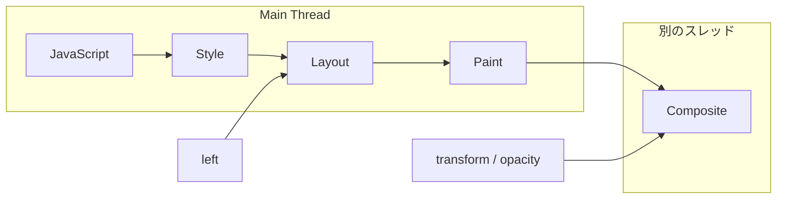

こんにちは、製造ビジネステクノロジー部のはすとです。

CSSアニメーションの話で「`transform`と`opacity`はMain Threadを使わないから速い」という説明を読んだことがあると思います。私もそう覚えていましたが、ではMain Threadを本当に止めてしまったとき、動き続けているアニメーションを誰が動かしているのかは考えたことがありませんでした。DevToolsのPerformanceパネルで見ることもできますが、ブラウザごとに作りが違う道具で見ると、結果を並べて比べにくいですよね。

そこで今回は、ブラウザのDevToolsを使わず、macOS標準の`sample`コマンドでChrome、Safari、Firefoxのプロセスを同じやり方で覗いてみました。本記事では、JavaScriptでMain Threadを止めている間に、どのプロセスのどのスレッドが動いていたかを3つのブラウザで比べます。

## Main Threadと合成

ブラウザはタブごとにページを処理するプロセスを持ち、その中のMain Threadと呼ばれる1本のスレッドで、JavaScriptの実行、CSSの適用、レイアウトの計算、描画内容の決定を順番に行っています。JavaScriptの`while`ループが終わらないと、同じスレッドにあるこれらの処理に順番が回ってこないため、ページが固まったように見えます。

描画内容が決まったあと、レイヤーを重ねて1枚の画面にする処理は合成（compositing）と呼ばれ、一般的な説明ではMain Threadとは別のスレッドが担当するとされています。`transform`と`opacity`はレイヤーの位置や透明度を変えるだけで、レイアウトも描画のやり直しも要らないため、Main Threadが止まっていても合成を担当する側だけで次のフレームを作れます。これが「`transform`と`opacity`は速い」と言われる理由です。一方で`left`はレイアウトから計算し直す必要があり、Main Threadが止まると動きも止まります。

図にすると以下のようになります。



この説明を聞くと、合成を担当する別のスレッドが同じプロセスの中にいるように思えます。本記事で確かめたいのは、そのスレッドが3つのブラウザでそれぞれどこにいるのかです。

## sampleコマンドとは

`sample`はmacOSに最初から入っているコマンドで、指定したプロセスの各スレッドが「今どの関数を実行しているか」を1msごとに記録し、呼び出しの木としてまとめて出力します。アクティビティモニタの「プロセスのサンプルを収集」ボタンと同じ機能です。

```bash
sample <pid> 3 -file out.txt   # 3秒間、1ms間隔で記録する
```

出力はスレッドごとに分かれていて、先頭の数字がそのスタックを観測した回数です。3秒なら1スレッドあたり約3000回になります。待ち状態のスレッドは`mach_msg2_trap`や`__psynch_cvwait`のようなシステムコールの中で止まっているため、それ以外の関数で観測された回数を数えれば、そのスレッドがどれだけ動いていたかが分かります。

## 検証ページ

同じ動きをする箱を2つ置き、A（青）は`transform: translateX()`で、B（赤）は`left`で動かします。ボタンを押すと`performance.now()`を見ながら`while`ループを回し、Main Threadを止めます。`requestAnimationFrame`の回数も表示しているため、止まっている間はこのカウンターが進みません。

```html
<style>
  .track { position: relative; height: 60px; width: 420px; border: 1px solid #999; }
  .box { position: absolute; top: 5px; left: 0; width: 50px; height: 50px; }
  #a { background: #2563eb; animation: move-transform 1s linear infinite alternate; }
  #b { background: #dc2626; animation: move-left 1s linear infinite alternate; }
  @keyframes move-transform { to { transform: translateX(370px); } }
  @keyframes move-left { to { left: 370px; } }
</style>
<div class="track"><div class="box" id="a"></div></div>
<div class="track"><div class="box" id="b"></div></div>
<p>requestAnimationFrame の回数: <span id="count">0</span> <strong id="state"></strong></p>
<button id="btn">Main Thread を止める</button>
<script>
  // ?block=<ms> で止める長さ、?delay=<ms> を付けると読み込み後に自動で止める
  const q = new URLSearchParams(location.search);
  const blockMs = Number(q.get('block') ?? 10000);
  const delayMs = q.get('delay');

  let n = 0;
  const count = document.getElementById('count');
  (function tick() { count.textContent = ++n; requestAnimationFrame(tick); })();

  function block() {
    document.getElementById('state').textContent = `${blockMs}ms 止めています...`;
    // 上の表示を 1 フレーム描いてから止める
    requestAnimationFrame(() => requestAnimationFrame(() => {
      const end = performance.now() + blockMs;
      while (performance.now() < end) {}
      document.getElementById('state').textContent = '止め終わりました';
    }));
  }
  document.getElementById('btn').onclick = block;
  if (delayMs !== null) setTimeout(block, Number(delayMs));
</script>
```

青は動き続けて赤は止まる、というところまでは予想がつくと思います。知りたいのはその先で、止まっているMain Threadの代わりに青を動かしているスレッドは、どのプロセスのどこにいるのかです。

## 計測の手順

ページを`python3 -m http.server 8787`で配り、`?delay=6000&block=20000`を付けて開きます。読み込みの6秒後にMain Threadが20秒止まるため、その間にブラウザの全プロセスを`sample`で3秒ずつ記録します。

ChromeとFirefoxは普段使っているものと混ざらないよう、別のプロファイルで起動しました。Safariは別インスタンスにできないため、起動中のSafariで開き、WebKitのプロセスをすべて記録しています。

```bash
# Chrome を別プロファイルで開く
open -na "Google Chrome" --args --user-data-dir=/tmp/brtl-chrome --no-first-run \
  "http://localhost:8787/?delay=6000&block=20000"

# Main Thread が止まったころに、そのプロファイルの全プロセスを 3 秒ずつ記録する
sleep 10
for pid in $(pgrep -f brtl-chrome); do
  sample "$pid" 3 -file "logs/chrome/raw/$pid.txt" &
done
wait
```

`sample`の出力はプロセスごとに数千行あるため、スレッドごとに「待ち状態のシステムコール以外で観測された回数 / 総回数」を数える集計スクリプトを書きました。以下の結果はその出力の抜粋です。検証一式は[browser-render-thread-lab](https://github.com/HasutoSasaki/browser-render-thread-lab)に置いています（公開前）。

実行環境は、macOS 26.7.1（Apple M4）、Chrome 156.0.8078.79、Safari 26.6.2、Firefox 159.0です。2026年11月1日時点で、いずれも安定版の最新です。

## Chrome

止めている間の画面を4秒間録画しました。青は動き、赤とカウンターは止まっています。


Chromeは1タブが1つのRendererプロセス（`--type=renderer`）で動きます。そのRendererのスレッドを見ると、main threadは2391回のうち2391回、つまり全部のサンプルで動いていました。`while`ループの中です。

```
## Google Chrome Helper (Aperitif Renderer) (94212)  threads=14
   2391/2391  com.apple.main-thread
     23/2391  Compositor

## Google Chrome Helper (Aperitif) (94202)  threads=25
     28/2537  com.apple.main-thread
     21/2537  VizCompositorThread
```

同じRendererプロセスに`Compositor`という名前のスレッドがいて、こちらは2391回のうち23回だけ動いていました。Rendererの他の12本のスレッドはすべて待ち状態でした。

もう1つ動いていたのが、GPUプロセス（上の2つめ。`ps`で見ると`--type=gpu-process`が付いています）の`VizCompositorThread`です。Chromeの[RenderingNG architecture](https://developer.chrome.com/docs/chromium/renderingng-architecture)には、この2つのスレッドの役割が次のように書かれています。

> The Compositor thread processes input events, performs scrolling and animations of web content, computes optimal layerization of web content, and coordinates image decodes, paint worklets and raster tasks.
>
> The display compositor thread aggregates and optimizes compositing from each render process, plus the browser process, into a single compositor frame for presentation to the screen.

（Compositorスレッドは入力イベントを処理し、Webコンテンツのスクロールとアニメーションを進め、レイヤー分けを計算し、画像のデコードやラスタの処理を調整する。display compositorスレッドは、各Renderプロセスとブラウザプロセスの合成結果を、画面に出す1枚のフレームにまとめる）

Rendererの`Compositor`がアニメーションの値を進め、GPUプロセスの`VizCompositorThread`（ドキュメントのdisplay compositor thread）が画面に出す1枚にまとめる、という分担が、Main Threadを止めた状態でもそのまま観測できました。

この`Compositor`スレッドがアニメーションを進めることは、Chromiumの設計文書[Compositor Thread Architecture](https://new.chromium.org/developers/design-documents/compositor-thread-architecture)にも書かれています。

> Although animations are added on the main thread, they are executed on the impl thread.
>
> We can draw the impl tree anytime, even while the main thread is blocked.

（アニメーションはmain threadで追加されるが、実行されるのはimpl threadである。impl treeはmain threadが止まっている間でもいつでも描画できる）

文書でimpl threadと呼ばれているのが、この`Compositor`スレッドです。

なお、Chromeのフレームワークはシンボルが削られていて、関数名はすべて`ChromeMain + オフセット`と出ます。何をしていたかはスレッド名からしか分かりません。

## Safari

Safariでも青は動き、赤とカウンターは止まりました。


Safariのタブは`com.apple.WebKit.WebContent`というプロセスで動きます。Chromeと同じように、このプロセスのmain threadが全部のサンプルで動いていました。

```
## com.apple.WebKit.WebContent (94520)  threads=8
   2557/2557  com.apple.main-thread

## com.apple.WebKit.GPU (94519)  threads=8
  (all idle)

## Safari (20503)  threads=11
     15/2628  CVDisplayLink
```

Chromeの感覚だと、WebContentの中にCompositorにあたるスレッドがいて、それが動いているはずだと考えると思います。実際には、WebContentの残り7本のスレッド（`WebCore: Scrolling`やJavaScriptCoreの補助スレッドなど）はすべて待ち状態で、`com.apple.WebKit.GPU`プロセスも何もしていませんでした。動いていたのはSafari本体のプロセスの`CVDisplayLink`（画面の更新タイミングを受け取るスレッド）が3秒で15回だけです。

つまり、Safariでは青を動かしているスレッドがブラウザのプロセスの中に見当たりません。WebKitのソースを見ると、[PlatformCAAnimationCocoa.mm](https://github.com/WebKit/WebKit/blob/main/Source/WebCore/platform/graphics/ca/cocoa/PlatformCAAnimationCocoa.mm)でCSSアニメーションをmacOSのCore Animationのアニメーション（`CABasicAnimation`、`CAKeyframeAnimation`、`CAAnimationGroup`）に変換する作りになっていました。Core Animationに渡したアニメーションは、アプリのプロセスの外で進みます。WWDC 2014のセッション419の内容をまとめた[WWDCNotes](https://github.com/WWDCNotes/Content/blob/main/content/notes/wwdc14/419.md)には次のようにあります。

> The application process does not do the actual rendering work for Core Animation.
>
> the render server, which is a separate process
>
> Once the animation is committed, we give it to the render server that will render each frame appropriately

（アプリのプロセスはCore Animationの描画そのものを行わない。描画は別プロセスのrender serverが行い、アニメーションはcommitされた後はrender serverに渡されて、そちらが各フレームを描く）

そこで、画面を合成しているOS側の`WindowServer`プロセスを疑って、同じ状態でこちらも記録しました。`WindowServer`は別ユーザーのプロセスのため、`sample`に`sudo`が要ります。

```bash
sudo sample WindowServer 3 -file logs/safari/raw/WindowServer.txt
```

`WindowServer`の`ws_main_thread`は2412回のうち912回動いていて、その中にCore Animationのアニメーションを評価する関数の呼び出しがありました。スタックの該当部分を、木の記号を除いて抜き出します。

```
5 CA::Render::Updater::prepare_layer0(...)  (in QuartzCore)
5 CA::Render::AnimationEvaluator::first_pass(bool)  (in QuartzCore)
4 CA::Render::GroupAnimation::apply(CA::Render::AnimationEvaluator&, double, int, bool) const  (in QuartzCore)
2 CA::Render::BasicAnimation0::apply(CA::Render::AnimationEvaluator&, double, int, bool) const  (in QuartzCore)
2 CA::Render::PropertyAnimation::set(CA::Render::Layer*, ...)  (in QuartzCore)
1 CA::Render::KeyframeAnimation::apply(CA::Render::AnimationEvaluator&, double, int, bool) const  (in QuartzCore)
1 CA::Render::Animation::map_time(double&, int*, bool*, bool*) const  (in QuartzCore)
```

`KeyframeAnimation`や`PropertyAnimation::set`、つまり「時刻からアニメーションの値を計算してレイヤーに設定する」処理が、ブラウザではなく`WindowServer`の中で動いていました。`BasicAnimation`、`KeyframeAnimation`、`GroupAnimation`という名前は、先ほどのWebKitのソースが生成していた`CABasicAnimation`、`CAKeyframeAnimation`、`CAAnimationGroup`と対応しています。ただし`WindowServer`は画面上のすべての窓を合成しているため、この呼び出しがSafariのレイヤーのものだとまでは、この記録だけでは言い切れません。また、macOSでCore Animationのrender serverが`WindowServer`であると明記したAppleの文書は見つけられませんでした。WebContentにもGPUプロセスにも動くスレッドが無いことと合わせて、Safariの`transform`アニメーションはOS側で進んでいると見ています。

## Firefox

Firefoxでも結果は同じで、青が動き、赤とカウンターは止まりました。


Firefoxのタブは`plugin-container`という名前のコンテンツプロセスで動きます。ここでもmain threadは全部のサンプルで動いていて、コンテンツプロセスの他のスレッドは待ち状態でした。

```
## plugin-container (99992)  threads=23
   2569/2569  com.apple.main-thread

## Firefox GPU Helper (99990)  threads=34
     55/2588  Renderer
     16/2610  WRRenderBackend#0

## firefox (99980)  threads=75
     32/2550  CVDisplayLink
     14/2550  Compositor
```

一方で、`Firefox GPU Helper`という別プロセスでは`Renderer`と`WRRenderBackend#0`が動いていました。`WR`で始まるのはFirefoxの描画エンジンWebRenderのスレッドで、`Renderer`スレッドのスタックには`glDrawElementsInstanced`のようなOpenGLの関数と、それを受ける`AppleMetalOpenGLRenderer`というライブラリが並んでいました。さらに親プロセスの`firefox`にも`Compositor`スレッドがいて、こちらは`CA::Transaction::commit()`、つまりCore Animationへの反映をしていました。

Firefoxの[Rendering Overview](https://firefox-source-docs.mozilla.org/gfx/RenderingOverview.html)には "Actual GPU rendering happens in a GPU Process (on some platforms)."（実際のGPU描画は、一部のプラットフォームではGPUプロセスで行われる）とあり、macOSではこのGPUプロセスが`Firefox GPU Helper`でした。WebRenderがGPUプロセスで描き、親プロセスがその結果をCore Animationに渡す、という3プロセスにまたがる分担です。

アニメーションの値をどのスレッドが計算しているかは、シンボルが`???`と出るため記録からは読めませんでしたが、Firefoxのソースに答えがありました。Main Threadの外でアニメーションを進める仕組みをFirefoxではOMTA（Off-Main-Thread Animation）と呼んでいて、その値の計算を担う[OMTASampler.h](https://searchfox.org/firefox-main/source/gfx/layers/wr/OMTASampler.h)のコメントに次のようにあります。

> Sample all animations, called on the sampler thread.
>
> If WebRender is enabled, this holds the thread id of the render backend thread (which is the sampler thread) for the compositor associated with this OMTASampler instance.

（すべてのアニメーションの値を計算する。sampler threadで呼ばれる。WebRenderが有効なら、sampler threadはrender backend threadである）

つまり、Firefoxで値を計算しているのはGPUプロセスの`WRRenderBackend#0`で、それを`Renderer`が描いていたことになります。GPUプロセスにも`Compositor`という名前のスレッドはいましたが、2610回のうち2回しか動いていませんでした。

## 3つを並べると

| | Main Threadが止まったプロセス | 青を動かしていたスレッド |
|---|---|---|
| Chrome | Rendererプロセス | 同じRendererの`Compositor`と、GPUプロセスの`VizCompositorThread` |
| Safari | WebContentプロセス | ブラウザのプロセスの中には無し。OSの`WindowServer`の`ws_main_thread`でCore Animationのアニメーション評価が動く |
| Firefox | コンテンツプロセス | GPUプロセス（WebRender）の`WRRenderBackend`が値を計算し`Renderer`が描く。親プロセスの`Compositor`はCore Animationへの反映 |

「`transform`はCompositorスレッドが動かすから速い」という説明は、Chromeの構成をそのまま言ったものでした。Firefoxで値を計算していたのはGPUプロセスにあるWebRenderのrender backendスレッドで、`Compositor`という名前のスレッドではありませんでした。Safariではブラウザのプロセスの外、OSの`WindowServer`でした。3つとも画面上の結果は同じで、止まったMain Threadの隣で動いているスレッドの場所だけが違っていました。

## まとめ

Main Threadを止めても`transform`のアニメーションが動き続けるのは3つのブラウザで共通でしたが、動かしているスレッドの居場所はChrome、Safari、Firefoxで3つとも違いました。Safariについては、WebContentにもGPUプロセスにも動くスレッドが無く、OSの`WindowServer`まで覗いてようやくアニメーションを評価する関数が見つかったのが一番意外でした。

`sample`はmacOSに入っているだけの道具ですが、ブラウザが違っても同じ出力の形で比べられます。私と同じようにレンダリングの仕組みを「どのスレッドが動いているか」から眺めてみたい方の参考になれば嬉しいです。

## 参考

- [RenderingNG architecture - Chrome for Developers](https://developer.chrome.com/docs/chromium/renderingng-architecture)
- [Compositor Thread Architecture - The Chromium Projects](https://new.chromium.org/developers/design-documents/compositor-thread-architecture)
- [PlatformCAAnimationCocoa.mm - WebKit/WebKit (GitHub)](https://github.com/WebKit/WebKit/blob/main/Source/WebCore/platform/graphics/ca/cocoa/PlatformCAAnimationCocoa.mm)
- [Advanced Graphics and Animations for iOS Apps (WWDC14 Session 419) - WWDCNotes](https://github.com/WWDCNotes/Content/blob/main/content/notes/wwdc14/419.md)
- [Rendering Overview - Firefox Source Docs](https://firefox-source-docs.mozilla.org/gfx/RenderingOverview.html)
- [OMTASampler.h - Searchfox](https://searchfox.org/firefox-main/source/gfx/layers/wr/OMTASampler.h)
- [browser-render-thread-lab - GitHub](https://github.com/HasutoSasaki/browser-render-thread-lab)
